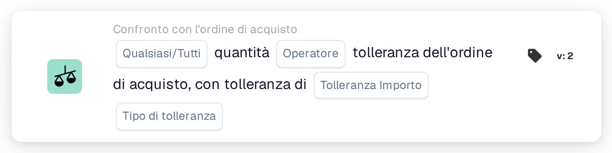
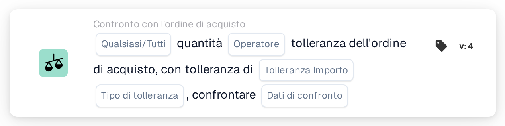

# Qualsiasi/tutta la quantità

<figure><figcaption>
Versione 2
</figcaption></figure>

<figure><figcaption>
Versione 3
</figcaption></figure>

<figure><figcaption>
Versione 4
</figcaption></figure>

## **Scopo:**

Questa scheda del flusso di lavoro è progettata per confrontare la quantità in un documento con la tolleranza definita nell'ordine di acquisto. Consente agli utenti di valutare se la quantità soddisfa determinate condizioni, come l'uguaglianza o il superamento della tolleranza specificata. Nella versione 4, la scheda estende le funzionalità aggiungendo la possibilità di confrontare più entità, tra cui l'ordine di acquisto, le quantità ricevute e le quantità di documenti, offrendo maggiore flessibilità nella gestione di diversi scenari.

## **Componenti della Carta:**

1. **Qualsiasi / Tutti:**
   * **Descrizione**: specifica come applicare il confronto tra più elementi o condizioni.
   * **Opzioni**:
     * **Any**: almeno una delle condizioni deve essere vera affinché l'azione venga attivata.
     * **All**: tutte le condizioni devono essere vere affinché l'azione possa procedere.
2. **Operatore:**
   * **Descrizione**: Definisce la condizione che verrà applicata per confrontare la quantità di documenti con la tolleranza specificata.
   * **Opzioni**:
     * **Uguale a (=)**: controlla se la quantità corrisponde al valore di tolleranza specificato.
     * **Non uguale (≠)**: garantisce che la quantità sia diversa dal valore di tolleranza specificato.
     * **Maggiore di (>)**: Verifica se la quantità è maggiore della tolleranza specificata.
     * **Maggiore o Uguale (≥)**: Controlla se la quantità è maggiore o uguale alla tolleranza specificata.
     * **Inferiore a (<)**: verifica se la quantità è inferiore alla tolleranza specificata.
     * **Inferiore o uguale (≤)**: controlla se la quantità è inferiore o uguale alla tolleranza specificata.
3. **Importo di tolleranza:**
   * **Descrizione**: specifica il valore di tolleranza con cui verrà confrontata la quantità di documenti.
   * **Dettaglio**: questo valore è numerico e rappresenta la soglia di varianza consentita nella quantità
4. **Tipo di tolleranza:**
   * **Descrizione**: Definisce il tipo di tolleranza che verrà applicata.
   * **Opzioni**:
     * **Percentuale**: la tolleranza viene calcolata come percentuale della quantità dell'ordine d'acquisto.
     * **Valore**: la tolleranza è specificata come valore numerico fisso.

## **Componenti aggiuntivi nella versione 4:**

* **Tipo di confronto**: seleziona le entità da confrontare, fornendo maggiore flessibilità nel modo in cui le quantità vengono valutate nella versione 4.
  * **Ordine d'acquisto su documento**: confronta la quantità nell'ordine d'acquisto con la quantità nel documento correlato.
  * **Ricevuto nel documento**: confronta la quantità ricevuta con la quantità nel documento.
  * **Ordine d'acquisto da ricevere**: confronta la quantità dell'ordine d'acquisto con la quantità ricevuta.

## **Funzionalità:**

* **Valutazione condizione:** Il sistema confronta la quantità nel documento con la tolleranza nell'ordine d'acquisto in base all'operatore selezionato e all'importo/tipo di tolleranza. Nella versione 4, il **Tipo di confronto** consente di confrontare diverse quantità, come l'ordine di acquisto da ricevere o l'ordine di acquisto da documentare, fornendo un confronto più dinamico.
* **Esecuzione dell'azione:**
  * **Condizione vera**: se il confronto risulta vero (ad esempio, la quantità di documenti rientra nell'intervallo di tolleranza accettabile), il flusso di lavoro procederà.
  * **Condizione falsa**: se il confronto risulta falso (ad esempio, la quantità non soddisfa la tolleranza), il flusso di lavoro non procederà.

## **Impostazione e configurazione:**

**Versione 3:**

* Gli utenti configurano la scheda selezionando la quantità del documento, definendo l'importo e il tipo di tolleranza e scegliendo l'operatore appropriato per confrontare la quantità con la tolleranza. La scheda valuta se la quantità rientra nella soglia di tolleranza e procede con l'azione “Vero” o “Falso” in base al risultato.

**Versione 4:**

* Oltre alla configurazione nella Versione 3, gli utenti possono selezionare il **Tipo di confronto**, consentendo confronti tra diverse entità, come:
  * **Ordine d'acquisto da documentare**
  * **Ricevuto nel documento**
  * **Ordine d'acquisto da ricevere**

## **Scenario di esempio:**

Una fattura mostra che sono state consegnate 100 unità, ma l'ordine di acquisto autorizzava solo 90 unità. L'importo della tolleranza è impostato su 10 unità e il tipo di tolleranza è assoluto.

* **Versione 3**: La carta confronta le 100 unità nel documento con la tolleranza di 90 unità dell'ordine di acquisto. Se la quantità supera la tolleranza, la scheda segnala la discrepanza per un'ulteriore revisione.
* **Versione 4**: La carta può confrontare la **quantità dell'ordine di acquisto** (90 unità) con la **quantità ricevuta** (100 unità) o la **quantità di documenti** (100 unità). A seconda del **Tipo di confronto** selezionato, controlla se la differenza tra le due entità supera la tolleranza e attiva l'azione corrispondente.

## **Conclusione:**

* **Versione 3**: questa scheda del flusso di lavoro confronta la quantità del documento con la tolleranza dell'ordine d'acquisto, contribuendo a garantire che le discrepanze nella quantità vengano contrassegnate e gestite in modo appropriato.
* **Versione 4**: Estende questa funzionalità consentendo agli utenti di confrontare diverse entità, come l'ordine di acquisto da ricevere o l'ordine di acquisto da documentare, fornendo maggiore flessibilità nella gestione di scenari più complessi. La versione 4 garantisce un controllo più rigoroso sui flussi di lavoro di approvvigionamento e ricezione, offrendo confronti e azioni più dinamici in base al tipo di confronto scelto.

Vedi [direzione del confronto, base di tolleranza e versioni delle carte salvate](../../cards-overview/po-comparison-versions-guide.md) prima di modificare i lati del confronto.
