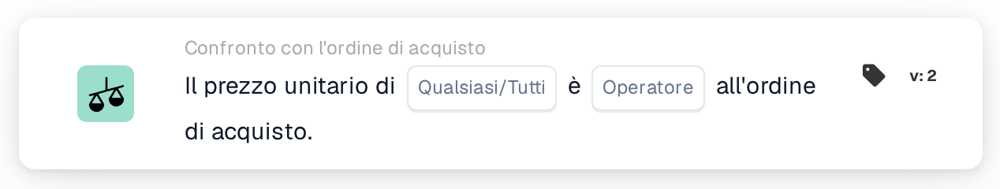
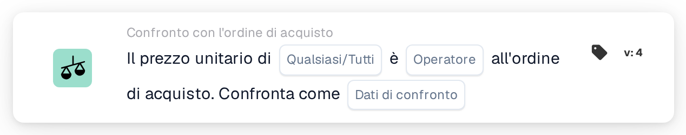
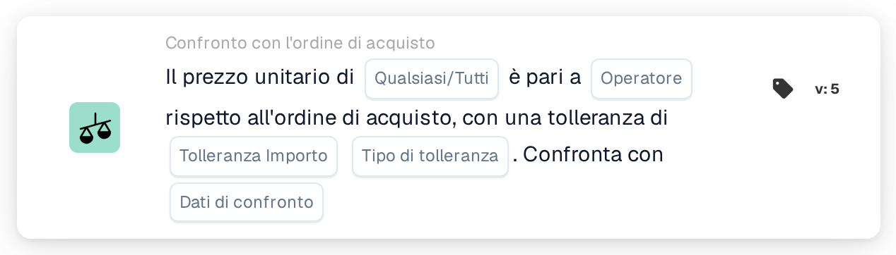

# Qualsiasi/tutti i prezzi unitari sono

<figure><figcaption>
Versione 2
</figcaption></figure>

<figure><figcaption>
Versione 3
</figcaption></figure>

<figure><figcaption>
Versione 4
</figcaption></figure>

<figure><figcaption>
Versione 5
</figcaption></figure>

## **Scopo:**

Questa scheda del flusso di lavoro viene utilizzata per confrontare il prezzo unitario in un documento con il prezzo unitario in un ordine di acquisto, garantendo che i prezzi siano allineati entro livelli di tolleranza definiti. Il confronto può innescare azioni se il prezzo unitario non soddisfa le aspettative. **Versione 4** aggiunge maggiore flessibilità consentendo agli utenti di scegliere diverse entità per il confronto, fornendo un livello più profondo di controllo sui processi di determinazione dei prezzi e di approvvigionamento.

## **Componenti della Carta:**

1. **Qualsiasi / Tutti:**
   * **Descrizione**: Definisce se la condizione si applica a una o tutte le istanze in cui viene confrontato il prezzo unitario.
   * **Opzioni**:
     * **Any**: la condizione è soddisfatta se un prezzo unitario soddisfa la condizione di confronto specificata.
     * **All**: la condizione è soddisfatta solo se tutti i prezzi unitari soddisfano la condizione di confronto specificata.
2. **Operatore:**
   * **Descrizione**: Definisce la condizione per confrontare il prezzo unitario con il valore specificato.
   * **Opzioni**:
     * **Uguale (=)**: verifica se il prezzo unitario corrisponde al valore specificato.
     * **Non uguale a (≠)**: garantisce che il prezzo unitario sia diverso dal valore specificato.
     * **Maggiore di (>)**: Verifica se il prezzo unitario è maggiore del valore specificato.
     * **Maggiore o Uguale (≥)**: Verifica se il prezzo unitario è maggiore o uguale al valore specificato.
     * **Inferiore a (<)**: verifica se il prezzo unitario è inferiore al valore specificato.
     * **Inferiore o uguale (≤)**: verifica se il prezzo unitario è inferiore o uguale al valore specificato.

## **Componenti aggiuntivi nella versione 4:**

**Tipo di confronto:**

* **Descrizione**: consente agli utenti di scegliere quali entità verranno confrontate oltre al prezzo unitario.
* **Opzioni**:
  * **Ordine di acquisto su documento**: confronta il prezzo unitario nell'ordine di acquisto con il prezzo unitario nel documento.
  * **Ricevuto nel documento**: confronta l'importo sul lato ricevuto derivato dall'ordine di acquisto abbinato con l'importo sul lato del documento.
  * **Ordine di acquisto da ricevere**: confronta il lato dell'ordine di acquisto con l'importo derivato dal lato ricevuto.

## **Funzionalità:**

* **Valutazione della condizione:** Il sistema confronta il prezzo unitario nel documento con il prezzo unitario nell'ordine di acquisto (o altra entità selezionata, nella Versione 4) in base all'operatore selezionato. Se il confronto è vero, il flusso di lavoro procede secondo i passaggi successivi, attivando l'approvazione o interrompendo il processo.
* **Esecuzione dell'azione:**
  * **Condizione vera**: se la condizione risulta vera (ad esempio, il prezzo unitario nel documento è maggiore del valore specificato), il flusso di lavoro procederà con l'azione vera (ad esempio, approvazione, elaborazione del documento).
  * **Condizione falsa**: se la condizione risulta falsa (ad esempio, il prezzo unitario nel documento non soddisfa il confronto), il flusso di lavoro non procederà.

## **Impostazione e configurazione:**

* **Impostazione versione 3:** Gli utenti configurano la carta selezionando il prezzo unitario nel documento, scegliendo l'operatore appropriato per definire come il prezzo unitario verrà confrontato con il valore specificato e impostando il valore con cui confrontare. Inoltre, gli utenti selezionano se la condizione si applica a una o a tutte le istanze del confronto dei prezzi unitari.
* **Impostazioni Versione 4:** Nella Versione 4, gli utenti hanno l'opzione aggiuntiva di selezionare il Tipo di confronto. Ciò consente loro di definire le entità da confrontare, ad esempio Ordine di acquisto su documento, Ricevuto su documento o Ordine di acquisto su ricevuto. Ciò migliora la flessibilità della carta per confrontare i prezzi unitari in scenari più complessi.

## **Scenario di esempio:**

*   **Versione 3 Esempio:**

    Una fattura mostra un prezzo unitario di $ 50. Il relativo ordine di acquisto ha un prezzo unitario di $ 45. La carta confronta i due prezzi unitari utilizzando l'operatore "Maggiore di". Poiché il prezzo unitario nel documento ($ 50) è maggiore del prezzo unitario nell'ordine di acquisto ($ 45), il flusso di lavoro attiverà la condizione vera (ad esempio, invio del documento per la revisione).
* **Versione 4 Esempio:**\
  Una fattura mostra un prezzo unitario di $ 50 e il relativo ordine di acquisto ha autorizzato un prezzo unitario di $ 45. Inoltre, la quantità ricevuta è di 60 unità. La carta confronta la quantità ricevuta con il prezzo unitario del documento utilizzando l'operatore "Maggiore di". Poiché la quantità ricevuta (60) è maggiore del prezzo unitario ($ 50), il flusso di lavoro attiva la condizione vera e il documento viene contrassegnato per un'ulteriore revisione.

## **Conclusione:**

La versione 3 della scheda del flusso di lavoro "Confronto prezzi unitari" è progettata per garantire che i prezzi unitari nei documenti siano allineati a quelli negli ordini di acquisto, attivando azioni in base a condizioni definite. La versione 4 estende questa funzionalità introducendo opzioni di confronto più complesse, come il confronto degli ordini d'acquisto con i documenti, delle quantità ricevute con i documenti e degli ordini d'acquisto con le quantità ricevute. Questa maggiore flessibilità consente alle organizzazioni di gestire scenari di determinazione dei prezzi e di approvvigionamento più sofisticati, migliorando il controllo e l'accuratezza dei flussi di lavoro.

## Versione 5 e direzione del confronto

La versione 5 include Qualsiasi/Tutto, operatore, importo di tolleranza, tipo di tolleranza e selezione del lato di confronto. Le versioni più recenti offrono entrambe le direzioni del documento, dell'ordine di acquisto e del confronto dei dati ricevuti. Il lato di riferimento determina la base di una tolleranza percentuale. Vedi [Versioni di confronto PO](../../cards-overview/po-comparison-versions-guide.md) per tutte e sei le opzioni, migrazione delle carte salvate ed esempi di test.
