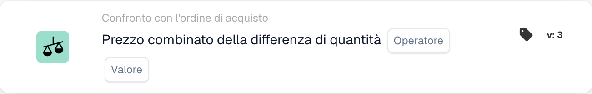
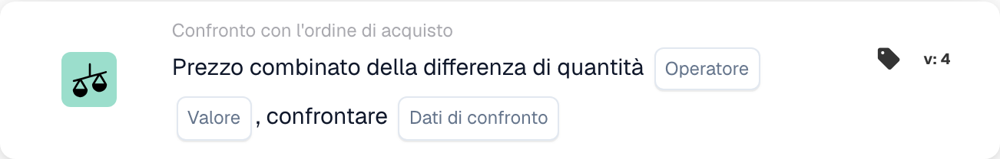

# Prezzo combinato della differenza di quantità

<figure><figcaption>
Campi della scheda nella versione visualizzata. I campi non sono ancora configurati.
</figcaption></figure>

<figure><figcaption>
Campi della scheda nella versione visualizzata. I campi non sono ancora configurati.
</figcaption></figure>

## **Scopo**:

Questa scheda del flusso di lavoro valuta il prezzo combinato di una differenza di quantità, confrontandolo con un valore specificato. Aiuta ad automatizzare le azioni basate sulle discrepanze di prezzo e quantità tra i documenti correlati, migliorando i flussi di lavoro di approvvigionamento e ricezione. **Versione 4** espande questa funzionalità consentendo confronti tra diverse entità come l'ordine di acquisto, le quantità ricevute e il documento stesso, aggiungendo maggiore flessibilità e controllo al flusso di lavoro.

## **Componenti della Carta**:

1. **Operatore**:
   * **Descrizione:** La condizione per confrontare il prezzo combinato con un valore specificato.
   * **Opzioni:**
     * **Uguale a (=)**: controlla se il prezzo combinato corrisponde al valore specificato.
     * **Non uguale a (≠)**: garantisce che il prezzo combinato sia diverso dal valore specificato.
     * **Maggiore di (>)**: verifica se il prezzo combinato è maggiore del valore specificato.
     * **Maggiore o Uguale (≥)**: controlla se il prezzo combinato è maggiore o uguale al valore specificato.
     * **Inferiore a (<)**: verifica se il prezzo combinato è inferiore al valore specificato.
     * **Inferiore o uguale a (≤)**: controlla se il prezzo combinato è inferiore o uguale al valore specificato
2. **Valore**:
   * **Descrizione:** Specifica il valore con cui verrà confrontato il prezzo combinato del valore della quantità.
   * **Dettaglio:** Il valore deve essere un valore numerico.

## **Componenti aggiuntivi nella versione 4**:

* **Tipo confronto**: Seleziona le entità da confrontare. Le opzioni includono:
  * **Ordine d'acquisto su documento**: confronta le quantità e i prezzi tra l'ordine d'acquisto e il relativo documento.
  * **Ricevuto nel documento**: confronta le quantità ricevute con le quantità nel documento.
  * **Ordine d'acquisto da ricevere**: confronta le quantità dell'ordine d'acquisto con le quantità ricevute.

## **Funzionalità**:

* **Valutazione condizione**: calcola il prezzo combinato moltiplicando la differenza di quantità per il prezzo unitario e lo confronta con il valore specificato utilizzando l'operatore selezionato.\
  **Versione 4** aggiunge l'opzione per confrontare entità aggiuntive in base alla configurazione dell'utente, come l'ordine d'acquisto da ricevere o l'ordine d'acquisto da documentare.
* **Esecuzione dell'azione**: a seconda che il prezzo combinato soddisfi la condizione specificata, il flusso di lavoro continuerà con condizioni vero o falso per attivare azioni o interrompere il flusso di lavoro. **Versione 4** consente anche un'esecuzione di azioni più dinamica, in cui il tipo di condizione (ad esempio, ordine di acquisto da ricevere) influenza il passaggio successivo.

## **Impostazione e configurazione**:

* **Versione 3**: gli utenti configurano la carta selezionando i campi del documento per la differenza di quantità e il prezzo per unità. L'operatore viene quindi scelto per definire come il prezzo combinato verrà confrontato con il valore specificato. Infine, gli utenti impostano la condizione di continuazione (vero o falso), che determina il passaggio successivo nel flusso di lavoro.
* **Versione 4**: oltre alla configurazione nella **Versione 3**, gli utenti hanno un'opzione aggiuntiva per configurare **Tipo di confronto**. Ciò definisce quali entità verranno confrontate, ad esempio **Ordine d'acquisto con Documento**, **Ricevuto con Documento** o **Ordine d'acquisto con Ricevuto**.

## **Scenario di esempio**:

* Una fattura mostra 50 unità di un prodotto a $ 100 ciascuna, per un totale di $ 5000. Il relativo ordine di acquisto autorizzava l'acquisto di 4500 dollari per 45 unità. La differenza di quantità è di 5 unità e il prezzo combinato della differenza è di $ 500. La carta confronta la quantità dell'ordine d'acquisto (45 unità) con la quantità ricevuta (50 unità) e controlla se il prezzo combinato è superiore a $ 400 (il valore specificato). Utilizzando l'operatore **Maggiore di (>)**, la carta identifica la discrepanza e la contrassegna per la revisione da parte del team finanziario.

## **Conclusione**:

**Versione 3** della scheda del flusso di lavoro "Differenza prezzo combinato di quantità" offre un approccio semplice per confrontare le discrepanze quantitative e attivare azioni in base alle soglie di prezzo.\
**Versione 4** estende questa funzionalità consentendo confronti tra diverse entità (ordine di acquisto, ricevuto, documento), fornendo maggiore flessibilità e controllo sul flusso di lavoro. Le organizzazioni possono ora automatizzare scenari più complessi e applicare un controllo più rigoroso sui processi di approvvigionamento e ricezione.

Vedi [direzione del confronto, base di tolleranza e versioni delle carte salvate](../../cards-overview/po-comparison-versions-guide.md) prima di modificare i lati del confronto.
