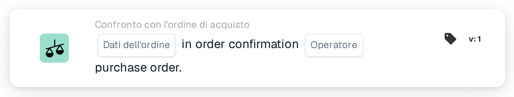
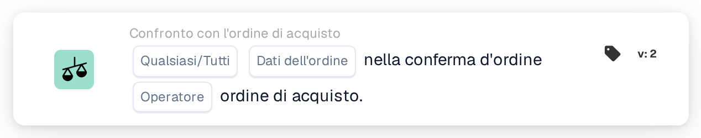
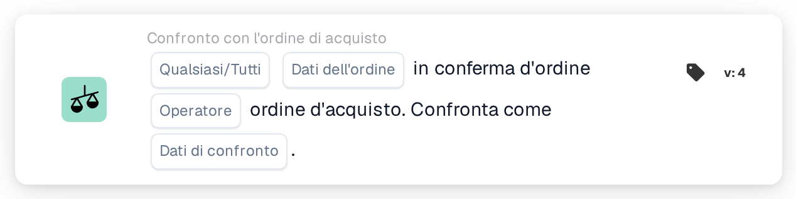

# Confronta la conferma dell'ordine con l'ordine d'acquisto

<figure><figcaption>
Versione 1
</figcaption></figure>

<figure><figcaption>
Versione 2
</figcaption></figure>

<figure><figcaption>
Versione 3
</figcaption></figure>

<figure><figcaption>
Versione 4
</figcaption></figure>

## Scopo:

Questa scheda DocBits è progettata per confrontare un campo dati specifico dell'ordine, come quantità, sconto o prezzo unitario, tra una conferma d'ordine e un ordine di acquisto. Consentendo un confronto mirato di un campo alla volta, garantisce precisione nella convalida dei punti dati chiave, mantenendo l'accuratezza dell'ordine. **Versione 4** espande questa funzionalità consentendo confronti tra diverse entità come l'ordine di acquisto, le quantità ricevute e il documento stesso, aggiungendo maggiore flessibilità e controllo al flusso di lavoro.

## Componenti della Carta:

1. **Qualsiasi/Tutti**
   * **Descrizione:** Determina se la condizione si applica ad alcune o tutte le righe della conferma d'ordine.\
     **Opzioni:**
     * **Any**: Il confronto verrà attivato se il valore del campo selezionato in qualsiasi riga della conferma d'ordine corrisponde al valore corrispondente nell'ordine d'acquisto.
     * **All**: Il confronto verrà attivato solo se il valore del campo selezionato in tutte le righe della conferma d'ordine corrisponde al valore corrispondente nell'ordine d'acquisto.
2. **Campo Dati Ordine**
   * **Descrizione**: Specifica il campo dati da confrontare tra la conferma d'ordine e l'ordine di acquisto.
   * **Dettaglio**: gli utenti possono selezionare uno dei seguenti campi per il confronto:
     * **Quantità**: Confronta la quantità ordinata con la quantità confermata.
     * **Sconto**: Verifica che lo sconto nella conferma corrisponda all'ordine di acquisto.
     * **Prezzo unitario**: garantisce che il prezzo unitario nella conferma sia allineato con l'ordine di acquisto.
3. **Operatore**
   * **Descrizione**: Definisce la condizione applicata al confronto del campo dati selezionato.
   * **Opzioni**:
     * **Uguale (=)**: conferma che il valore corrisponde all'ordine d'acquisto.
     * **Non uguale (≠)**: garantisce che il valore sia diverso dall'ordine di acquisto.
     * **Maggiore di (>)**: verifica che il valore superi il valore dell'ordine di acquisto.
     * **Maggiore o Uguale (≥)**: conferma che il valore è uguale o superiore al valore dell'ordine di acquisto.
     * **Inferiore a (<)**: verifica che il valore sia inferiore al valore dell'ordine di acquisto.
     * **Inferiore o uguale a (≤)**: conferma che il valore è inferiore o uguale al valore dell'ordine di acquisto.

## **Componenti aggiuntivi nella versione 4**:

* **Tipo confronto**: Seleziona le entità da confrontare. Le opzioni includono:
  * **Ordine d'acquisto su documento**: confronta i dati dell'ordine d'acquisto con il documento correlato.
  * **Ricevuto nel documento**: confronta i dati ricevuti (ad esempio, le quantità ricevute) con il documento.
  * **Ordine d'acquisto da ricevere**: confronta i dati dell'ordine d'acquisto con le quantità ricevute.

## Funzionalità:

* **Confronto campi**: il sistema confronta il campo dati dell'ordine selezionato (Prezzo unitario, Sconto o Quantità) dalla conferma dell'ordine con il valore corrispondente nell'ordine d'acquisto.
* **Esecuzione dell'azione**: in base al risultato del confronto e alle condizioni dell'operatore, la carta può attivare azioni di follow-up, come notifiche o avvisi.

## Scenario di esempio:

* Una conferma d'ordine specifica un **prezzo unitario** di $ 50, mentre l'ordine di acquisto indica $ 45. Utilizzando l'operatore "Maggiore di", la carta segnala la discrepanza, consentendo al team di procurement di risolverla prima dell'elaborazione.

## Conclusione:

Questa scheda semplifica la convalida dei singoli campi dati dell'ordine, garantendo il rispetto dei termini dell'ordine di acquisto. Isolando un campo alla volta per il confronto, supporta revisioni mirate e prevenzione degli errori nell'elaborazione degli ordini.

Vedi [direzione del confronto, base di tolleranza e versioni delle carte salvate](../../cards-overview/po-comparison-versions-guide.md) prima di modificare i lati del confronto.
