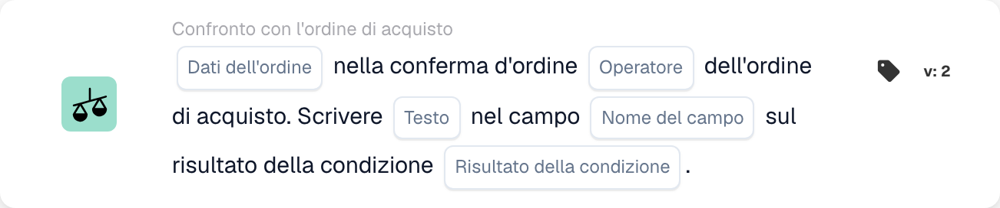
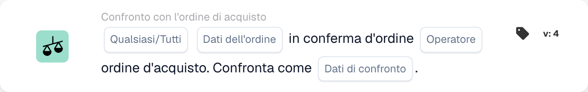

# Confronto tra conferma d’ordine e ordine di acquisto

Usa **Confronto con l'ordine di acquisto** nel Workflow Builder quando una conferma d'ordine deve essere verificata rispetto al suo ordine di acquisto. Aggiungi la scheda sotto **E....**, poi scegli i dati dell'ordine, un operatore e cosa deve accadere con il risultato. Gli screenshot qui sotto mostrano due versioni disponibili della scheda nell'interfaccia italiana. I loro campi sono ancora segnaposto; impostali per il tuo workflow prima di salvare.

## Scrivere il risultato in un campo

<figure><figcaption>
Campi della scheda nella versione visualizzata. I campi non sono ancora configurati.
</figcaption></figure>

Scegli **Dati dell'ordine** dalla conferma d'ordine e un **Operatore** per il confronto con l'ordine di acquisto. Inserisci il **Testo** da scrivere, seleziona il **Nome del campo** e scegli il **Risultato della condizione** che deve attivare la scrittura.

## Confrontare i dati

<figure><figcaption>
Campi della scheda nella versione visualizzata. I campi non sono ancora configurati.
</figcaption></figure>

Scegli **Qualsiasi/Tutti** per decidere se deve corrispondere una sola condizione selezionata o tutte. Poi seleziona **Dati dell'ordine**, **Operatore** e **Dati di confronto** per il confronto con l'ordine di acquisto.

Per i passaggi circostanti, vedi [Flusso di lavoro](../..) e [Confronto con l'ordine di acquisto](.).

<!-- workflow-card-practical-example-20261021 -->

## Esempio pratico

**Quando utilizzarlo:** Controllare una conferma d'ordine rispetto all'ordine di acquisto collegato.

**Configurazione:** Utilizza un ordine demo e conferma con lo stesso fornitore, riferimento articolo e valori confrontati. Seleziona la direzione di confronto prevista e i campi offerti da questa versione.

**Risultato atteso e controesempio:** Il confronto corrispondente ha esito positivo. Modificare il valore di un elemento confrontato in un caso di test separato e verificare che venga rilevato; un ordine collegato mancante è un problema di dati separato.

Questa è una configurazione illustrativa e il risultato atteso. Utilizza campi, utenti e gruppi configurati nella tua organizzazione di test; non si afferma che questo esempio sia stato eseguito.
