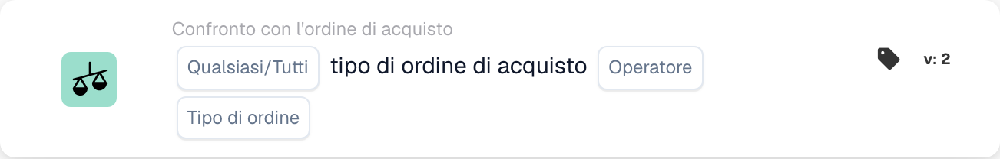

# Tipo di ordine di acquisto

<figure><figcaption>
Campi della scheda nella versione visualizzata. I campi non sono ancora configurati.
</figcaption></figure>

## **Scopo**:

Questa scheda DocBits consente di verificare il tipo di ordine su un ordine d'acquisto, garantendo che sia allineato ai criteri specificati.

## **Funzionalità**:

* **Confronto del tipo di ordine**: Questa scheda confronta il tipo di ordine dell'ordine d'acquisto con un valore specificato, consentendo agli utenti di verificare se il tipo di ordine soddisfa determinate condizioni.
* **Selezione Any/All**: Gli utenti possono scegliere di applicare il confronto a **any** (almeno un tipo di ordine selezionato corrisponde) o **all** (tutti i tipi di ordine selezionati corrispondono) i tipi di ordine specificati.
* **Operatore**: Gli utenti possono impostare condizioni per confrontare il tipo di ordine nell'ordine d'acquisto. Gli operatori disponibili includono:
  * **Uguale (=)**: Conferma che il tipo di ordine nell'ordine d'acquisto corrisponda al tipo specificato.
  * **Non uguali (≠)**: Garantisce che il tipo di ordine nell'ordine d'acquisto non corrisponda al tipo specificato.

## **Utilizzo**:

Questa scheda è particolarmente utile per i team di approvvigionamento, i pianificatori dell'inventario e i responsabili operativi che devono categorizzare e prioritizzare gli ordini in modo accurato. Garantendo che i tipi di ordine corrispondano alle classificazioni previste, gli utenti possono semplificare la gestione degli ordini, ottimizzare l'allocazione delle risorse e rispettare gli accordi sui livelli di servizio.

## **Scenario di esempio**:

* Un ordine d'acquisto è categorizzato come "IGR". Il sistema utilizza l'operatore "Equals" per verificare che questo tipo di ordine sia allineato alla classificazione prevista per l'elaborazione.

Utilizzando la scheda "Compare with Purchase Order: Order Type", le organizzazioni possono automatizzare la validazione dei tipi di ordine, garantendo coerenza nelle priorità di elaborazione e riducendo gli errori di classificazione manuale.
