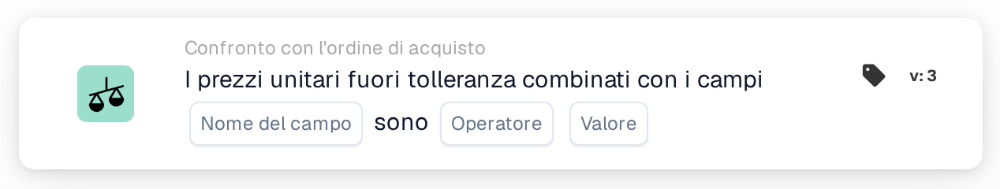

# Prezzo unitario fuori tolleranza

<figure><figcaption>
Versione 3
</figcaption></figure>

## **Scopo:**

Questa scheda di workflow è progettata per valutare se il valore combinato dei prezzi unitari e di un campo specificato supera o non raggiunge una soglia definita. Aiuta a identificare eventuali discrepanze in cui i prezzi unitari, combinati con altri campi, sono fuori tolleranza, garantendo che le condizioni di prezzo soddisfino le aspettative e segnalando eventuali problemi per la revisione o ulteriori azioni.

## **Componenti della scheda:**

1. **Nome campo:**
   * **Descrizione**: Specifica il campo del documento che contiene il valore da combinare con il prezzo unitario.
   * **Dettaglio**: Il valore in questo campo verrà combinato con il prezzo unitario per creare il valore combinato totale da confrontare.
2. **Operatore:**
   * **Descrizione**: Definisce la condizione per confrontare il valore combinato del prezzo unitario e del valore del campo con il valore specificato.
   * **Opzioni**:
     * **Uguale (=)**: Verifica se il valore combinato del prezzo unitario e del campo corrisponde al valore specificato.
     * **Diverso (≠)**: Garantisce che il valore combinato del prezzo unitario e del campo sia diverso dal valore specificato.
     * **Maggiore di (>)**: Verifica se il valore combinato del prezzo unitario e del campo supera il valore specificato.
     * **Maggiore o uguale (≥)**: Verifica se il valore combinato del prezzo unitario e del campo è maggiore o uguale al valore specificato.
     * **Minore di (<)**: Verifica se il valore combinato del prezzo unitario e del campo è minore del valore specificato.
     * **Minore o uguale (≤)**: Verifica se il valore combinato del prezzo unitario e del campo è minore o uguale al valore specificato.
3. **Valore:**
   * **Descrizione**: Specifica il valore con cui verrà confrontato il valore combinato del prezzo unitario e del campo.
   * **Dettaglio**: Questo valore numerico rappresenta la soglia per il confronto. Se il valore combinato del prezzo unitario e del campo supera o non raggiunge questo valore (in base all'operatore selezionato), la condizione attiverà le azioni specificate.

## **Funzionalità:**

* **Valutazione della condizione:** Il sistema calcola il valore combinato moltiplicando o sommando il prezzo unitario con il valore del campo, a seconda della configurazione. Il risultato viene quindi confrontato con il valore specificato utilizzando l'operatore selezionato. Se la condizione è soddisfatta (ovvero il valore combinato è fuori tolleranza), il workflow procede al passaggio successivo, che si tratti di approvazione, rifiuto o ulteriore revisione.
* **Esecuzione dell'azione:**
  * **Condizione vera**: Se il confronto risulta vero (ovvero il valore combinato soddisfa la condizione), il workflow attiva l'azione associata alla condizione vera (es. approvazione o notifica).
  * **Condizione falsa**: Se il confronto risulta falso (ovvero il valore combinato non soddisfa la condizione), il workflow non proseguirà.

## **Configurazione e impostazione:**

* Gli utenti selezionano il campo che contiene il valore da combinare con il prezzo unitario. Successivamente, scelgono l'operatore appropriato per determinare come il valore combinato verrà confrontato con il valore specificato. Infine, l'utente imposta il valore con cui verrà confrontato il prezzo combinato.

## **Scenario di esempio:**

* Una fattura elenca 50 unità di un prodotto a $30 ciascuna, per un totale di $1500. Il documento correlato ha un campo quantità con un valore di 10. Il prezzo combinato viene calcolato moltiplicando il prezzo unitario ($30) e la quantità (10), ottenendo $300. La scheda confronta quindi questo valore combinato con una soglia di $250. Utilizzando l'operatore "Greater Than", la scheda rileva che $300 è maggiore di $250, attivando un processo di approvazione per il documento.

## **Conclusione:**

La scheda di workflow "Out of Tolerance Unit Prices Combined with Fields" aiuta a garantire che i valori di prezzo e dei campi siano allineati alle regole aziendali. Automatizzando questo controllo, le organizzazioni possono identificare le discrepanze precocemente nel processo, garantendo che eventuali prezzi unitari fuori tolleranza vengano segnalati per la revisione o l'azione necessaria.
