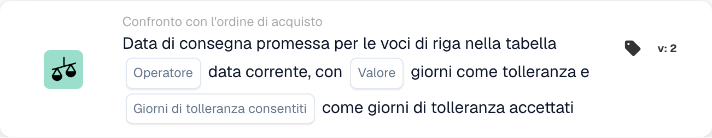
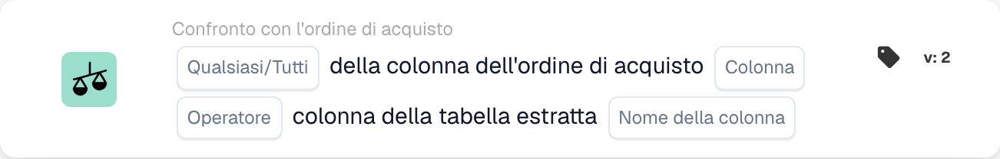
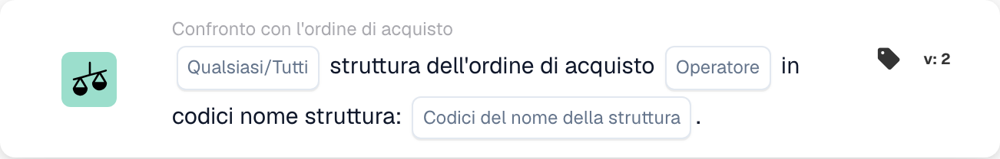
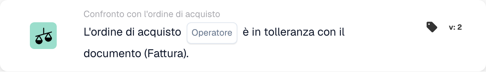
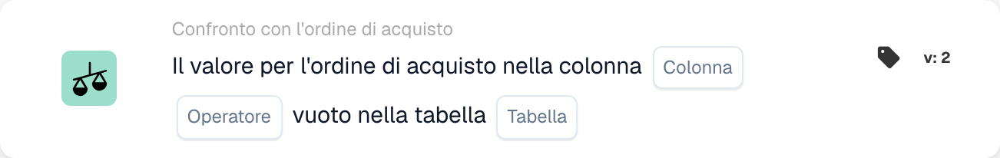
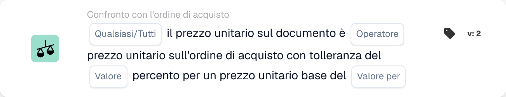
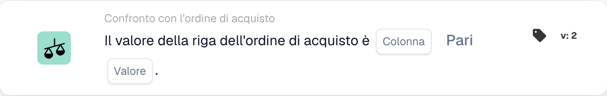

# Carte corrispondenti PO - Guida completa

## Carte corrispondenti agli ordini di acquisto (PO) - Guida completa

**Stato:** Copre 15 schede di confronto PO con calcoli dettagliati

***

Le schede di confronto degli ordini d'acquisto in questa pagina vanno nel gruppo **E** del Workflow Builder: confrontano i dati della fattura con l'ordine di acquisto abbinato prima dell'esecuzione delle azioni Quindi:

<figure><figcaption><p>Esempio non salvato con schede Quando, E e Allora. Configurare tutti i campi prima dell’esecuzione. Alcune etichette dell’interfaccia di questa versione sono ancora in inglese o tradotte in modo non corretto. Le spiegazioni di questa pagina sono tradotte; l’immagine mostra l’interfaccia reale.</p></figcaption></figure>

***

### 📌 Informazioni sulla versione

**Carta più evoluta:** CONDITION\_DOC\_TO\_PO\_UNIT\_PRICE (5 versioni, v5 più recente) **Altre carte complesse:** CONDITION\_OC\_TO\_PO\_ITEMS (v4), CONDITION\_LESS\_THAN\_TOLERANCE\_AS\_VALUE\_OF\_ORDERED\_QUANTITY (v4)

**Schemi chiave:**

* **v2 → v3+:** Aggiunta di parametri di tolleranza per un abbinamento flessibile
* **v3 → v4:** Aggiunta dei parametri della modalità confronto
* **v4 → v5:** Tolleranza migliorata con più unità (%, EUR, $, ecc.)

📖 [Cronologia completa delle versioni](../../release.md) | [Versioni e comportamento delle carte](../../cards-overview/card-versions-guide.md)

***

### Comprendere la corrispondenza PO

Quando ricevi una fattura, questa deve corrispondere all'ordine di acquisto (PO) effettuato in precedenza. Le carte di corrispondenza PO controllano automaticamente se i dati della fattura corrispondono ai dati PO.

**Il quadro generale:**

```
PO Placed     Invoice Arrives     PO Matching     Decision
(€100)    →   (€103)          →   (Check if       → Approve/Reject
Qty: 100      Qty: 100            within tolerance)
```

***

## 1. Corrispondenza completa dell'ordine di acquisto

### Scopo

Controlla se l'intera fattura corrisponde perfettamente all'ordine d'acquisto o entro la tolleranza

### Quando usarlo

* Prima di approvare una fattura
* Come controllo di qualità preliminare
* Per identificare tempestivamente i problemi

### Come funziona

Il sistema confronta:

* Quantità fattura e quantità ordine d'acquisto
* Prezzi delle fatture e prezzi degli ordini d'acquisto
* Elementi della fattura e elementi dell'ordine d'acquisto
* Totale fattura rispetto al totale ordine d'acquisto

### Risultato

* **TRUE** (Corrispondenza completa): tutto corrisponde, procedi
* **FALSE** (Mancata corrispondenza): qualcosa non corrisponde, necessita di revisione

### Esempio

```
PO:
- Item ABC: Qty 100, Unit Price €50 = €5000
- Item XYZ: Qty 50, Unit Price €20 = €1000
- Total: €6000

Invoice:
- Item ABC: Qty 100, Unit Price €50 = €5000
- Item XYZ: Qty 50, Unit Price €20 = €1000
- Total: €6000

Result: ✅ FULL MATCH
```

***

## 2. Confronto dei prezzi unitari (documento vs ordine d'acquisto)

### Scopo

Confronta il prezzo unitario sulla fattura con il prezzo unitario sull'ordine d'acquisto

### Parametri

* **Tolleranza prezzo unitario**: consente la varianza fino a questo importo
* **Tipo di tolleranza**: Percentuale (%) o Assoluta (€/$)
* **Operatore**: è uguale a, è maggiore di, è minore di, ecc.

### Come funziona (tolleranza percentuale)

**Formula:**

```
Variance % = |(Invoice Price - PO Price)| / PO Price × 100

Check: Is Variance % ≤ Tolerance %?
```

**Esempio passo passo:**

```
Step 1: Get prices
  PO Unit Price: €100.00
  Invoice Unit Price: €103.00

Step 2: Calculate difference
  Difference = |€103.00 - €100.00| = €3.00

Step 3: Calculate percentage
  Percentage = (€3.00 / €100.00) × 100 = 3%

Step 4: Check tolerance (5% allowed)
  Is 3% ≤ 5%? YES ✅

Result: PASS - Within tolerance
```

### Esempi del mondo reale

#### Esempio 1: piccolo aumento (accettato)

```
PO Price: €50.00
Invoice Price: €51.50
Tolerance: ±3%

Calculation:
  Variance = |(€51.50 - €50.00)| / €50.00 × 100
  Variance = €1.50 / €50.00 × 100 = 3%

Is 3% ≤ 3%? YES ✅ ACCEPT
```

#### Esempio 2: aumento significativo (rifiutato)

```
PO Price: €50.00
Invoice Price: €55.00
Tolerance: ±3%

Calculation:
  Variance = |(€55.00 - €50.00)| / €50.00 × 100
  Variance = €5.00 / €50.00 × 100 = 10%

Is 10% ≤ 3%? NO ❌ REJECT - NEEDS REVIEW
```

#### Esempio 3: sconto (anche controllato)

```
PO Price: €100.00
Invoice Price: €97.00
Tolerance: ±5%

Calculation:
  Variance = |(€97.00 - €100.00)| / €100.00 × 100
  Variance = €3.00 / €100.00 × 100 = 3%

Is 3% ≤ 5%? YES ✅ ACCEPT (Discount is within tolerance)
```

#### Esempio 4: Tolleranza del valore assoluto

```
PO Price: €10.00
Invoice Price: €10.50
Tolerance: ±€1.00 (absolute, not %)

Calculation:
  Variance = |€10.50 - €10.00| = €0.50

Is €0.50 ≤ €1.00? YES ✅ ACCEPT
```

### Cosa fare con i risultati

**Se PASSATO ✅:**

* Procedi al controllo successivo
* Oppure approva la fattura
* Oppure procedi con l'esportazione

**Se FAIL ❌:**

* Contrassegna per la revisione manuale
* Chiedere spiegazioni al fornitore
* Contatta il team di approvvigionamento
* Approvare con nota se accettabile

***

## 3. Confronto delle quantità

### Scopo

Controlla se la quantità ordinata corrisponde alla quantità fatturata

### Parametri

* **Tolleranza**: importo o percentuale consentita per differire
* **Operatore**: Uguale a, Maggiore di, Minore di
* **Tipo quantità**: ordinato, ricevuto, aperto

### Esempio di calcolo

**Tolleranza percentuale:**

```
Formula:
  Quantity Variance % = |(Invoice Qty - PO Qty)| / PO Qty × 100

Example:
  PO Quantity: 100 units
  Invoice Quantity: 103 units
  Tolerance: ±5%

  Variance = |(103 - 100)| / 100 × 100
  Variance = 3 / 100 × 100 = 3%

  Is 3% ≤ 5%? YES ✅ ACCEPT
```

**Tolleranza assoluta:**

```
Formula:
  Quantity Variance = |Invoice Qty - PO Qty|

Example:
  PO Quantity: 100 units
  Invoice Quantity: 102 units
  Tolerance: ±5 units

  Variance = |102 - 100| = 2 units

  Is 2 units ≤ 5 units? YES ✅ ACCEPT
```

### Scenari del mondo reale

#### Consegna eccessiva (più di quanto ordinato)

```
Ordered: 100 units
Invoiced: 110 units
Tolerance: ±5%

Variance = |(110-100)|/100 × 100 = 10%

Is 10% ≤ 5%? NO ❌

Decision: Contact supplier - more delivered than ordered
Possible reason: Error by supplier, partial shipment already received
```

#### Sottoconsegna (meno di quanto ordinato)

```
Ordered: 100 units
Invoiced: 95 units
Tolerance: ±5%

Variance = |(95-100)|/100 × 100 = 5%

Is 5% ≤ 5%? YES ✅

Decision: Accept - within tolerance
Possible reason: Partial shipment, rest to follow
```

***

## 4. Prezzo combinato della differenza di quantità

### Scopo

Quando la quantità differisce, calcola se la differenza di prezzo totale è accettabile

### Perché questo è importante

```
Scenario: You ordered 100 units but received 110
- Quantity is 10% over (bad)
- BUT: You're only charged for 10% extra
- Combined effect might be acceptable
```

### Calcolo

**Formula:**

```
Combined Variance = Quantity Variance × Price Variance

If both are within tolerance, combined is usually acceptable
```

**Esempio:**

```
PO:
- Unit Price: €100
- Quantity: 100
- Total: €10,000

Invoice:
- Unit Price: €102 (2% higher)
- Quantity: 105 (5% higher)
- Total: €10,710

Analysis:
- Price variance: 2% ✅
- Quantity variance: 5% ✅
- Combined effect: 1.02 × 1.05 = 1.071 = 7.1% total increase

Is combined variance acceptable? Usually YES ✅
```

***

## 5. Confronto ID articolo/numero articolo fornitore

### Scopo

Controlla se gli articoli nella fattura corrispondono agli articoli nell'ordine d'acquisto

### Come funziona

**Corrispondenza esatta (più semplice):**

```
PO Item ID: ABC-123
Invoice Item ID: ABC-123
Result: ✅ MATCH
```

**Numero articolo fornitore (più comune):**

```
PO Item: ABC-123 (Our internal code)
Supplier Item: SUPP-456 (Their code for same item)
System matches these as same item
Result: ✅ MATCH
```

### Scenario: cosa succede se non corrisponde?

```
PO Item: ABC-123 (Copper Wire, 2mm)
Invoice Item: ABC-124 (Steel Wire, 2mm)

Result: ❌ NO MATCH

Actions:
1. Is this a substitution? Check with procurement
2. Is this an error? Contact supplier
3. Is the description similar? Verify manually
```

***

## 6. Verifica del tipo di ordine

### Scopo

Verifica che il tipo di ordine di acquisto sia corretto

### Tipi di ordine

* **Norma dell'Ordine**: acquisto regolare
* **Rush Order**: urgente, potrebbe avere un premio
* **Accordo quadro**: Contratto a lungo termine
* **Ordine Globale**: Contratto a tempo indeterminato
* **Spedizione**: Non paghi fino all'utilizzo

### Controlla l'esempio

```
PO Order Type: Standard Order
Invoice Order Type: Standard Order
Result: ✅ MATCH

If mismatch: Could affect terms, payment, pricing
```

***

## 7. Verifica della data di consegna

### Scopo

Controlla se la data di consegna corrisponde alla data promessa sull'ordine d'acquisto

### Calcolo

**Consegna in ritardo:**

```
Formula:
  Days Late = Invoice Delivery Date - PO Promised Date

Example:
  PO Promised: 2025-10-15
  Actual Delivery: 2025-10-22
  Days Late = 7 days

If tolerance is ±3 days:
  Is 7 ≤ 3? NO ❌ LATE
```

**Consegna anticipata:**

```
Formula:
  Days Early = PO Promised Date - Invoice Delivery Date

Example:
  PO Promised: 2025-10-15
  Actual Delivery: 2025-10-10
  Days Early = 5 days

Early delivery is usually OK ✅
Unless you need it at specific time
```

### Impostazioni di tolleranza

```
±3 days: Allow 3 days late or early
±5 days: Allow up to 5 days variance
0 days: Must match exactly
```

***

## 8. Verifica degli addebiti (tasse, spedizione, ecc.)

### Scopo

Controlla se i costi aggiuntivi (tasse, spedizione, gestione) corrispondono all'ordine di acquisto

### Spese comuni

```
- Shipping: €50
- Handling: €10
- Packaging: €5
- Insurance: €15
- Taxes: €300
```

### Calcolo

**Esempio: controllo delle spese di spedizione**

```
PO Shipping: €50.00
Invoice Shipping: €51.00
Tolerance: ±3%

Variance = |€51.00 - €50.00| / €50.00 × 100 = 2%

Is 2% ≤ 3%? YES ✅ ACCEPT
```

**Esempio: addebiti multipli**

```
PO Total Charges:
  - Shipping: €50
  - Taxes: €300
  - Handling: €10
  Total: €360

Invoice Total Charges:
  - Shipping: €50
  - Taxes: €312 (11% tax)
  - Handling: €10
  Total: €372

Difference: €12
Check if within tolerance ✅ or ❌
```

***

## 9. Verifica fiscale

### Scopo

Verifica che gli importi delle imposte siano calcolati correttamente

### Calcolo

**Formula:**

```
Tax Amount = Subtotal × Tax Rate

Example:
  Subtotal: €1000
  Tax Rate: 19%
  Expected Tax: €1000 × 0.19 = €190

Invoice Tax: €190
Match? YES ✅
```

**Problemi comuni:**

```
1. Tax rate changed (region-based)
2. Tax applied to wrong amount (before/after discounts)
3. Multiple tax rates (some items 7%, others 19%)
4. Tax exempt items (0% tax)
```

**Esempio: tassazione multialiquota**

```
Item A: €100 @ 19% tax = €119
Item B: €100 @ 7% tax = €107
Item C: €100 @ 0% tax = €100
Total: €326

Invoice shows €325 (€1 error)

Check: Within tolerance or needs attention?
```

***

## 10. Abbinamento struttura/centro di costo

### Scopo

Garantisce che la fattura sia per la struttura/centro di costo corretto

### Esempio

```
PO is for:
- Facility: Berlin Plant
- Cost Center: CC-2025

Invoice should have:
- Facility: Berlin Plant ✅
- Cost Center: CC-2025 ✅

If different facility: May need different approval
```

***

## 11. Convalida dello status di fornitore

### Scopo

Controlla se il fornitore è ancora approvato/attivo

### Tipi di stato

```
✅ ACTIVE: Approved, can do business
⚠️ ON HOLD: Temporarily blocked
❌ INACTIVE: No longer doing business
⚠️ CONDITIONAL: Only for specific items
```

### Controlla l'esempio

```
Supplier: ABC Corp
Status in Database: ACTIVE
Status when creating PO: ACTIVE
Status when invoice arrives: INACTIVE

Alert: Supplier status changed! Investigate why.
```

***

## Quale tolleranza dovrei usare?

### Tolleranze rigorose (rischio inferiore, più lavoro manuale)

```
Use for:
- High-value items
- Items where exactness matters
- Regulated industries

Settings:
- Unit Price: ±1%
- Quantity: ±1%
- Delivery Date: ±1 day
- Charges: ±1%
```

### Tolleranze moderate (bilanciate)

```
Use for:
- Most business transactions
- Standard items
- Normal purchasing

Settings:
- Unit Price: ±3-5%
- Quantity: ±3-5%
- Delivery Date: ±3 days
- Charges: ±5%
```

### Tolleranze allentate (rischio più elevato, meno lavoro manuale)

```
Use for:
- Low-value items
- Bulk purchases
- Supplier agreements with flexibility

Settings:
- Unit Price: ±10%
- Quantity: ±10%
- Delivery Date: ±7 days
- Charges: ±10%
```

***

## Esempio di flusso di lavoro di corrispondenza PO

```
Invoice Arrives
    ↓
Condition: "Is amount > €5000?" → YES
    ↓
Check: Full Match? → NO (10% price difference)
    ↓
Check: Unit Price within 5%? → NO (12% difference)
    ↓
Check: Quantity within 5%? → YES (2% difference)
    ↓
Decision: FAIL - Price variance too high
    ↓
Flag for: Manual review / Buyer approval
    ↓
Wait for: Buyer comment
    ↓
If Approved: Continue to Export
If Rejected: Return to Supplier
```

***

## Risoluzione dei problemi relativi alla corrispondenza PO

### "PO non trovato"

```
Cause: Invoice PO number doesn't exist in system
Fix:
1. Verify PO number spelling
2. Check if PO was created
3. Verify PO is in correct organization
4. Ask supplier for PO reference
```

### "Gli articoli non corrispondono"

```
Cause: Invoice items are different from PO items
Possible Reasons:
1. Substitution approved by procurement
2. Different item numbers for same item
3. Error by supplier
Fix: Contact procurement or supplier
```

### "Prezzo superiore al PO"

```
Cause: Invoice price > PO price
Possible Reasons:
1. Price increase approved
2. Supplier error
3. Currency difference
4. Additional services included
Fix: Verify with procurement
```

### "Data di consegna errata"

```
Cause: Invoice dated after promised delivery
Possible Reasons:
1. Shipment was delayed
2. Receiving date different from invoice date
3. Partial shipment
Fix: Check shipping documents or contact supplier
```

***

## Tabella riassuntiva

| Carta           | Cosa controlla        | Calcolo principale     | Tolleranza comune |
| -------------- | --------------------- | -------------------- | ---------------- |
| Partita completa     | Tutto            | Tutti i controlli           | Varia           |
| Prezzo unitario     | Prezzo per unità        | % o € di differenza    | ±3-5%            |
| Quantità       | Importo ordinato        | % o differenza unitaria | ±3-5%            |
| Prezzo combinato | Totale con cambio quantità | Quantità × Prezzo          | ±5-10%           |
| ID articolo        | Articoli giusti           | Corrispondenza di corde         | Esatto            |
| Tipo di ordine     | Tipologia di acquisto      | Corrispondenza di corde         | Esatto            |
| Data di consegna  | Quando è arrivato          | Differenza di giorno       | ±3 giorni          |
| Spese        | Commissioni aggiuntive            | % o € di differenza    | ±5%              |
| Tassa            | Importo fiscale            | Calcolo della % dell'imposta    | ±1%              |
| Struttura       | Centro di costo           | Corrispondenza di corde         | Esatto            |
| Fornitore       | Approvato?             | Controllo dello stato         | Solo attivo      |

***

## Documentazione correlata

* Consulta la guida "Convalida della fattura" per il flusso di lavoro completo
* Vedere "Impostazioni di tolleranza" per i valori consigliati per settore
* Vedere "Gestione delle eccezioni" per cosa fare in caso di errori
* Contatta il tuo team di approvvigionamento per politiche di tolleranza specifiche

<!-- workflow-card-example-condition_promised_delivery_date_to_current-20261021 -->

### Data di consegna promessa rispetto alla data di riferimento

<figure><figcaption><p>Campi della scheda nella versione visualizzata. I campi non sono ancora configurati.</p></figcaption></figure>

`CONDITION_PROMISED_DELIVERY_DATE_TO_CURRENT` · versione 2

Assumere una data di riferimento di `2026-10-21` e una data di consegna della linea promessa di `2026-10-23`. Selezionare il confronto con ritardo e la tolleranza zero giorni. La data futura soddisfa questo confronto; `2026-10-20` no. Configura deliberatamente le opzioni Tutti/Tutti e i giorni di tolleranza accettati e verifica separatamente una data mancante.

<!-- workflow-card-example-condition_po_extracted_table_column-20261021 -->

### Colonna dell'ordine di acquisto rispetto a una colonna estratta

<figure><figcaption><p>Campi della scheda nella versione visualizzata. I campi non sono ancora configurati.</p></figcaption></figure>

`CONDITION_PO_EXTRACTED_TABLE_COLUMN` · versione 2

Confronta la colonna dell'articolo dell'ordine di acquisto corrispondente con la colonna estratta `article_number`, utilizzando l'uguaglianza e Tutto. Valori corrispondenti `DEMO-A` superato; un valore estratto `DEMO-B` fallisce. Selezionare una tabella di ricerca solo quando è necessaria una sostituzione documentata da ID a valore; verificare la mappatura prima del confronto.

<!-- workflow-card-example-condition_check_facility_in_po-20261021 -->

### Strutture consentite per gli ordini di acquisto

<figure><figcaption><p>Campi della scheda nella versione visualizzata. I campi non sono ancora configurati.</p></figcaption></figure>

`CONDITION_CHECK_FACILITY_IN_PO` · versione 2

Selezionare Tutto, il confronto e il codice struttura configurato `DEMO-NORTH`. Linee PO abbinate nel pass per quella struttura; una riga in `DEMO-SOUTH` fallisce. Utilizzare i codici struttura dai dati dell'ordine di acquisto anziché presupporre che il codice sia un'etichetta visualizzata.

<!-- workflow-card-example-condition_purchase_order_full_match-20261021 -->

### Completare la corrispondenza dell'ordine di acquisto

<figure><figcaption><p>Campi della scheda nella versione visualizzata. I campi non sono ancora configurati.</p></figcaption></figure>

`CONDITION_PURCHASE_ORDER_FULL_MATCH` · versione 2

Utilizza una fattura dimostrativa e un ordine d'acquisto completamente abbinati con quantità `2` e prezzo unitario `100` su entrambi i lati e tolleranze quantità/prezzo configurate. Seleziona la condizione di piena corrispondenza: passa. Quindi testa un prezzo al di fuori della tolleranza configurata. Dati di confronto mancanti o un PO assente non indicano una corrispondenza completa riuscita. Una nota di consegna prevede un confronto basato solo sulla quantità; non dare per scontato che ad esso si applichino le regole del prezzo della fattura.

<!-- workflow-card-example-condition_po_update_empty_column_check-20261021 -->

### Colonna del database degli ordini di acquisto vuota

<figure><figcaption><p>Campi della scheda nella versione visualizzata. I campi non sono ancora configurati.</p></figcaption></figure>

`CONDITION_PO_UPDATE_EMPTY_COLUMN_CHECK` · versione 2

Selezionare una tabella e una colonna PO valide offerte dalla carta e dall'operatore è vuoto. Per un record PO corrispondente esistente con un valore vuoto, la condizione passa; un valore popolato fallisce. Verificare innanzitutto il riferimento dell'ordine di acquisto e la mappatura della tabella/colonna. Boolean `false` è ancora un valore booleano attuale; un record PO mancante è un errore di dati separato.

<!-- workflow-card-example-condition_compare_unit_price_percent_per-20261021 -->

### Tolleranza percentuale per base di prezzo

<figure><figcaption><p>Campi della scheda nella versione visualizzata. I campi non sono ancora configurati.</p></figcaption></figure>

`CONDITION_COMPARE_UNIT_PRICE_PERCENT_PER` · versione 2

Esempio: il prezzo unitario PO `200`, il prezzo base `100` e la tolleranza configurata `1` producono un tasso effettivo di `(200 / 100) * (1 / 100) = 0.02` o `2%`. La banda di confronto è `196–204`. L'uguaglianza entro la tolleranza accetta un prezzo del documento di `203` e rifiuta `210`. Non dare per scontato che questa carta equivalga a una tolleranza fissa dell'1%.

<!-- workflow-card-example-condition_compare_po_line_value-20261021 -->

### Valore della riga dell'ordine di acquisto rispetto a un riferimento

<figure><figcaption><p>Campi della scheda nella versione visualizzata. I campi non sono ancora configurati.</p></figcaption></figure>

`CONDITION_COMPARE_PO_LINE_VALUE` · versione 2

Seleziona la colonna PO corrispondente `item_number`, l'uguaglianza e il valore `DEMO-A`. Passa una linea con `DEMO-A`; `DEMO-B` fallisce. Utilizza solo gli operatori supportati per il tipo di dati selezionato e verifica separatamente i dati delle righe corrispondenti mancanti.
