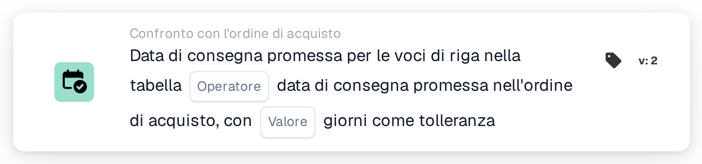
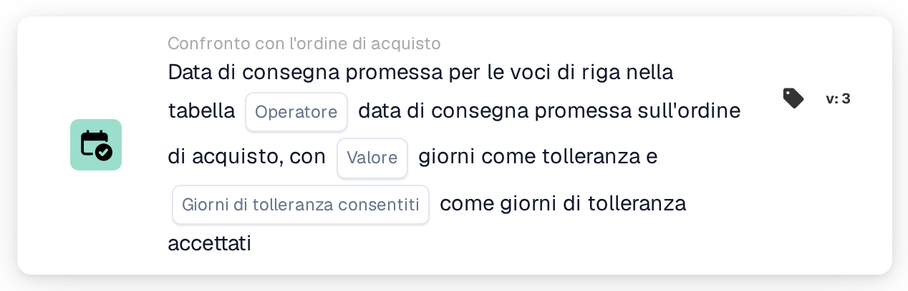
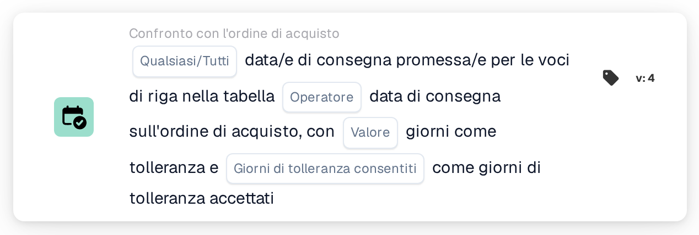

# Data di consegna promessa sull'ordine di acquisto

<figure><figcaption>
Versione 2
</figcaption></figure>

<figure><figcaption>
Versione 3
</figcaption></figure>

<figure><figcaption>
Versione 4
</figcaption></figure>

Il modo in cui viene calcolata la finestra di tolleranza, con esempi come "oggi o domani", è spiegato in [Date Tolerances](../date-tolerances.md).

## **Scopo**

Questa scheda DocBits è progettata per facilitare il confronto preciso tra le date di consegna promesse sugli ordini d'acquisto e le date di consegna specificate per le righe articolo in una tabella. Integrando un valore di tolleranza, la scheda garantisce flessibilità nel monitoraggio delle tempistiche di consegna, contribuendo a mantenere l'accuratezza della pianificazione dell'inventario e la soddisfazione del cliente.

## **Componenti della scheda**

1. **Operatore**
   * **Descrizione:** Definisce la condizione applicata per confrontare le date di consegna.
   * **Opzioni:**
     * **Uguale (=):** Verifica se la data di consegna promessa sulla riga articolo corrisponde alla data di consegna dell'ordine d'acquisto.
     * **Diverso (≠):** Garantisce che la data di consegna promessa sulla riga articolo non corrisponda alla data sull'ordine d'acquisto.
     * **Maggiore di (>):** Verifica se la data di consegna promessa della riga articolo è successiva alla data di consegna dell'ordine d'acquisto.
     * **Maggiore o uguale (≥):** Verifica se la data di consegna promessa della riga articolo è uguale o successiva alla data di consegna dell'ordine d'acquisto.
     * **Less Than (<):** Conferma se la data di consegna promessa della riga articolo è precedente alla data di consegna dell'ordine d'acquisto.
     * **Minore o uguale (≤):** Verifica se la data di consegna promessa della riga articolo è uguale o precedente alla data di consegna dell'ordine d'acquisto.
2. **Valore**
   * **Descrizione:** Specifica un margine di errore ammissibile nel confronto delle date di consegna.
   * **Dettaglio:** Gli utenti definiscono il numero di giorni di cui la data di consegna della riga articolo può differire dalla data di consegna promessa.

## **Funzionalità**

* **Valutazione della condizione:**\
  La scheda calcola la differenza tra la data di consegna promessa dell'ordine d'acquisto e le date di consegna delle righe articolo nella tabella. L'operatore selezionato viene quindi applicato per determinare se la condizione è soddisfatta.
* **Esecuzione dell'azione:**
  * **Condizione vera:** Se la differenza tra le date di consegna rientra nell'intervallo di tolleranza e soddisfa la condizione impostata dall'operatore, il workflow prosegue.
  * **Condizione falsa:** Se la condizione non è soddisfatta, il workflow non continuerà.

## **Configurazione e impostazione**

* L'operatore viene selezionato per definire la condizione di confronto desiderata, come uguale a, maggiore di o minore di. Infine, gli utenti specificano un valore di tolleranza in giorni, che consente piccole variazioni nel confronto senza attivare avvisi.

## **Scenario di esempio**

* Un ordine d'acquisto specifica una data di consegna promessa del 1° dicembre. Una riga articolo nella tabella ha una data di consegna promessa del 3 dicembre. Con un valore di tolleranza impostato a 2 giorni e l'operatore **Equals (≥)** selezionato, la scheda considera la data di consegna entro l'intervallo accettabile. Non viene attivato alcun avviso, garantendo che le piccole variazioni siano tollerate senza interrompere le operazioni.

## **Conclusione**

La scheda "Promised Delivery Date Comparison" aiuta a semplificare le operazioni della supply chain consentendo un monitoraggio preciso delle tempistiche di consegna. Grazie alla sua capacità di incorporare tolleranze e operatori di confronto flessibili, garantisce l'aderenza alle aspettative di consegna evitando al contempo avvisi non necessari per deviazioni minori. Ciò migliora la gestione dei fornitori e l'efficienza complessiva del workflow.
