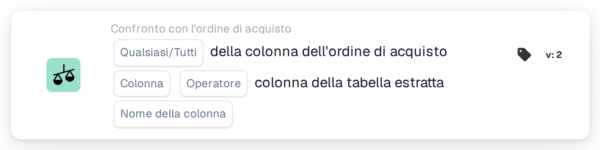
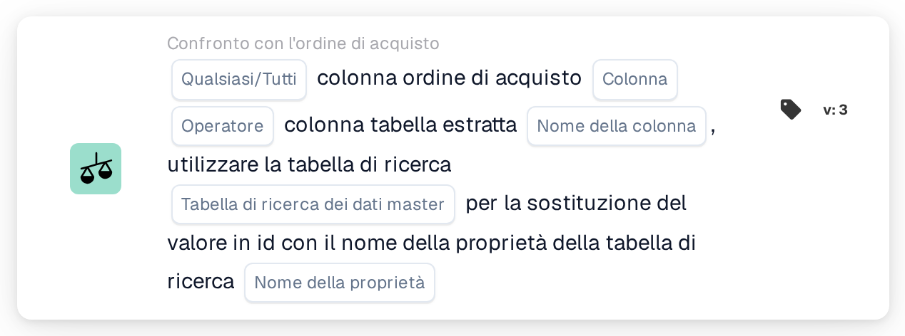

# Colonna dell'ordine di acquisto e colonna della tabella estratta

<figure><figcaption>
Versione 2
</figcaption></figure>

<figure><figcaption>
Versione 3
</figcaption></figure>

## Scopo:

Questa scheda del workflow confronta una colonna delle righe dell'ordine di acquisto abbinate con una colonna della tabella delle righe estratta dal documento. Per ogni riga del documento che l'abbinamento dell'ordine di acquisto ha associato a una riga dell'ordine di acquisto, il valore nella colonna selezionata dell'ordine di acquisto viene confrontato con il valore nella colonna selezionata della tabella per quella riga. I singoli risultati vengono poi combinati con l'impostazione **Qualsiasi/Tutti** nell'unico risultato della scheda.

La versione 3 può inoltre tradurre il valore dell'ordine di acquisto tramite una tabella di ricerca dei dati master prima del confronto; ciò è utile quando l'ordine di acquisto e il documento utilizzano codici diversi per la stessa cosa, ad esempio codici unità diversi.

L'abbinamento dell'ordine di acquisto dovrebbe essere eseguito prima di questa scheda. Senza un ordine di acquisto abbinato, la scheda segnala dati mancanti.

## Componenti della scheda:

1. **Qualsiasi/Tutti**
   * **Descrizione:** Come i confronti delle singole righe vengono combinati nel risultato della scheda.
   * **Opzioni:**
     * **Qualsiasi:** Almeno una riga confrontata soddisfa la condizione.
     * **Tutti:** Ogni riga confrontata soddisfa la condizione. Se non è impostato alcun valore, la scheda utilizza **Tutti**.
2. **Colonna**
   * **Descrizione:** La colonna della riga dell'ordine di acquisto il cui valore viene confrontato.
   * **Dettaglio:** Il valore viene letto dalla riga dell'ordine di acquisto abbinata alla riga del documento.
3. **Operatore**
   * **Descrizione:** Come il valore dell'ordine di acquisto viene confrontato con il valore del documento. Il valore dell'ordine di acquisto si trova sul lato sinistro del confronto, quindi **Maggiore di** significa che il valore dell'ordine di acquisto è maggiore del valore del documento.
   * **Opzioni:**
     * **Pari**
     * **Non uguali**
     * **Maggiore di**
     * **Maggiore o uguale**
     * **Meno di**
     * **Meno o uguale**
4. **Nome della colonna**
   * **Descrizione:** La colonna della tabella estratta dal documento che viene confrontata con la colonna dell'ordine di acquisto.
   * **Dettaglio:** La scheda utilizza la prima tabella estratta del documento.
5. **Tabella di ricerca dei dati master (solo versione 3)**
   * **Descrizione:** Una tabella di ricerca facoltativa utilizzata per tradurre il valore dell'ordine di acquisto prima del confronto.
   * **Dettaglio:** Il valore dell'ordine di acquisto, convertito in maiuscolo, viene cercato nella proprietà **codevalue** della tabella di ricerca. Se viene trovato un record e questo ha un valore per il **Nome della proprietà** selezionato, il valore dell'ordine di acquisto viene sostituito dal valore ripulito di quella proprietà. Se non viene trovato alcun record o alcun valore, viene utilizzato il valore dell'ordine di acquisto in maiuscolo. Il valore del documento non viene tradotto.
6. **Nome della proprietà (solo versione 3)**
   * **Descrizione:** La proprietà del record della tabella di ricerca il cui valore sostituisce il valore dell'ordine di acquisto.
   * **Dettaglio:** **Tabella di ricerca dei dati master** e **Nome della proprietà** possono essere lasciati entrambi vuoti; in tal caso la scheda confronta i valori senza traduzione. Se ne è impostato solo uno dei due, la scheda segnala dati mancanti.

## Funzionalità:

* **Valutazione della condizione:** Per ogni riga dell'ordine di acquisto abbinata, la scheda individua la riga della tabella del documento (o, nella versione 3, le righe) associata e confronta i due valori con l'operatore selezionato.
  * Se entrambi i valori sono numeri, vengono confrontati come numeri.
  * Altrimenti vengono confrontati come testo. Con **Pari**, le differenze tra maiuscole e minuscole non contano. Nella versione 3 entrambi i valori vengono convertiti in maiuscolo prima del confronto; un valore ricavato dalla tabella di ricerca viene utilizzato così come vi è memorizzato. Gli operatori **Maggiore** e **Meno** confrontano il testo nel semplice ordine dei caratteri, quindi sono utili soprattutto per le colonne numeriche.
* **Esecuzione dell'azione:**
  * **Condizione vera:**\
    Con **Tutti**, ogni riga confrontata soddisfa l'operatore; con **Qualsiasi**, almeno una. Il workflow prosegue.
  * **Condizione falsa:**\
    Se il risultato combinato non è soddisfatto, il workflow si arresta con una condizione non soddisfatta.
* **Dati mancanti:** La scheda non valuta la condizione e segnala dati mancanti nel log del workflow quando:
  * il documento non ha un ordine di acquisto abbinato, oppure i dati di un ordine di acquisto abbinato non sono disponibili,
  * il documento non ha una tabella estratta,
  * la colonna dell'ordine di acquisto di una riga confrontata è vuota (anche un valore numerico pari a 0 conta come vuoto),
  * la colonna della tabella di una riga confrontata è vuota o non presente,
  * non è stato possibile confrontare alcuna riga,
  * un input obbligatorio non è impostato (nella versione 3 anche quando è impostato solo uno dei due input di ricerca).

## Configurazione e impostazione:

* La scheda può essere aggiunta come condizione And dopo l'abbinamento dell'ordine di acquisto, dalla categoria **Confronto con l'ordine di acquisto**. Successivamente è possibile selezionare **Qualsiasi/Tutti**, la **Colonna** dell'ordine di acquisto, l'**Operatore** e il **Nome della colonna** della tabella del documento. Nella versione 3 è possibile aggiungere una **Tabella di ricerca dei dati master** e un **Nome della proprietà** quando l'ordine di acquisto utilizza codici diversi da quelli del documento.
* Per verificare una configurazione, è possibile utilizzare **Scheda di prova** nel menu della scheda del Workflow Builder su un documento esistente. Il log della scheda elenca ogni confronto con entrambi i valori e il relativo risultato.

## Conclusione:

La scheda del workflow "Purchase Order Column and Extracted Table Column" verifica una singola colonna delle righe rispetto all'ordine di acquisto abbinato, riga per riga. Può essere utilizzata per qualsiasi colonna presente su entrambi i lati, e la versione 3 copre anche i casi in cui i due lati utilizzano codici diversi per lo stesso valore.
