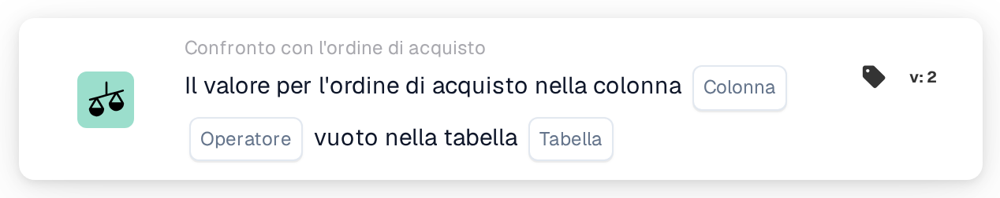

# Colonna dell'ordine di acquisto vuota

<figure><figcaption>
Versione 2
</figcaption></figure>

## Scopo:

Questa scheda del workflow verifica se una colonna dei dati dell'ordine di acquisto è vuota. Esamina direttamente l'ordine di acquisto memorizzato, le sue righe o i suoi addebiti distribuiti, e può essere utilizzata, ad esempio, per trattenere i documenti il cui ordine di acquisto è privo di informazioni su cui si basano i passaggi successivi.

## Componenti della scheda:

1. **Colonna**
   * **Descrizione:** La colonna dell'ordine di acquisto che viene verificata.
   * **Dettaglio:** L'elenco contiene le colonne della testata dell'ordine di acquisto, delle righe dell'ordine di acquisto e degli addebiti distribuiti, ad esempio **ID fornitore**, **Prezzo unitario**, **Quantità** o **Tipo di carica**. La colonna dovrebbe appartenere alla tabella selezionata in **Tabella**.
2. **Operatore**
   * **Descrizione:** Se la colonna dovrebbe essere vuota o no.
   * **Opzioni:**
     * **È:** La condizione è soddisfatta se la colonna è vuota in almeno un record verificato.
     * **Non è:** La condizione è soddisfatta se la colonna ha un valore in ogni record verificato.
3. **Tabella**
   * **Descrizione:** La tabella dell'ordine di acquisto da cui viene letta la colonna.
   * **Opzioni:**
     * **Ordine di acquisto:** La testata dell'ordine di acquisto (un record).
     * **Riga dell'ordine di acquisto:** Tutte le righe dell'ordine di acquisto.
     * **Addebito per ordine di acquisto distribuito:** Tutti gli addebiti distribuiti dell'ordine di acquisto.

## Funzionalità:

* **Ordine di acquisto utilizzato:** Se l'esecuzione del workflow porta con sé un proprio ordine di acquisto, viene verificato quell'ordine di acquisto. Altrimenti la scheda utilizza l'ordine di acquisto della prima riga del documento abbinata oppure, se nessuna riga è abbinata, il primo ordine di acquisto caricato per il documento.
* **Valutazione della condizione:** La scheda legge tutti i record della tabella selezionata che appartengono all'ordine di acquisto e verifica la colonna selezionata in ciascuno di essi. Una colonna conta come vuota se non ha alcun valore, se contiene un testo vuoto o un valore numerico pari a 0. Un valore sì/no conta sempre come compilato, anche quando è "no".
* **Colonna non presente nella tabella:** Se la colonna selezionata non esiste nella tabella selezionata, la scheda non segnala alcun errore. Con **È** la condizione viene considerata soddisfatta, con **Non è** non soddisfatta.
* **Esecuzione dell'azione:**
  * **Condizione vera:**\
    Con **È**, la colonna è vuota in almeno un record; con **Non è**, ha un valore in ogni record. Il workflow prosegue.
  * **Condizione falsa:**\
    Altrimenti il workflow si arresta con una condizione non soddisfatta.
* **Dati mancanti:** La scheda non valuta la condizione e segnala dati mancanti nel log del workflow quando non è disponibile alcun ordine di acquisto (né dall'esecuzione del workflow né abbinato al documento), quando **Colonna** o **Tabella** non sono impostate, oppure quando per l'ordine di acquisto non esiste alcun record della tabella selezionata.

## Configurazione e impostazione:

* La scheda può essere aggiunta come condizione And dalla categoria **Confronto con l'ordine di acquisto**. Successivamente è possibile selezionare la **Colonna**, l'operatore e la **Tabella**. Scegliere una colonna che appartiene alla tabella selezionata evita il risultato silenzioso descritto sopra.
* Per provare la scheda su un documento esistente è possibile utilizzare **Scheda di prova** nel menu della scheda del Workflow Builder.

## Conclusione:

La scheda del workflow "Purchase Order Column Empty" verifica la completezza dei dati dell'ordine di acquisto stesso. Aiuta a fermare tempestivamente i documenti quando all'ordine di acquisto manca un valore da cui dipendono l'approvazione, l'esportazione o altri passaggi del workflow.
