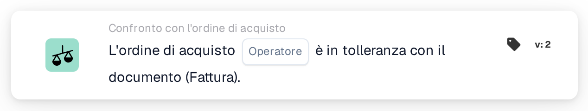

# Corrispondenza completa con l'ordine di acquisto

<figure><figcaption>
Versione 2
</figcaption></figure>

## Scopo:

Questa scheda del workflow verifica se l'ordine di acquisto abbinato concorda nel suo insieme con il documento, entro le tolleranze. Quantità, prezzo unitario e addebiti accessori di ogni riga abbinata vengono verificati in un unico passaggio, così una sola scheda può decidere se un documento può essere elaborato senza revisione manuale.

L'abbinamento dell'ordine di acquisto dovrebbe essere eseguito prima di questa scheda. Senza un ordine di acquisto abbinato, la scheda segnala dati mancanti.

## Componenti della scheda:

1. **Operatore**
   * **Descrizione:** Se l'ordine di acquisto dovrebbe corrispondere completamente al documento o no.
   * **Opzioni:**
     * **È:** La condizione è soddisfatta se ogni verifica rientra nella tolleranza.
     * **Non è:** La condizione è soddisfatta se almeno una verifica è al di fuori della tolleranza.

## Funzionalità:

* **Valutazione della condizione:** La scheda esamina ogni riga dell'ordine di acquisto abbinata (comprese le righe secondarie) e utilizza i dati di confronto che l'abbinamento dell'ordine di acquisto ha memorizzato per essa:
  * **Quantità:** La quantità del documento viene confrontata con la quantità dell'ordine di acquisto, entro la tolleranza di quantità della riga.
  * **Prezzo unitario:** Il prezzo unitario del documento viene confrontato con il prezzo unitario dell'ordine di acquisto, entro la tolleranza del prezzo unitario della riga. Se la riga non riporta un prezzo unitario nei suoi dati di confronto, ma solo nelle sue informazioni generali di abbinamento, la scheda utilizza la tolleranza del prezzo unitario configurata per il tipo di documento anziché quella memorizzata sulla riga; una tolleranza percentuale viene quindi calcolata a partire dal prezzo dell'ordine di acquisto.
  * **Addebiti accessori:** Per ogni addebito accessorio della riga, la tariffa dell'addebito, il prezzo unitario e l'importo vengono confrontati ciascuno con l'ordine di acquisto, entro le rispettive tolleranze.
  * Per i documenti di trasporto, che non riportano prezzi, viene confrontata solo la quantità.
* Tutte le verifiche di tutte le righe vengono combinate: l'ordine di acquisto corrisponde completamente solo se ogni singola verifica rientra nella tolleranza.
* **Esecuzione dell'azione:**
  * **Condizione vera:**\
    Con **È**, ogni verifica rientra nella tolleranza; con **Non è**, almeno una non vi rientra. Il workflow prosegue.
  * **Condizione falsa:**\
    Altrimenti il workflow si arresta con una condizione non soddisfatta.
* **Dati mancanti:** La scheda non valuta la condizione e segnala dati mancanti nel log del workflow quando il documento non ha un ordine di acquisto abbinato, oppure quando a una riga abbinata manca una parte dei dati necessari per le sue verifiche, ad esempio una quantità, un prezzo unitario, il valore di un addebito accessorio o la tolleranza di uno di essi (compresa una tolleranza del prezzo unitario mancante o non utilizzabile sul tipo di documento, nei casi in cui è necessaria). Una tolleranza mancante non viene trattata come una tolleranza pari a 0. Ciò vale anche con **Non è**: i dati mancanti vengono segnalati come dati mancanti, non come una discrepanza.

## Configurazione e impostazione:

* La scheda può essere aggiunta come condizione And dopo l'abbinamento dell'ordine di acquisto, dalla categoria **Confronto con l'ordine di acquisto**. Successivamente è possibile selezionare l'operatore (**È** o **Non è**). Le tolleranze stesse non vengono impostate sulla scheda; derivano dall'abbinamento dell'ordine di acquisto e dalle impostazioni del tipo di documento.
* Per provare la scheda su un documento esistente è possibile utilizzare **Scheda di prova** nel menu della scheda del Workflow Builder. Il log della scheda elenca ogni confronto di quantità, prezzo unitario e addebito con i valori del documento e dell'ordine di acquisto.

## Conclusione:

La scheda del workflow "Purchase Order Full Match" riassume in un'unica condizione il confronto di un documento con l'ordine di acquisto. I documenti che concordano con il loro ordine di acquisto su ogni riga possono passare automaticamente, mentre qualsiasi differenza al di fuori delle tolleranze viene segnalata come condizione non soddisfatta e i dati di confronto mancanti come dati mancanti, mai come una corrispondenza.
