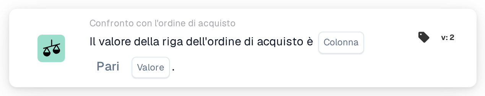

# Valore della riga dell'ordine di acquisto

<figure><figcaption>
Versione 2
</figcaption></figure>

## Scopo:

Questa scheda del workflow confronta una colonna delle righe dell'ordine di acquisto abbinate con un valore fisso. Può essere utilizzata per verificare una proprietà delle righe ordinate che non è stampata sul documento, ad esempio uno stato, un codice unità o un metodo di consegna, e per gestire il documento di conseguenza.

L'abbinamento dell'ordine di acquisto dovrebbe essere eseguito prima di questa scheda. Senza un ordine di acquisto abbinato, la scheda segnala dati mancanti.

## Componenti della scheda:

1. **Colonna**
   * **Descrizione:** La colonna della riga dell'ordine di acquisto il cui valore viene confrontato.
2. **Operatore**
   * **Descrizione:** Come il valore della riga dell'ordine di acquisto viene confrontato con il valore indicato sulla scheda. L'impostazione predefinita è **Pari**.
   * **Opzioni:**
     * **Pari:** Il valore della riga è uguale al valore. Per il testo, le maiuscole e le minuscole vengono ignorate.
     * **Non uguali:** Il valore della riga è diverso dal valore. Per il testo, le maiuscole e le minuscole contano.
     * **Maggiore di**, **Maggiore o uguale**, **Meno di**, **Meno o uguale:** Utili soprattutto per le colonne numeriche.
     * **Contiene:** Il valore della riga è esattamente una delle voci di **Valore**, comprese maiuscole e minuscole. Le corrispondenze parziali non vengono considerate.
     * **Non contiene:** Il valore della riga non è nessuna delle voci di **Valore** (confrontate nello stesso modo esatto).
3. **Valore**
   * **Descrizione:** Il valore con cui viene confrontato il valore della riga dell'ordine di acquisto.
   * **Dettaglio:** Con **Contiene** e **Non contiene** è possibile inserire più voci, separate da virgole. Con gli operatori **Maggiore** e **Meno** non è supportato un elenco di valori.

## Funzionalità:

* **Valutazione della condizione:** Per ogni riga dell'ordine di acquisto abbinata (comprese le righe secondarie), la scheda legge il valore della colonna selezionata e lo confronta con **Valore** utilizzando l'operatore. Se entrambi sono numeri, vengono confrontati come numeri, altrimenti come testo.
* La condizione vale per ogni riga confrontata; questa scheda non prevede l'opzione **Qualsiasi/Tutti**.
* **Esecuzione dell'azione:**
  * **Condizione vera:**\
    Se ogni riga confrontata soddisfa la condizione, il workflow prosegue.
  * **Condizione falsa:**\
    Se almeno una riga non la soddisfa, il workflow si arresta con una condizione non soddisfatta.
* **Dati mancanti:** La scheda non valuta la condizione e segnala dati mancanti nel log del workflow quando **Colonna** o **Valore** non sono impostati, quando il documento non ha un ordine di acquisto abbinato o i suoi dati non sono disponibili, quando la colonna selezionata di una riga abbinata è vuota (anche un valore numerico pari a 0 conta come vuoto), oppure quando non è stato possibile confrontare alcuna riga.
* **Errore di configurazione:** Se **Valore** contiene una virgola ed è selezionato uno degli operatori **Maggiore** o **Meno**, la scheda si arresta con un errore di configurazione.

## Configurazione e impostazione:

* La scheda può essere aggiunta come condizione And dopo l'abbinamento dell'ordine di acquisto, dalla categoria **Confronto con l'ordine di acquisto**. Successivamente è possibile impostare la **Colonna** della riga dell'ordine di acquisto, l'operatore e il **Valore**. Per una verifica rispetto a più valori consentiti, è possibile utilizzare **Contiene** con un elenco separato da virgole.
* Per provare la scheda su un documento esistente è possibile utilizzare **Scheda di prova** nel menu della scheda del Workflow Builder. Il log della scheda elenca ogni valore di riga confrontato con l'operatore e il valore utilizzati.

## Conclusione:

La scheda del workflow "Purchase Order Line Value" porta i dati delle righe dell'ordine di acquisto nel workflow sotto forma di semplice condizione. Consente a un workflow di reagire al modo in cui la merce è stata ordinata, anche quando questa informazione non compare sul documento stesso.
