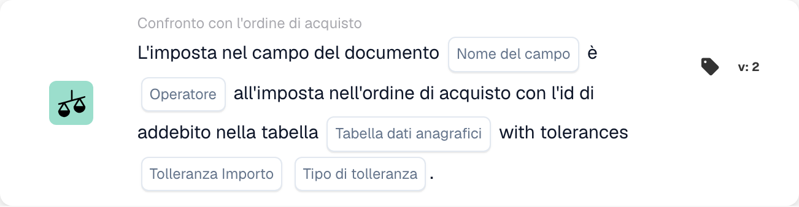

# Imposta nel campo del documento

<figure><figcaption>
Campi della scheda nella versione visualizzata. I campi non sono ancora configurati. Alcune etichette dell’interfaccia di questa versione sono ancora in inglese o tradotte in modo non corretto. Le spiegazioni di questa pagina sono tradotte; l’immagine mostra l’interfaccia reale.
</figcaption></figure>

## **Scopo:**

Questa scheda di workflow è progettata per valutare se il valore dell'imposta in un campo del documento corrisponde al valore dell'imposta in un ordine d'acquisto, tenendo conto delle tolleranze basate sul charge ID. La scheda confronta questi due valori d'imposta (uno dal campo del documento e uno dall'ordine d'acquisto) e verifica se soddisfano una condizione specificata (es. equals, greater than, lesser than, ecc.). Ciò aiuta a garantire che i valori delle imposte siano coerenti e a segnalare le discrepanze per un'ulteriore revisione o approvazione nei workflow di approvvigionamento.

## **Componenti della scheda:**

1. **Nome campo**
   * **Descrizione**: Specifica il campo del documento che contiene il valore dell'imposta da confrontare con il valore dell'imposta nell'ordine d'acquisto.
   * **Dettaglio**: Questo campo deve corrispondere all'identificatore esatto del valore dell'imposta nel documento.
2. **Operatore**
   * **Descrizione**: Definisce la condizione da applicare al confronto tra il valore dell'imposta del documento e il valore dell'imposta dell'ordine d'acquisto.
   * **Opzioni**:
     * **Uguale (=)**: Verifica se l'imposta nel campo del documento corrisponde all'imposta nell'ordine d'acquisto.
     * **Diverso (≠)**: Garantisce che l'imposta nel campo del documento non corrisponda all'imposta nell'ordine d'acquisto.
     * **Maggiore di (>)**: Verifica se l'imposta nel campo del documento è maggiore dell'imposta nell'ordine d'acquisto.
     * **Maggiore o uguale (≥)**: Verifica se l'imposta nel campo del documento è maggiore o uguale all'imposta nell'ordine d'acquisto.
     * **Minore di (<)**: Verifica se l'imposta nel campo del documento è minore dell'imposta nell'ordine d'acquisto.
     * **Minore o uguale (≤)**: Verifica se l'imposta nel campo del documento è minore o uguale all'imposta nell'ordine d'acquisto.
3. **Tabella dati anagrafici**
   * **Descrizione**: La tabella che contiene i dettagli dell'ordine d'acquisto, inclusi il charge ID e i valori delle imposte.
   * **Dettaglio**: Questa tabella deve avere un riferimento al charge ID associato al valore dell'imposta dell'ordine d'acquisto.
4. **Importo di tolleranza**
   * **Descrizione**: L'importo soglia entro il quale i valori delle imposte possono variare. Viene utilizzato per tenere conto di piccole discrepanze nei calcoli delle imposte.
   * **Dettaglio**: La quantità di tolleranza deve essere un valore numerico, che definisce la differenza massima consentita tra i valori delle imposte.
5. **Tipo di tolleranza**
   * **Descrizione**: Specifica il tipo di tolleranza applicata, assoluta o basata su percentuale.
   * **Opzioni**:
     * **Valore**: La tolleranza è un valore numerico fisso.
     * **Percentage**: La tolleranza è calcolata come percentuale del valore dell'imposta.

## **Funzionalità:**

* **Valutazione della condizione:** Il sistema valuta se il valore dell'imposta nel campo del documento soddisfa la condizione specificata quando confrontato con il valore dell'imposta nell'ordine d'acquisto (con il riferimento al charge ID dalla master data table). La quantità e il tipo di tolleranza vengono considerati in questa valutazione per consentire piccole differenze nei calcoli delle imposte.
* **Esecuzione dell'azione:**
  * **Condizione vera**: Se l'imposta nel campo del documento soddisfa la condizione quando confrontata con l'imposta dell'ordine d'acquisto (entro la quantità e il tipo di tolleranza), il workflow continua.
  * **Condizione falsa**: Se l'imposta nel campo del documento non soddisfa la condizione (non rientra nell'intervallo di tolleranza o il confronto fallisce), il workflow si arresterà.

## **Configurazione e impostazione:**

* Gli utenti devono selezionare il campo del documento che contiene il valore dell'imposta da confrontare. Sceglieranno quindi l'operatore per definire come effettuare il confronto (es. equals, greater than). Successivamente, gli utenti devono specificare il riferimento alla master data table e impostare la quantità e il tipo di tolleranza per tenere conto di piccole discrepanze nelle imposte.

## **Scenario di esempio:**

* Una fattura elenca un importo d'imposta di $100. L'ordine d'acquisto corrispondente, presente nella master data table, specifica un valore d'imposta di $95. Utilizzando l'operatore "Greater Than", il sistema confronta il valore dell'imposta del documento ($100) con il valore dell'imposta dell'ordine d'acquisto ($95) con una tolleranza di $10 (tipo di tolleranza assoluta). Poiché la differenza di $5 rientra nell'intervallo di tolleranza, il workflow procede senza attivare alcun avviso.

## **Conclusione:**

La scheda di workflow "Tax in Document Field Comparison" garantisce che i valori delle imposte nei documenti siano allineati ai dettagli dell'ordine d'acquisto, consentendo piccole discrepanze in base alle tolleranze specificate. Automatizzando questo controllo, le organizzazioni possono ridurre al minimo gli errori nei calcoli delle imposte e semplificare i processi di approvvigionamento, riducendo la necessità di interventi o approvazioni manuali.
