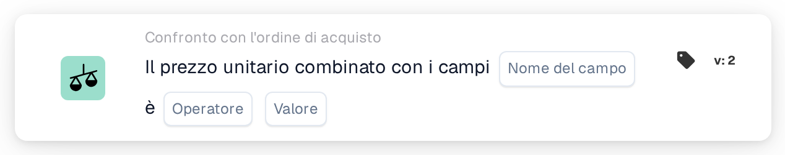

# Prezzo unitario combinato con i campi

<figure><figcaption>
Versione 2
</figcaption></figure>

<figure><figcaption>
Versione 3
</figcaption></figure>

## **Scopo:**

Questa scheda di workflow è progettata per valutare se il prezzo unitario, combinato con il valore di un campo specificato (come quantità, sconto o costi aggiuntivi), soddisfa una condizione definita. La scheda confronta il prezzo unitario e il valore del campo con una soglia specificata per aiutare a garantire che i prezzi siano allineati alle aspettative. Questo confronto può attivare azioni in base a condizioni specifiche, come la segnalazione di discrepanze o l'automazione dei processi di approvazione nei workflow di approvvigionamento o ricezione.

## **Componenti della scheda:**

1. **Nome campo**
   * **Descrizione:** Specifica il campo del documento che contiene il valore da combinare con il prezzo unitario.
   * **Dettaglio:** Deve corrispondere all'identificatore esatto del primo campo all'interno del documento.
2. **Operatore**
   * **Descrizione:** Definisce la condizione che verrà applicata al confronto tra il valore combinato e il valore specificato.
   * **Opzioni:**
     * **Uguale (=):** Verifica se il valore combinato del prezzo unitario e del campo corrisponde al valore specificato.
     * **Diverso (≠):** Garantisce che il valore combinato del prezzo unitario e del campo sia diverso dal valore specificato.
     * **Maggiore di (>):** Verifica se il valore combinato è maggiore del valore specificato.
     * **Maggiore o uguale (≥):** Verifica se il valore combinato è maggiore o uguale al valore specificato.
     * **Minore di (<):** Verifica se il valore combinato è minore del valore specificato.
     * **Minore o uguale (≤):** Verifica se il valore combinato è minore o uguale al valore specificato.
3. **Valore**
   * **Descrizione:** Specifica il valore con cui verrà confrontato il valore combinato del prezzo unitario e del campo.
   * **Dettaglio:** Il valore deve essere numerico.

## **Funzionalità:**

* **Valutazione della condizione:** Il sistema valuta il valore combinato del prezzo unitario e del campo in base all'operatore selezionato e lo confronta con il valore specificato. Il risultato di questa valutazione determina se la condizione è vera o falsa.
* **Esecuzione dell'azione:**
  * **Condizione vera:** Se il confronto risulta vero (es. il valore combinato supera il valore specificato), il workflow prosegue con la condizione vera. Ciò potrebbe attivare azioni come l'approvazione, l'instradamento del documento o l'applicazione di regole di elaborazione.
  * **Condizione falsa:** Se il confronto risulta falso (es. il valore combinato non soddisfa la condizione), il workflow prosegue con la condizione falsa. Ciò potrebbe attivare una notifica, inviare il documento per la revisione manuale o arrestare il workflow.

## **Configurazione e impostazione:**

* Gli utenti iniziano selezionando il campo o i campi del documento che contengono il valore o i valori da combinare con il prezzo unitario. Dopo aver selezionato il campo, scelgono l'operatore appropriato per definire come il valore combinato verrà confrontato con il valore specificato. Quindi possono impostare il valore.

## **Scenario di esempio:**

* Una fattura elenca 50 unità di un prodotto a $20 ciascuna, per un totale di $1000. Il documento correlato ha un campo quantità con un valore di 10. Utilizzando l'operatore "Greater Than", la scheda confronta il valore combinato del prezzo unitario ($20) e della quantità (10), che equivale a $200. La scheda verifica se il valore combinato è maggiore di $150 (il valore specificato). Poiché il valore combinato di $200 è maggiore della soglia di $150, il workflow procede ad attivare un'approvazione per il documento.

## **Conclusione:**

La scheda di workflow "Unit Price Combined with Fields" garantisce che le condizioni di prezzo siano soddisfatte valutando il valore combinato del prezzo unitario e di un campo specificato. Automatizzando questo confronto, le organizzazioni possono garantire coerenza e segnalare discrepanze nei prezzi o nelle quantità prima di procedere con l'approvazione, contribuendo a semplificare i processi di approvvigionamento e finanziari.
