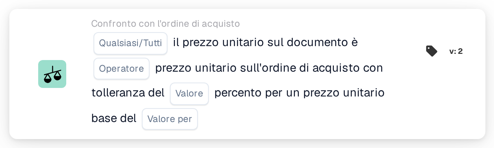

# Tolleranza del prezzo unitario per prezzo base

<figure><figcaption>
Versione 2
</figcaption></figure>

## Scopo:

Questa scheda del workflow confronta i prezzi unitari del documento con i prezzi unitari delle righe dell'ordine di acquisto abbinate, utilizzando una tolleranza percentuale che cresce con il prezzo dell'ordine di acquisto. La tolleranza viene inserita come percentuale per prezzo unitario base, così gli articoli più costosi ottengono una tolleranza percentuale maggiore rispetto a quelli meno costosi.

Per una tolleranza fissa è possibile utilizzare la scheda **Any / All Unit Price is**.

L'abbinamento dell'ordine di acquisto dovrebbe essere eseguito prima di questa scheda. Senza un ordine di acquisto abbinato, la scheda segnala dati mancanti.

## Componenti della scheda:

1. **Qualsiasi/Tutti**
   * **Descrizione:** Come i confronti delle singole righe vengono combinati nel risultato della scheda.
   * **Opzioni:**
     * **Qualsiasi:** Almeno una riga soddisfa il confronto.
     * **Tutti:** Ogni riga confrontata soddisfa il confronto. Se non è impostato alcun valore, la scheda utilizza **Tutti**.
2. **Operatore**
   * **Descrizione:** Come il prezzo unitario del documento viene confrontato con il prezzo unitario dell'ordine di acquisto, tenendo conto della tolleranza.
   * **Opzioni:**
     * **Pari:** Il prezzo del documento rientra nell'intervallo di tolleranza attorno al prezzo dell'ordine di acquisto.
     * **Non uguali:** Il prezzo del documento è al di fuori dell'intervallo di tolleranza.
     * **Maggiore di:** Il prezzo del documento è al di sopra dell'intervallo di tolleranza.
     * **Maggiore o uguale:** Il prezzo del documento rientra nell'intervallo di tolleranza o è al di sopra.
     * **Meno di:** Il prezzo del documento è al di sotto dell'intervallo di tolleranza.
     * **Meno o uguale:** Il prezzo del documento rientra nell'intervallo di tolleranza o è al di sotto.
3. **Valore**
   * **Descrizione:** La tolleranza in percentuale che si applica al prezzo unitario base.
   * **Dettaglio:** Un numero, ad esempio `1` per l'1 percento.
4. **Valore per**
   * **Descrizione:** Il prezzo unitario base a cui si riferisce la percentuale di tolleranza.
   * **Dettaglio:** Un numero maggiore di 0, ad esempio `100`.

## Funzionalità:

* **Calcolo della tolleranza:** Per ogni riga, la percentuale di tolleranza viene scalata in base al rapporto tra il prezzo unitario dell'ordine di acquisto e il prezzo unitario base:\
  tolleranza % = **Valore** × (prezzo unitario dell'ordine di acquisto ÷ **Valore per**)\
  L'intervallo di tolleranza è il prezzo unitario dell'ordine di acquisto più e meno questa percentuale.\
  Esempio con **Valore** 1 e **Valore per** 100: un prezzo dell'ordine di acquisto di 50 dà una tolleranza dello 0,5 %, quindi l'intervallo va da 49,75 a 50,25. Un prezzo dell'ordine di acquisto di 200 dà il 2 %, quindi l'intervallo va da 196 a 204.
* **Valutazione della condizione:** Per ogni riga dell'ordine di acquisto abbinata, il prezzo unitario del documento viene confrontato con il prezzo unitario della riga dell'ordine di acquisto, utilizzando l'operatore e l'intervallo calcolato. Le voci abbinate senza una riga dell'ordine di acquisto vengono saltate. I risultati vengono combinati con **Qualsiasi/Tutti**.
* **Esecuzione dell'azione:**
  * **Condizione vera:**\
    Se il risultato combinato è soddisfatto, il workflow prosegue.
  * **Condizione falsa:**\
    Se il risultato combinato non è soddisfatto, il workflow si arresta con una condizione non soddisfatta. Ciò avviene anche quando non è stato possibile confrontare alcuna riga.
* **Dati mancanti:** La scheda non valuta la condizione e segnala dati mancanti nel log del workflow quando **Valore** o **Valore per** non sono impostati, quando il documento non ha un ordine di acquisto abbinato, oppure quando al documento o all'ordine di acquisto manca il prezzo unitario di una riga confrontata (un prezzo unitario vuoto o un prezzo unitario numerico pari a 0 conta come mancante).
* **Errori:** La scheda si arresta con un errore quando **Valore** o **Valore per** non sono numeri, quando un prezzo unitario non può essere letto come numero, quando **Valore per** è 0, oppure quando la tolleranza calcolata per una riga è inferiore allo 0 % o superiore al 100 %.

## Configurazione e impostazione:

* La scheda può essere aggiunta come condizione And dopo l'abbinamento dell'ordine di acquisto, dalla categoria **Confronto con l'ordine di acquisto**. Successivamente è possibile inserire **Qualsiasi/Tutti**, l'operatore, la percentuale di tolleranza in **Valore** e il prezzo unitario base in **Valore per**. Il prezzo unitario base dovrebbe essere scelto in modo che la tolleranza calcolata resti tra lo 0 % e il 100 % per la fascia di prezzo degli articoli.
* Per provare la scheda su un documento esistente è possibile utilizzare **Scheda di prova** nel menu della scheda del Workflow Builder. Il log della scheda mostra, per ogni riga, entrambi i prezzi, la tolleranza calcolata in percentuale e l'intervallo risultante.

## Conclusione:

La scheda del workflow "Unit Price Tolerance per Base Price" applica una tolleranza dipendente dal prezzo al confronto del prezzo unitario con l'ordine di acquisto. In questo modo, con una sola scheda, è possibile applicare una tolleranza ristretta agli articoli a basso prezzo e una più ampia a quelli ad alto prezzo.
