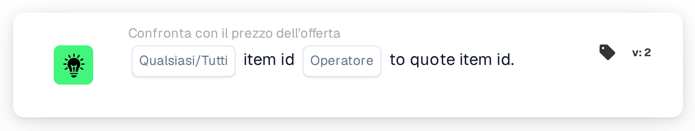

# ID articolo rispetto all'ID articolo dell'offerta

<figure><figcaption>
Versione 2
</figcaption></figure>

## Scopo:

Questa scheda del workflow confronta il codice articolo di ogni riga di un documento con il codice articolo memorizzato per lo stesso articolo del fornitore nella tabella dei prezzi degli articoli del fornitore. Può essere utilizzata per individuare le righe in cui il documento indica un articolo diverso da quello a cui si riferiscono i dati di prezzo. In base al risultato, il workflow prosegue con la condizione vera o con quella falsa.

## Componenti della scheda:

1. **Qualsiasi/Tutti**
   * **Descrizione:** Definisce se una riga o ogni riga confrontata della tabella del documento dovrebbe soddisfare la condizione.
   * **Opzioni:**
     * **Qualsiasi:** La condizione è vera se almeno una riga confrontata soddisfa la condizione.
     * **Tutti:** La condizione è vera solo se ogni riga confrontata soddisfa la condizione.
2. **Operatore**
   * **Descrizione:** Definisce come il codice articolo nella tabella dei prezzi degli articoli del fornitore viene confrontato con il codice articolo sulla riga del documento.
   * **Opzioni:**
     * **Pari:** I codici articolo sono uguali. I codici articolo che possono essere letti entrambi come numeri vengono confrontati come numeri (ad esempio "007" e "7" sono uguali); altrimenti vengono confrontati come testo senza distinguere tra maiuscole e minuscole.
     * **Non uguali:** I codici articolo sono diversi. I codici articolo che possono essere letti entrambi come numeri vengono confrontati come numeri; altrimenti vengono confrontati come testo, e in questo caso le maiuscole e le minuscole vengono distinte.
     * **Maggiore di, Maggiore o uguale, Meno di, Meno o uguale:** Anch'essi offerti dalla scheda. Con questi operatori i codici articolo vengono sempre confrontati come testo, carattere per carattere, quindi ad esempio "10" risulta minore di "9".

## Funzionalità:

* **Valutazione della condizione:** Per ogni riga della tabella del documento, la scheda cerca l'ID articolo fornitore della riga (colonna `SUPPLIER_ITEM_NUMBER`) nella tabella dei prezzi degli articoli del fornitore e confronta il codice articolo lì memorizzato con il codice articolo della riga (colonna `ITEM_NUMBER`). I risultati di tutte le righe confrontate vengono quindi combinati con **Qualsiasi** o **Tutti**.
* **Righe saltate:** Una riga viene esclusa dal confronto se la tabella dei prezzi degli articoli del fornitore non contiene alcuna voce per il suo ID articolo fornitore, oppure se la voce non ha un codice articolo. Ogni riga saltata viene annotata nel log del workflow.
* **Date di validità:** Se una voce della tabella dei prezzi degli articoli del fornitore ha una data di inizio o di fine e la data del documento è al di fuori di tale periodo, la scheda lo annota nel log del workflow. Questa annotazione non modifica il risultato della scheda.
* **Esecuzione dell'azione:**
  * **Condizione vera:**\
    I codici articolo soddisfano l'operatore selezionato per qualsiasi riga confrontata o per tutte. Il workflow prosegue con la condizione vera.
  * **Condizione falsa:**\
    Se la condizione non è soddisfatta, il workflow prosegue con la condizione falsa, ad esempio per inviare il documento a una revisione manuale. La condizione falsa viene utilizzata anche se non è stato possibile confrontare nessuna delle righe, perché nessuna riga aveva un codice articolo nella tabella dei prezzi degli articoli del fornitore.
* **Dati mancanti:** Se il documento non ha una tabella, ha più di una tabella, oppure non è stato possibile leggere alcuna riga dalla tabella, la scheda non valuta la condizione e segnala i dati mancanti nel log del workflow. Se non è impostata alcuna opzione **Qualsiasi/Tutti**, la scheda lo annota nel log e utilizza **Tutti**.

## Configurazione e impostazione:

* La scheda può essere aggiunta dalla categoria **Confronta con il prezzo dell'offerta**. Successivamente è possibile selezionare **Qualsiasi** o **Tutti** e l'operatore. Per verificare la corrispondenza dei codici articolo, la scelta abituale è **Pari** o **Non uguali**. Infine si imposta la condizione di prosecuzione (vera o falsa), che determina il passo successivo del workflow.
* La scheda funziona su documenti con esattamente una tabella, le cui righe riportano l'ID articolo fornitore e il codice articolo.

## Conclusione:

La scheda del workflow "Item ID to Quote Item ID" garantisce che gli articoli di un documento corrispondano agli articoli a cui si riferisce la tabella dei prezzi degli articoli del fornitore. Le righe senza dati di prezzo vengono saltate anziché essere conteggiate come differenze, così il risultato riflette solo le righe che possono effettivamente essere confrontate.
