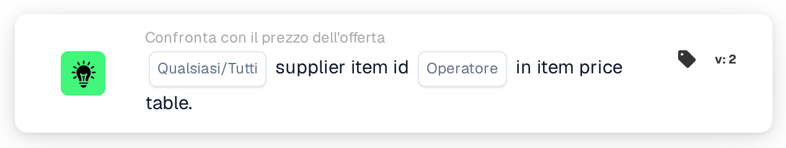

# ID articolo fornitore nella tabella dei prezzi degli articoli

<figure><figcaption>
Versione 2
</figcaption></figure>

## Scopo:

Questa scheda del workflow verifica se gli ID articolo fornitore presenti sulle righe di un documento si trovano nella tabella dei prezzi degli articoli del fornitore. Può essere utilizzata per stabilire se DocBits dispone di dati di prezzo per gli articoli di un'offerta, per il fornitore del documento, prima che vengano eseguiti altri confronti con l'offerta, oppure per inoltrare a una verifica manuale i documenti con articoli sconosciuti. In base al risultato, il workflow prosegue con la condizione vera o con quella falsa.

## Componenti della scheda:

1. **Qualsiasi/Tutti**
   * **Descrizione:** Definisce se una riga o ogni riga della tabella del documento dovrebbe soddisfare la condizione.
   * **Opzioni:**
     * **Qualsiasi:** La condizione è vera se almeno una riga soddisfa la condizione.
     * **Tutti:** La condizione è vera solo se ogni riga soddisfa la condizione.
2. **Operatore**
   * **Descrizione:** Definisce se l'ID articolo fornitore dovrebbe essere trovato nella tabella dei prezzi degli articoli del fornitore o no.
   * **Opzioni:**
     * **È:** Una riga soddisfa la condizione se il suo ID articolo fornitore è presente nella tabella dei prezzi degli articoli del fornitore.
     * **Non è:** Una riga soddisfa la condizione se il suo ID articolo fornitore non è presente nella tabella dei prezzi degli articoli del fornitore.

## Funzionalità:

* **Valutazione della condizione:** La scheda legge l'ID articolo fornitore (colonna `SUPPLIER_ITEM_NUMBER`) di ogni riga della tabella del documento e verifica se la tabella dei prezzi degli articoli del fornitore contiene una voce corrispondente. I risultati di tutte le righe vengono quindi combinati con **Qualsiasi** o **Tutti**.
* **Date di validità:** Se una voce della tabella dei prezzi degli articoli del fornitore ha una data di inizio o di fine e la data del documento è al di fuori di tale periodo, la scheda lo annota nel log del workflow. Questa annotazione non modifica il risultato della scheda.
* **Esecuzione dell'azione:**
  * **Condizione vera:**\
    Con **È**, gli ID articolo fornitore (qualsiasi o tutti, come selezionato) sono presenti nella tabella dei prezzi degli articoli del fornitore. Con **Non è**, non lo sono. Il workflow prosegue con la condizione vera, ad esempio per proseguire con il confronto dei prezzi.
  * **Condizione falsa:**\
    Se la condizione non è soddisfatta, il workflow prosegue con la condizione falsa, ad esempio per inviare il documento a una revisione manuale.
* **Dati mancanti:** Se il documento non ha una tabella, ha più di una tabella, non è stato possibile leggere alcuna riga dalla tabella, oppure per il documento non esistono affatto dati di prezzo degli articoli del fornitore, la scheda non valuta la condizione e segnala i dati mancanti nel log del workflow. Se non è impostata alcuna opzione **Qualsiasi/Tutti**, la scheda lo annota nel log e utilizza **Tutti**.
* **Errori:** La scheda termina con un errore se una riga della tabella non ha la colonna `SUPPLIER_ITEM_NUMBER`. Se non è impostato alcun operatore, la scheda segnala un errore di configurazione.

## Configurazione e impostazione:

* La scheda può essere aggiunta dalla categoria **Confronta con il prezzo dell'offerta**. Successivamente è possibile selezionare **Qualsiasi** o **Tutti** e l'operatore (**È** o **Non è**). Infine si imposta la condizione di prosecuzione (vera o falsa), che determina il passo successivo del workflow.
* La scheda funziona su documenti con esattamente una tabella, le cui righe riportano l'ID articolo fornitore.

## Conclusione:

La scheda del workflow "Supplier Item ID in Item Price Table" mostra se gli articoli di un documento sono noti nella tabella dei prezzi degli articoli del fornitore. Può fungere da primo controllo in un workflow per le offerte, così che i successivi confronti di prezzo, codice articolo e unità di misura vengano eseguiti solo per i documenti i cui articoli dispongono di dati di prezzo.
