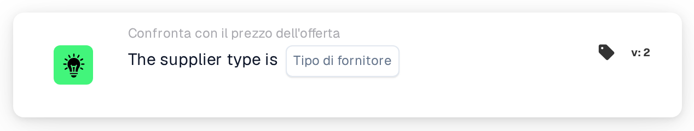

# Tipo di fornitore

<figure><figcaption>
Versione 2
</figcaption></figure>

## Scopo:

Questa scheda del workflow verifica il tipo di fornitore degli articoli nei dati di prezzo degli articoli del fornitore di un documento, ad esempio se si tratta di articoli a contratto o di articoli gestiti. Può essere utilizzata per applicare regole di approvazione diverse a seconda di come vengono gestiti gli articoli del fornitore. In base al risultato, il workflow prosegue con la condizione vera o con quella falsa.

## Componenti della scheda:

1. **Tipo di fornitore**
   * **Descrizione:** Il tipo di fornitore rispetto al quale viene verificato il documento.
   * **Opzioni:**
     * **Contract:** Corrisponde alle voci la cui classe di gestione è "contract".
     * **Managed:** Corrisponde alle voci la cui classe di gestione è "managed".
     * **NonManaged:** Corrisponde alle voci la cui classe di gestione è "unmanaged".

## Funzionalità:

* **Valutazione della condizione:** La scheda legge il tipo di fornitore (classe di gestione) di ogni voce nei dati di prezzo degli articoli del fornitore del documento e lo confronta con il tipo di fornitore selezionato sulla scheda. Il confronto non distingue tra maiuscole e minuscole.
* **Esecuzione dell'azione:**
  * **Condizione vera:**\
    Ogni voce nei dati di prezzo degli articoli del fornitore ha il tipo di fornitore selezionato. Il workflow prosegue con la condizione vera, ad esempio per applicare le regole previste per questo tipo di fornitore.
  * **Condizione falsa:**\
    Se almeno una voce ha un tipo di fornitore diverso o non ha una classe di gestione, il workflow prosegue con la condizione falsa.
* **Dati mancanti:** Se sulla scheda non è selezionato alcun tipo di fornitore, oppure il documento non ha dati di prezzo degli articoli del fornitore, la scheda non valuta la condizione e segnala i dati mancanti nel log del workflow.

## Configurazione e impostazione:

* La scheda può essere aggiunta dalla categoria **Confronta con il prezzo dell'offerta**. Successivamente è possibile selezionare il tipo di fornitore nel campo **Tipo di fornitore**. Infine si imposta la condizione di prosecuzione (vera o falsa), che determina il passo successivo del workflow.

## Conclusione:

La scheda del workflow "Supplier Type" consente a un workflow per le offerte di ramificarsi in base al tipo di fornitore degli articoli, così che gli articoli a contratto, gestiti e non gestiti possano essere trattati ciascuno con le proprie regole.
