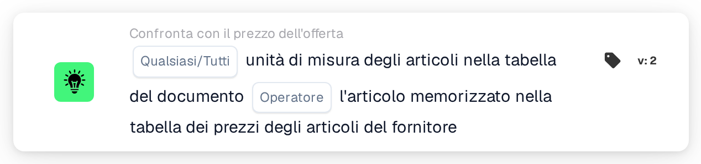
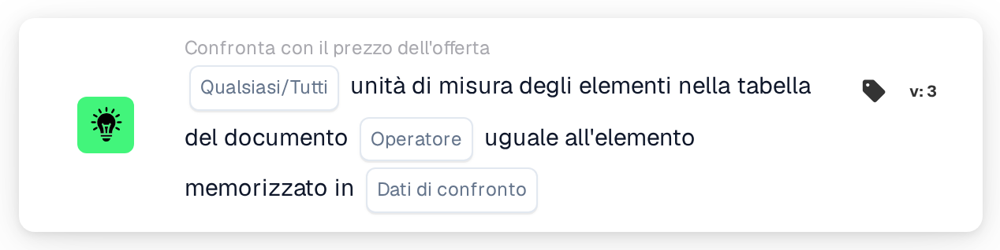

# Unità di misura

<figure><figcaption>
Versione 2
</figcaption></figure>

<figure><figcaption>
Versione 3
</figcaption></figure>

## Scopo:

Questa scheda del workflow confronta l'unità di misura degli articoli nella tabella del documento con l'unità di misura memorizzata altrove per gli stessi articoli. Nella versione 2, il confronto avviene sempre con la tabella dei prezzi degli articoli del fornitore. La versione 3 aggiunge la possibilità di scegliere tra la tabella dei prezzi degli articoli del fornitore e le righe dell'ordine di acquisto abbinato. La scheda può essere utilizzata per individuare le righe in cui un articolo viene offerto o fatturato in un'unità diversa da quella prevista. In base al risultato, il workflow prosegue con la condizione vera o con quella falsa.

## Componenti della scheda:

1. **Qualsiasi/Tutti**
   * **Descrizione:** Definisce se una riga o ogni riga confrontata della tabella del documento dovrebbe soddisfare la condizione.
   * **Opzioni:**
     * **Qualsiasi:** La condizione è vera se almeno una riga confrontata soddisfa la condizione.
     * **Tutti:** La condizione è vera solo se ogni riga confrontata soddisfa la condizione.
2. **Operatore**
   * **Descrizione:** Definisce se le unità di misura dovrebbero essere uguali o diverse.
   * **Opzioni:**
     * **Pari:** L'unità di misura sulla riga del documento è uguale a quella memorizzata.
     * **Non uguali:** L'unità di misura sulla riga del documento è diversa da quella memorizzata.
3. **Dati di confronto** (solo versione 3)
   * **Descrizione:** La fonte con cui viene confrontata l'unità di misura del documento.
   * **Opzioni:**
     * **prezzo dell'articolo quotato dal fornitore:** L'unità di misura memorizzata per l'articolo del fornitore nella tabella dei prezzi degli articoli del fornitore, come nella versione 2.
     * **voce di ordine di acquisto:** L'unità di misura della riga dell'ordine di acquisto abbinata.

## Funzionalità:

* **Valutazione della condizione:** La scheda legge l'unità di misura (colonna `UNIT`) delle righe nella prima tabella del documento e la confronta con la fonte selezionata. Il confronto non distingue tra maiuscole e minuscole. I risultati di tutte le righe confrontate vengono quindi combinati con **Qualsiasi** o **Tutti**.
  * **prezzo dell'articolo quotato dal fornitore:** Vengono confrontate solo le righe collegate a una voce dei dati di offerta abbinati. Per ciascuna di queste righe viene utilizzata l'unità di misura memorizzata per il relativo articolo del fornitore.
  * **voce di ordine di acquisto** (versione 3): Vengono confrontate solo le righe abbinate a una riga dell'ordine di acquisto. L'unità di misura della riga dell'ordine di acquisto viene prima tradotta con la tabella di ricerca delle unità di misura (dall'unità EDI all'unità M3). Su entrambi i lati alcune grafie vengono considerate equivalenti: "each" come "ea", e "lbs" e "lbp" come "lb".
* **Righe saltate:** Una riga viene esclusa dal confronto se la fonte non ha un'unità di misura per essa. Ogni riga saltata viene annotata nel log del workflow.
* **Esecuzione dell'azione:**
  * **Condizione vera:**\
    Le unità di misura soddisfano l'operatore selezionato per qualsiasi riga confrontata o per tutte. Il workflow prosegue con la condizione vera.
  * **Condizione falsa:**\
    Se la condizione non è soddisfatta, il workflow prosegue con la condizione falsa, ad esempio per inviare il documento a una revisione manuale. La condizione falsa viene utilizzata anche se nessuna riga ha potuto essere collegata alla fonte selezionata e, nella versione 3, se non è selezionata alcuna opzione in **Dati di confronto**, perché in tal caso non viene confrontata alcuna riga.
* **Dati mancanti:** La scheda non valuta la condizione e segnala i dati mancanti nel log del workflow se:
  * il documento non ha una tabella,
  * viene utilizzato **prezzo dell'articolo quotato dal fornitore** (o la versione 2) e il documento non ha dati di offerta abbinati o dati di prezzo degli articoli del fornitore,
  * è selezionato **voce di ordine di acquisto** e il documento non ha un ordine di acquisto abbinato,
  * una riga confrontata ha un'unità di misura vuota sul documento,
  * non è stato possibile confrontare nessuna delle righe perché ogni riga è stata saltata.

  Se non è impostata alcuna opzione **Qualsiasi/Tutti**, la scheda lo annota nel log e utilizza **Tutti**.
* **Errori:** Con **voce di ordine di acquisto**, se una riga dell'ordine di acquisto è suddivisa in righe secondarie con unità di misura diverse, la scheda termina con un errore.

## Configurazione e impostazione:

* La scheda può essere aggiunta dalla categoria **Confronta con il prezzo dell'offerta**. Successivamente è possibile selezionare **Qualsiasi** o **Tutti** e l'operatore. Nella versione 3 è inoltre possibile selezionare la fonte del confronto nel campo **Dati di confronto**. Infine si imposta la condizione di prosecuzione (vera o falsa), che determina il passo successivo del workflow.
* La tabella del documento dovrebbe contenere una colonna `UNIT`. Per il confronto con le righe dell'ordine di acquisto, la tabella di ricerca delle unità di misura dovrebbe contenere le corrispondenze tra le unità utilizzate sui documenti e quelle utilizzate sugli ordini di acquisto.

## Conclusione:

La scheda del workflow "Unit of Measure" garantisce che gli articoli vengano offerti o fatturati nell'unità prevista. Le righe senza un'unità di misura memorizzata vengono saltate anziché essere conteggiate come differenze, e la versione 3 estende la verifica dalla tabella dei prezzi degli articoli del fornitore alle righe dell'ordine di acquisto.
