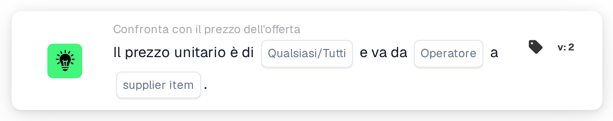

# Prezzo unitario rispetto al prezzo dell'articolo del fornitore

<figure><figcaption>
Versione 2
</figcaption></figure>

## Scopo:

Questa scheda del workflow confronta il prezzo unitario di ogni riga di un documento con un prezzo della tabella dei prezzi degli articoli del fornitore, ovvero il prezzo gestito oppure l'ultimo prezzo pagato per lo stesso articolo del fornitore. Può essere utilizzata per verificare, prima dell'approvazione del documento, se un prezzo offerto corrisponde al prezzo noto, lo supera o resta al di sotto. In base al risultato, il workflow prosegue con la condizione vera o con quella falsa.

## Componenti della scheda:

1. **Qualsiasi/Tutti**
   * **Descrizione:** Definisce se una riga o ogni riga confrontata della tabella del documento dovrebbe soddisfare la condizione.
   * **Opzioni:**
     * **Qualsiasi:** La condizione è vera se almeno una riga confrontata soddisfa la condizione.
     * **Tutti:** La condizione è vera solo se ogni riga confrontata soddisfa la condizione.
2. **Operatore**
   * **Descrizione:** Definisce come il prezzo unitario del documento viene confrontato con il prezzo dell'articolo del fornitore selezionato.
   * **Opzioni:**
     * **Pari:** Il prezzo unitario è uguale al prezzo dell'articolo del fornitore.
     * **Non uguali:** Il prezzo unitario è diverso dal prezzo dell'articolo del fornitore.
     * **Maggiore di:** Il prezzo unitario è superiore al prezzo dell'articolo del fornitore.
     * **Maggiore o uguale:** Il prezzo unitario è superiore o uguale al prezzo dell'articolo del fornitore.
     * **Meno di:** Il prezzo unitario è inferiore al prezzo dell'articolo del fornitore.
     * **Meno o uguale:** Il prezzo unitario è inferiore o uguale al prezzo dell'articolo del fornitore.
3. **supplier item**
   * **Descrizione:** Il prezzo della tabella dei prezzi degli articoli del fornitore con cui viene confrontato il prezzo unitario.
   * **Opzioni:**
     * **ManagedPrice:** Il prezzo gestito memorizzato per l'articolo del fornitore.
     * **LastPrice:** L'ultimo prezzo pagato per l'articolo del fornitore.

## Funzionalità:

* **Valutazione della condizione:** Per ogni riga della tabella del documento, la scheda cerca l'ID articolo fornitore della riga (colonna `SUPPLIER_ITEM_NUMBER`) nella tabella dei prezzi degli articoli del fornitore e confronta il prezzo unitario della riga (colonna `UNIT_PRICE`) con il prezzo selezionato. Entrambi i prezzi vengono confrontati come numeri. I risultati di tutte le righe confrontate vengono quindi combinati con **Qualsiasi** o **Tutti**.
* **Righe saltate:** Una riga viene esclusa dal confronto se il suo prezzo unitario è vuoto o non può essere letto come numero, oppure se per il suo articolo del fornitore non è memorizzato alcun prezzo del tipo selezionato, ad esempio perché l'articolo del fornitore non è presente nella tabella dei prezzi degli articoli del fornitore. Ogni riga saltata viene annotata nel log del workflow, insieme al lato che non aveva un prezzo.
* **Esecuzione dell'azione:**
  * **Condizione vera:**\
    I prezzi unitari soddisfano l'operatore selezionato per qualsiasi riga confrontata o per tutte. Il workflow prosegue con la condizione vera, ad esempio per approvare il documento.
  * **Condizione falsa:**\
    Se la condizione non è soddisfatta, il workflow prosegue con la condizione falsa, ad esempio per inviare il documento a una revisione dei prezzi.
* **Dati mancanti:** La scheda non valuta la condizione e segnala i dati mancanti nel log del workflow se:
  * sulla scheda non è selezionato alcun prezzo dell'articolo del fornitore,
  * il documento non ha dati di offerta abbinati,
  * il documento non ha una tabella, ha più di una tabella, oppure non è stato possibile leggere alcuna riga dalla tabella,
  * non è stato possibile confrontare nessuna delle righe perché ogni riga è stata saltata.

  Se non è impostata alcuna opzione **Qualsiasi/Tutti**, la scheda lo annota nel log e utilizza **Tutti**.
* **Errori:** Se una riga della tabella non ha la colonna `SUPPLIER_ITEM_NUMBER` o la colonna `UNIT_PRICE`, la scheda termina con un errore.

## Configurazione e impostazione:

* La scheda può essere aggiunta dalla categoria **Confronta con il prezzo dell'offerta**. Successivamente è possibile selezionare **Qualsiasi** o **Tutti**, l'operatore e, nel campo **supplier item**, il prezzo con cui effettuare il confronto. Infine si imposta la condizione di prosecuzione (vera o falsa), che determina il passo successivo del workflow.
* La scheda funziona su documenti con esattamente una tabella, le cui righe riportano l'ID articolo fornitore e il prezzo unitario.

## Conclusione:

La scheda del workflow "Unit Price to Supplier Item Price" verifica i prezzi offerti rispetto al prezzo gestito o all'ultimo prezzo pagato. Le righe senza un prezzo su uno dei due lati vengono saltate, così una singola riga incompleta non decide il risultato, e un documento senza alcuna riga confrontabile viene segnalato come dati mancanti.
