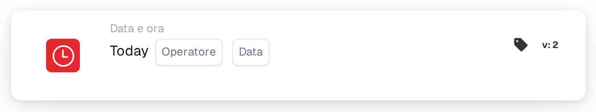

# Oggi

<figure><figcaption>
Versione 2
</figcaption></figure>

## Scopo:

Questa scheda del workflow confronta la data di oggi con una data impostata sulla scheda. Può essere utilizzata per regole che dovrebbero valere solo a partire da una certa data o fino a essa, ad esempio una modifica del processo a partire da una data di inizio pianificata.

## Componenti della scheda:

1. **Operatore**
   * **Descrizione:** Come viene confrontata la data di oggi con la data sulla scheda.
   * **Opzioni:**
     * **Pari:** Oggi è la data sulla scheda.
     * **Non uguali:** Oggi è un qualsiasi altro giorno.
     * **Maggiore di:** Oggi è successivo alla data sulla scheda.
     * **Maggiore o uguale:** Oggi è la data sulla scheda o una data successiva.
     * **Meno di:** Oggi è precedente alla data sulla scheda.
     * **Meno o uguale:** Oggi è la data sulla scheda o una data precedente.
2. **Data**
   * **Descrizione:** La data con cui viene confrontato il giorno di oggi.

## Funzionalità:

* **Valutazione della condizione:** Quando il workflow raggiunge la scheda, questa prende la data attuale in UTC e la confronta con la data sulla scheda tramite l'operatore. Vengono confrontate solo le date; gli orari vengono ignorati. Le date sul documento non hanno alcun ruolo.
* **Esecuzione dell'azione:**
  * **Condizione vera:**\
    Se il confronto è vero, il workflow prosegue con le schede successive.
  * **Condizione falsa:**\
    Se non è vero, il workflow si ferma con una condizione non soddisfatta.
* **Dati mancanti:** Se sulla scheda non è impostata alcuna data, la scheda non valuta la condizione e segnala l'input mancante nel log del workflow.

## Configurazione e impostazione:

* La scheda può essere aggiunta come condizione And dalla categoria **Data e ora**. Successivamente si selezionano un operatore e una data.
* **Esempio:** Con **Maggiore o uguale** e `2026-11-01`, la scheda è soddisfatta dal 1° novembre 2026 (UTC) in poi e non è soddisfatta il 31 ottobre 2026.
* Poiché la data viene presa in UTC, intorno alla mezzanotte può differire dalla data locale: in Europa, poco dopo la mezzanotte la scheda vede ancora il giorno precedente; in America, la sera vede già il giorno successivo.

## Conclusione:

La scheda del workflow "Today" rende la data del calendario una condizione del workflow. Le regole basate sulla data, come una data di inizio o di fine di un processo, possono essere configurate una sola volta e si applicano automaticamente.
