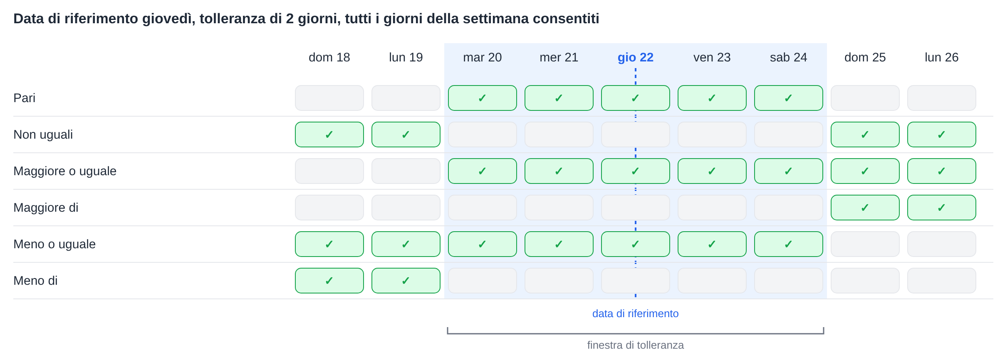
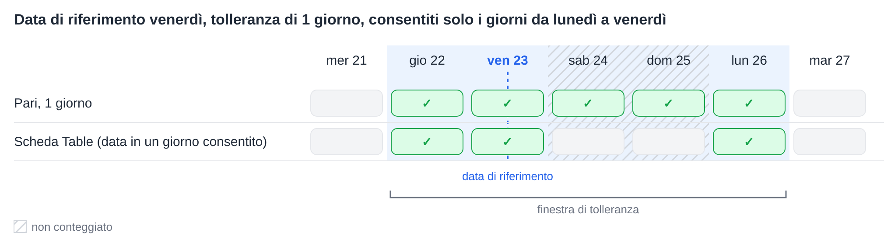
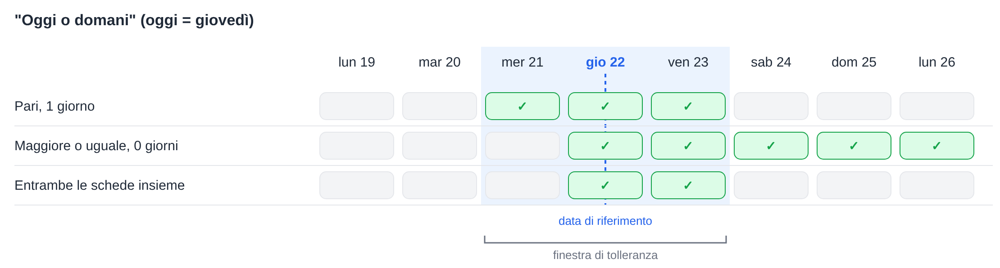

# Tolleranze di data

Diverse schede del workflow confrontano una data con una data di riferimento e accettano una tolleranza di un certo numero di giorni. Tutte calcolano la tolleranza nello stesso modo. Questa pagina spiega tale calcolo, il significato di ciascun operatore, il funzionamento dei **Giorni di tolleranza consentiti** e come combinare due schede per intervalli come "oggi o domani".

Le schede che utilizzano questo calcolo:

* [Table Date to Current Date](table/table-date-to-current-date.md) – una data in una tabella del documento confrontata con la data corrente.
* [Promised delivery date for line items in table with promised delivery date](compare-with-purchase-order/promised-delivery-date-for-line-items-in-table-with-promised-delivery-date/README.md) – le date di consegna promesse delle righe confrontate con la data corrente.
* [Promised Delivery Date on Purchase Order](compare-with-purchase-order/promised-delivery-date-on-purchase-order.md) – le date di consegna delle righe confrontate con la data di consegna dell'ordine di acquisto.

## La finestra di tolleranza

A partire dalla data di riferimento, la tolleranza viene contata all'indietro e in avanti. Il risultato è una **finestra di tolleranza**: dalla data di inizio alla data di fine, entrambe incluse.

* Con una tolleranza di **0 giorni**, la finestra comprende solo la data di riferimento stessa.
* Con una tolleranza di **2 giorni**, la finestra si estende da 2 giorni prima a 2 giorni dopo la data di riferimento.
* La **data corrente** è la data sui server DocBits, che funzionano in **UTC**.

Ogni operatore confronta la data con questa finestra:

| Operatore | Vero quando la data è … |
|---|---|
| **Pari** | all'interno della finestra |
| **Non uguali** | al di fuori della finestra |
| **Maggiore o uguale** | uguale o successiva all'**inizio** della finestra |
| **Maggiore di** | successiva alla **fine** della finestra |
| **Meno o uguale** | uguale o precedente alla **fine** della finestra |
| **Meno di** | precedente all'**inizio** della finestra |

Va notato che la tolleranza amplia anche **Maggiore o uguale** e **Meno o uguale**: con 2 giorni, **Maggiore o uguale** accetta già una data di 2 giorni precedente alla data di riferimento.

<figure><figcaption>
Data di riferimento giovedì 22, tolleranza di 2 giorni: la finestra va da martedì 20 a sabato 24.
</figcaption></figure>

## Giorni di tolleranza consentiti

Le schede che offrono **Giorni di tolleranza consentiti** contano solo i giorni della settimana selezionati quando calcolano la finestra. I giorni della settimana non selezionati vengono saltati nel conteggio, ma restano all'interno della finestra.

**Esempio:** data di riferimento venerdì, tolleranza di 1 giorno, solo i giorni da lunedì a venerdì selezionati. Contando all'indietro si arriva a giovedì. Contando in avanti si saltano sabato e domenica e si arriva a lunedì. La finestra va **da giovedì a lunedì**.

**Table Date to Current Date** aggiunge un'ulteriore verifica: anche la data nella tabella dovrebbe cadere in uno dei giorni della settimana selezionati. Un sabato all'interno della finestra non viene quindi accettato da questa scheda. Le altre due schede non prevedono questa verifica aggiuntiva.

<figure><figcaption>
Vengono contati solo i giorni da lunedì a venerdì, quindi 1 giorno dopo venerdì è lunedì.
</figcaption></figure>

## Esempio: oggi o domani

Una singola scheda non può accettare esattamente "oggi o domani", perché la finestra si estende sempre dello stesso numero di giorni in entrambe le direzioni. Due schede in sequenza invece possono farlo:

1. **Pari** con una tolleranza di **1 giorno** accetta ieri, oggi e domani.
2. **Maggiore o uguale** con una tolleranza di **0 giorni** accetta oggi e ogni giorno successivo.

Restano solo le date che superano entrambe le schede: **oggi e domani**.

<figure><figcaption>
Oggi è giovedì 22: insieme, le due schede accettano giovedì 22 e venerdì 23.
</figcaption></figure>

Allo stesso modo è possibile costruire altri intervalli:

| Intervallo | Prima scheda | Seconda scheda |
|---|---|---|
| Oggi o domani | **Pari**, 1 giorno | **Maggiore o uguale**, 0 giorni |
| Ieri o oggi | **Pari**, 1 giorno | **Meno o uguale**, 0 giorni |
| Da oggi fino a 3 giorni dopo | **Pari**, 3 giorni | **Maggiore o uguale**, 0 giorni |
| Non oggi | **Non uguali**, 0 giorni | – |
| Da dopodomani | **Maggiore di**, 1 giorno | – |

Quando come **Giorni di tolleranza consentiti** sono selezionati solo i giorni da lunedì a venerdì, "domani" di venerdì corrisponde al lunedì successivo.

## Conclusione

Tutte le schede di data con una tolleranza utilizzano un'unica finestra attorno alla data di riferimento. Sapere dove inizia e dove finisce la finestra chiarisce che cosa accetta ciascun operatore, e due schede insieme possono coprire intervalli che una sola scheda non può coprire.
