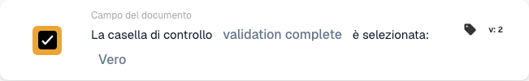

# La casella di controllo è selezionata

## Quando e dove usare questa scheda

Usa questa condizione quando un'azione successiva dipende da una casella di controllo del documento. Ad esempio, consenti a una fattura di proseguire solo dopo che il relativo indicatore di verifica è stato selezionato.

Nell'editor del workflow, aggiungi la scheda sotto **E… → Campo del documento**. La scheda confronta il valore del campo quando viene eseguito il workflow; non monitora continuamente un campo dell'ERP e non modifica la casella.

## Prerequisiti

Il tipo di documento deve contenere un campo booleano per questa casella. Usa il suo identificatore tecnico esatto. Questo esempio usa `validation_complete`; sostituiscilo con il campo corrispondente della tua organizzazione.

## Configurare la scheda

1. Scegli **La casella di controllo … è selezionata** in **Campo del documento**.
2. Inserisci `validation_complete` in **Nome campo** e conferma il valore.
3. Seleziona **Vero** in **Booleano** per richiedere una casella selezionata. Seleziona **Falso** per verificare che non sia selezionata.

## Esempio pratico: proseguire dopo la verifica

**Quando usarla:** una fattura richiede una verifica preliminare e il processo ne registra il completamento in `validation_complete`.

**Dove inserirla:** nelle condizioni sotto **E…**, prima dell'azione successiva configurata in **Poi…**. Configura separatamente questa azione e l'evento che avvia il workflow.

**Configurazione dell'esempio:** campo `validation_complete`, confronto **Vero** (`true`), scheda versione 2.

<figure><figcaption>
Esempio con la versione 2: validation complete confrontato con Vero.
</figcaption></figure>

I risultati attesi per questa configurazione sono:

| Valore del campo nel documento | Risultato della condizione |
| --- | --- |
| Casella esistente e selezionata (`true`) | La condizione è soddisfatta. |
| Casella esistente e non selezionata (`false`) | La condizione non è soddisfatta. |
| Casella esistente con un valore vuoto (`None`) | Considerata non selezionata; la condizione non è soddisfatta. |
| Campo assente dal documento | `NOT_FOUND_IN_DOCUMENT`; questo caso è diverso da una casella esistente non selezionata. |

Se scegli **Falso**, una casella esistente non selezionata soddisfa la condizione e una casella selezionata non la soddisfa. Un campo assente continua a produrre un risultato di errore distinto.

## Verificare prima dell'attivazione

Verifica che il campo scelto sia booleano e appartenga al tipo di documento utilizzato. Prova un documento con la casella selezionata, uno con la casella non selezionata e un documento in cui il campo sia assente. Controlla il risultato della scheda e il percorso successivo del workflow in ogni caso.

Questa scheda verifica lo stato della casella; il processo precedente deve impostare l'indicatore di verifica. Selezionarlo automaticamente senza eseguire la verifica non dimostra che la verifica sia stata effettuata.
