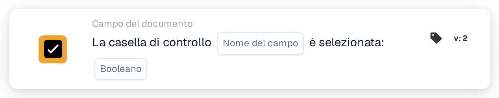

# La casella di controllo è selezionata

<figure><figcaption>
Versione 2
</figcaption></figure>

## Scopo:

Questa scheda del workflow verifica se un campo casella di controllo del documento è selezionato o non selezionato. Può essere utilizzata per far proseguire un workflow solo dopo che sul documento è stato impostato un contrassegno, ad esempio un contrassegno di revisione.

## Componenti della scheda:

1. **Nome del campo**
   * **Descrizione:** Il nome tecnico del campo casella di controllo del documento.
   * **Dettaglio:** Il campo dovrebbe essere un campo casella di controllo (booleano) del tipo di documento.
2. **Booleano**
   * **Descrizione:** Lo stato che la casella di controllo dovrebbe avere.
   * **Opzioni:**
     * **Vero:** La casella di controllo dovrebbe essere selezionata.
     * **Falso:** La casella di controllo dovrebbe essere non selezionata.

## Funzionalità:

* **Valutazione della condizione:** Quando il workflow raggiunge la scheda, questa legge il valore attuale del campo sul documento e lo confronta con **Booleano**. La scheda non sorveglia il campo nel tempo e non lo modifica.
  * Un valore vuoto della casella di controllo conta come non selezionato.
  * Se non è selezionato alcun valore in **Booleano**, la scheda verifica che la casella di controllo non sia selezionata.
  * Se il campo non è un campo casella di controllo, la scheda lo annota nel log del workflow e confronta comunque il suo valore.
* **Esecuzione dell'azione:**
  * **Condizione vera:**\
    Se lo stato della casella di controllo corrisponde a **Booleano**, il workflow prosegue con le schede successive.
  * **Condizione falsa:**\
    Se non corrisponde, il workflow si ferma con una condizione non soddisfatta.
* **Dati mancanti:** Se il campo non esiste sul documento, la scheda non valuta la condizione. Segnala che il campo non è stato trovato sul documento, che è un risultato diverso da una casella di controllo non selezionata.

## Configurazione e impostazione:

* La scheda può essere aggiunta come condizione And dalla categoria **Campo del documento**. Successivamente si inserisce il nome tecnico del campo casella di controllo in **Nome del campo** e si seleziona **Vero** o **Falso**.
* Per verificare la configurazione è possibile utilizzare **Scheda di prova** nel menu della scheda del Workflow Builder su un documento con la casella selezionata, uno con la casella non selezionata e uno senza il campo.

## Conclusione:

La scheda del workflow "Checkbox is checked" trasforma una casella di controllo del documento in una condizione del workflow. In questo modo un workflow può attendere un passaggio manuale, come una revisione completata, prima che vengano eseguite le azioni successive.
