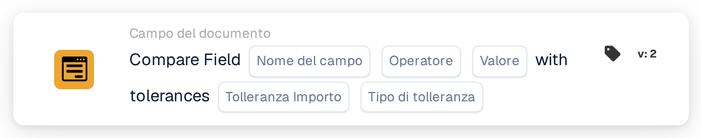

# Confronta il campo con le tolleranze

<figure><figcaption>
Versione 2
</figcaption></figure>

## Quando utilizzare questa scheda

Utilizzare questa condizione per confrontare un campo numerico del documento con un riferimento fisso, ammettendo uno scostamento definito. Ad esempio, un importo totale può corrispondere al riferimento 100 se la differenza non supera 5.

## Dove trovarla

Nel designer dei workflow standard, aggiungere una scheda in **E**, aprire **Campo del documento** e selezionare il confronto di un campo con riferimento e tolleranze. L'esempio seguente utilizza la versione 2.

## Impostazioni

Utilizzare un campo numerico configurato nell'organizzazione. Valore del campo, riferimento e tolleranza sono valutati numericamente. Utilizzare unità coerenti.

| Impostazione | Significato |
| --- | --- |
| Nome del campo | Il campo configurato, ad esempio `total_amount`. |
| Operatore | Il confronto: `eq`, `neq`, `gt`, `ge`, `lt` o `le`. |
| Valore di riferimento | Il numero fisso con cui confrontare il campo. |
| Tolleranza | Lo scostamento numerico consentito. |
| Tipo di tolleranza | **Valore** (`value`) per un importo assoluto oppure **Percentuale** (`percent`) per uno scostamento relativo. |

Con un riferimento positivo di 200, una tolleranza percentuale di 5 consente uno scostamento di 10. Una tolleranza assoluta di 5 consente invece uno scostamento di 5. Verificare i casi limite per l'operatore e i valori scelti.

## Come la tolleranza modifica il confronto

Con riferimento **100** e tolleranza assoluta **5**, il limite inferiore è **95** e quello superiore è **105**.

| Operatore | La condizione è soddisfatta quando il valore del campo… |
| --- | --- |
| `eq` (=) | È compreso tra 95 e 105, inclusi entrambi i limiti. |
| `neq` (≠) | È inferiore a 95 oppure superiore a 105. |
| `gt` (>) | È superiore a 105. |
| `ge` (≥) | È almeno 95. |
| `lt` (<) | È inferiore a 95. |
| `le` (≤) | È al massimo 105. |

La scheda restituisce il risultato di una condizione. I passaggi successivi dipendono dal trigger, dalle altre condizioni e dalle azioni configurate nel workflow.

<!-- workflow-card-complete-example-20261021 condition_docfield_operator_value_tolerances -->

## Esempio pratico

1. Selezionare il campo numerico configurato **Importo totale** (`total_amount`).
2. Selezionare **Pari** (`eq`).
3. Inserire riferimento **100** e tolleranza **5**.
4. Selezionare il tipo di tolleranza **Valore** (`value`).

| Valore del campo | Differenza assoluta rispetto a 100 | Risultato atteso |
| --- | --- | --- |
| 103 | 3 | Condizione soddisfatta. |
| 110 | 10 | Condizione non soddisfatta. |
| 95 o 105 | 5 | Condizione soddisfatta: il confronto di uguaglianza include i limiti di tolleranza. |

Si tratta di risultati di calcolo attesi per una configurazione di esempio. Non è stato eseguito alcun workflow per questo esempio.

## Prima di attivare la regola

Verificare un caso corrispondente, uno non corrispondente e i limiti con dati di prova adeguati. Esaminare separatamente campi mancanti, valori non numerici ed errori di configurazione. Nel registro di esecuzione controllare i valori, l'operatore, la tolleranza e il risultato effettivamente utilizzati.

Se entrambi gli importi provengono da campi del documento, utilizzare la scheda separata per il [confronto di due campi con tolleranza](compare-two-fields-with-tolerance.md).
