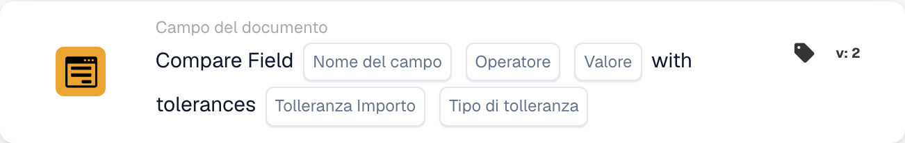

# Confronta il campo con le tolleranze

<figure><figcaption>
Campi della scheda nella versione visualizzata. I campi non sono ancora configurati. Alcune etichette dell’interfaccia di questa versione sono ancora in inglese o tradotte in modo non corretto. Le spiegazioni di questa pagina sono tradotte; l’immagine mostra l’interfaccia reale.
</figcaption></figure>

## **Scopo:**

Questa scheda di workflow è progettata per confrontare il valore di un campo con un valore di riferimento specificato, consentendo l'applicazione di tolleranze. Permette un'elaborazione condizionale precisa nei workflow in cui sono accettabili piccole deviazioni, rendendola ideale per scenari come l'assicurazione qualità, l'analisi finanziaria o le azioni basate su soglie.

## **Componenti della scheda:**

1. **Nome campo**
   * **Descrizione:** Il campo da valutare nel confronto.
   * **Dettaglio:** Deve corrispondere all'identificatore esatto del primo campo all'interno del documento.
2. **Operatore di confronto**
   * **Descrizione:** Specifica come il valore del campo selezionato verrà confrontato con il valore di riferimento.
   * **Opzioni:**
     * **Uguale (=):** Verifica se il valore del campo corrisponde esattamente al valore di riferimento.
     * **Diverso (≠):** Verifica se il valore del campo non corrisponde al valore di riferimento.
     * **Maggiore di (>):** Verifica se il valore del campo è maggiore del valore di riferimento.
     * **Maggiore o uguale (≥):** Verifica se il valore del campo è maggiore o uguale al valore di riferimento.
     * **Minore di (<):** Verifica se il valore del campo è minore del valore di riferimento.
     * **Minore o uguale (≤):** Verifica se il valore del campo è minore o uguale al valore di riferimento.
3. **Valore di riferimento**
   * **Descrizione:** Il valore con cui viene confrontato il campo.
   * **Dettaglio:** Questo valore può essere numerico, testuale o basato su date, a seconda del contesto del confronto.
4. **Importo di tolleranza**
   * **Descrizione:** Definisce il margine di errore accettabile per il confronto.
   * **Dettaglio:** La quantità di tolleranza è un valore numerico che indica la differenza massima ammissibile tra i due valori dei campi affinché il confronto sia considerato vero.
5. **Tipo di tolleranza**
   * **Descrizione:** Specifica l'unità di misura per la quantità di tolleranza.
   * **Opzioni:**
     * **Valore:** La tolleranza è un valore assoluto, ovvero i due campi possono differire della quantità di tolleranza specificata.
     * **Percent:** La tolleranza è calcolata come percentuale del valore del secondo campo, consentendo un margine di errore relativo.

## **Funzionalità:**

* **Valutazione della condizione:** Il sistema valuta il valore del campo rispetto al valore di riferimento utilizzando l'operatore di confronto selezionato. Se è configurata una tolleranza, il sistema considera il confronto riuscito se il valore del campo rientra nell'intervallo di tolleranza definito.
* **Esecuzione dell'azione:**
  * **Entro la tolleranza:** Se il valore del campo soddisfa la condizione entro la tolleranza specificata, il workflow prosegue, attivando le azioni associate.
  * **Fuori dalla tolleranza:** Se il valore del campo non soddisfa la condizione o ricade al di fuori dell'intervallo di tolleranza, possono essere eseguite azioni alternative, come la registrazione di log, l'invio di avvisi o l'arresto del workflow.

## **Configurazione e impostazione:**

* Gli utenti configurano la scheda selezionando il campo da valutare da un elenco di campi disponibili e scegliendo l'operatore di confronto (es. equals, greater than) da un menu a discesa. Quindi specificano il valore di riferimento con cui effettuare il confronto e definiscono la quantità di tolleranza, dopodiché selezionano il tipo di tolleranza (es. percent o value).

## **Conclusione:**

La scheda "Field Comparison with Tolerances" è uno strumento versatile per i workflow che richiedono valutazioni flessibili. Consentendo confronti con tolleranze, garantisce che i workflow rimangano efficienti e adattabili, accogliendo le variazioni del mondo reale senza compromettere l'accuratezza.

<!-- workflow-card-complete-example-20261021 condition_docfield_operator_value_tolerances -->

### Esempio di tolleranza del valore di riferimento

**Configurazione:** Scegli il campo numerico del documento `total_amount`, uguaglianza, valore di riferimento `100`, tolleranza assoluta `5` e tipo di tolleranza Valore.

**Risultato atteso e controesempio:** Con il valore `103`, la condizione è vera perché la differenza rientra nella tolleranza consentita. Con il valore `110`, la condizione è falsa perché la differenza supera tale tolleranza. Questa scheda confronta un campo con un valore di riferimento configurato. Utilizzare la carta separata a due campi quando entrambi i lati devono provenire dai campi del documento. I dati mancanti o non numerici richiedono un'indagine, non una corrispondenza presunta.

Questa è una configurazione di test illustrativa e il risultato atteso; non è stato eseguito. Utilizza dati e destinatari configurati nella tua organizzazione di test.
