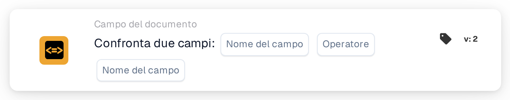

# Confronta due campi

<figure><figcaption>
Versione 2
</figcaption></figure>

## **Scopo:**

Questa scheda di workflow è progettata per automatizzare le azioni confrontando i valori di due campi del documento specificati. Consente un processo decisionale dinamico in base ai dati dei campi e garantisce che i workflow vengano eseguiti in base ai confronti tra i diversi valori del documento.

## **Componenti della scheda:**

1. **Nome campo (1)**
   * **Descrizione:** Specifica il primo campo del documento da confrontare.
   * **Dettaglio:** Deve corrispondere all'identificatore esatto del primo campo all'interno del documento.
2. **Operatore**
   * **Descrizione:** Definisce il tipo di confronto da eseguire tra i due campi.
   * **Opzioni:**
     * **Uguale (=):** Verifica se i valori dei due campi sono uguali.
     * **Diverso (≠):** Garantisce che i valori dei due campi siano diversi.
     * **Maggiore di (>):** Conferma che il valore del primo campo sia maggiore del secondo campo.
     * **Maggiore o uguale (≥):** Verifica che il valore del primo campo sia uguale o maggiore del secondo campo.
     * **Minore di (<):** Verifica se il valore del primo campo è minore del secondo campo.
     * **Minore o uguale (≤):** Garantisce che il valore del primo campo sia minore o uguale al secondo campo.
3. **Nome campo (2)**
   * **Descrizione:** Specifica il secondo campo del documento da confrontare con il primo campo.
   * **Dettaglio:** Deve corrispondere all'identificatore esatto del secondo campo all'interno del documento.

## **Funzionalità:**

**Valutazione della condizione:** Il sistema valuta se i valori nei due campi specificati soddisfano la condizione di confronto definita dall'operatore.

**Esecuzione dell'azione:**

* **Condizione vera:**\
  Se i valori dei due campi soddisfano la condizione di confronto, il sistema attiva le azioni associate. Queste azioni potrebbero includere l'aggiornamento di record o l'attivazione di avvisi.
* **Condizione falsa:**\
  Se i valori dei due campi non soddisfano la condizione specificata, possono essere eseguite azioni alternative o nessuna azione, a seconda della configurazione dei workflow.

## **Configurazione e impostazione:**

* Gli utenti configurano la scheda selezionando i due campi da confrontare da un elenco di campi disponibili nel sistema. L'operatore viene selezionato da un menu a discesa di opzioni di confronto disponibili.

## **Conclusione:**

La scheda di workflow "Compare Two Fields" è uno strumento essenziale per confrontare i dati tra i campi all'interno dei documenti. Automatizzando le azioni in base ai confronti dei campi, questa scheda aiuta a ottimizzare il processo decisionale, supporta la validazione dei dati e potenzia l'automazione del workflow.

<!-- workflow-card-practical-example-20261021 -->

## Esempio pratico

**Quando usarlo:** Verificare che un riferimento copiato sia uguale al riferimento originale.

**Configurazione:** Seleziona i campi di testo `purchase_order_number` e `confirmed_order_number` e l'operatore uguale.

**Risultato atteso e controesempio:** I valori `PO-DEMO-001` e `PO-DEMO-001` passano. Un secondo valore di `PO-DEMO-002` fallisce.

Questa è una configurazione illustrativa e il risultato atteso. Utilizza campi, utenti e gruppi configurati nella tua organizzazione di test; non si afferma che questo esempio sia stato eseguito.
