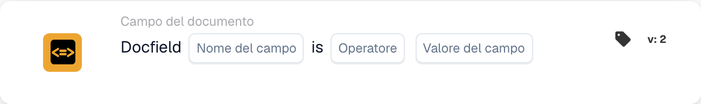

# Confrontare un campo documento con un valore di riferimento

<figure><figcaption>
Campi della scheda nella versione visualizzata. I campi non sono ancora configurati.
</figcaption></figure>

## **Scopo:**

Questa scheda di workflow è progettata per automatizzare le azioni confrontando il valore di un campo del documento specificato con un valore o una condizione di riferimento. Garantisce un processo decisionale dinamico e accurato nei workflow basato sulla validazione dei dati del documento.

## **Componenti della scheda:**

1. **Nome campo**
   * **Descrizione:** Specifica il nome del campo del documento da valutare.
   * **Dettaglio:** Deve corrispondere all'identificatore esatto del campo all'interno del documento.
2. **Operatori**
   * **Descrizione:** Definisce il tipo di confronto da eseguire tra il valore del campo e il valore di riferimento.
   * **Opzioni:**
     * **Uguale (=):** Verifica se il valore del campo corrisponde al valore di riferimento.
     * **Diverso (≠):** Garantisce che il valore del campo sia diverso dal valore di riferimento.
     * **Maggiore di (>):** Conferma che il valore del campo sia maggiore del valore di riferimento.
     * **Maggiore o uguale (≥):** Verifica che il valore del campo sia uguale o maggiore del valore di riferimento.
     * **Minore di (<):** Verifica se il valore del campo è minore del valore di riferimento.
     * **Minore o uguale (≤):** Garantisce che il valore del campo sia minore o uguale al valore di riferimento.

## **Funzionalità:**

* **Valutazione della condizione:** Il sistema verifica se il valore del campo del documento, in relazione alla colonna associata, soddisfa la condizione di confronto specificata dall'operatore e dal valore di riferimento.
* **Esecuzione dell'azione:**
  * **Condizione vera:**\
    Se il valore del campo del documento soddisfa la condizione specificata (es. è uguale al valore di riferimento), il sistema attiva le azioni associate. Queste potrebbero includere l'aggiornamento di record, l'avanzamento del workflow o la generazione di notifiche.
  * **Condizione falsa:**\
    Se il valore del campo del documento non soddisfa la condizione specificata, vengono eseguite azioni alternative o nessuna azione, in base alla configurazione del workflow.

## **Configurazione e impostazione:**

* L'utente seleziona il nome del campo del documento pertinente e sceglie l'operatore dal menu a discesa. L'utente specifica quindi il valore del campo di riferimento per completare la configurazione.

## **Conclusione:**

La scheda di workflow "DocField Comparison Validation" è uno strumento robusto per l'elaborazione dinamica dei documenti. Automatizzando le azioni in base ai confronti dei campi, questa scheda semplifica i workflow, migliora l'accuratezza e supporta un processo decisionale basato sui dati.

<!-- workflow-card-practical-example-20261021 -->

## Esempio pratico

**Quando utilizzarlo:** Revisione delle fatture superiori a un importo definito.

**Configurazione:** Selezionare il campo numerico `net_total`, l'operatore `>` e il valore di riferimento `1000`.

**Risultato atteso e controesempio:** Passa un valore di `1200`. `1000` e `900` falliscono perché il confronto è strettamente maggiore di.

Questa è una configurazione illustrativa e il risultato atteso. Utilizza campi, utenti e gruppi configurati nella tua organizzazione di test; non si afferma che questo esempio sia stato eseguito.
