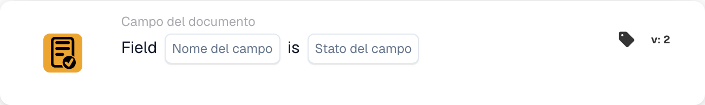

# Verificare la presenza e il contenuto di un campo

<figure><figcaption>
Campi della scheda nella versione visualizzata. I campi non sono ancora configurati.
</figcaption></figure>

## Quando usarla

Usare questa scheda per verificare se un campo del documento è vuoto o assente, ad esempio quando una fattura senza numero richiede un controllo aggiuntivo. Si tratta di una condizione; configurare separatamente l’azione successiva.

**Posizione:** Workflow standard → condizioni aggiuntive (AND) → Campo del documento.

## Configurazione — versione 2

| Impostazione | Valore di esempio |
| --- | --- |
| Campo | `invoice_id` — numero di fattura |
| Stato del campo | Vuoto o assente (`field_empty`) |

Selezionare un campo realmente configurato nella propria organizzazione. L’opzione `field_not_empty` verifica se il campo contiene un valore.

<!-- workflow-card-practical-example-20261021 -->

## Esempio pratico

| Valore di esempio | Risultato atteso per `field_empty` |
| --- | --- |
| Campo vuoto o assente | Condizione soddisfatta |
| `DEMO-001` | Condizione non soddisfatta |
| Numero presente ma errato | Condizione non soddisfatta — il campo contiene ancora un valore |

Gli esempi mostrano risultati attesi. Per verificare la validità del numero stesso, aggiungere una condizione adatta al contenuto; questa scheda controlla lo stato del campo. Nella versione 2, gli spazi iniziali e finali vengono rimossi dal testo prima di verificare se il campo è vuoto. Alcune etichette dell’interfaccia sono ancora in inglese nella versione mostrata.

## Video di esempio con un amministratore

Quando uso questa scheda, dove trovarla e come individuare i numeri di fattura mancanti. Gli esempi mostrano i risultati attesi.



[Apri il video con sottotitoli italiani](https://docbits-videos.fra1.cdn.digitaloceanspaces.com/settings-assistant/workflow-card-field-status-admin/v1/it.html)

[Leggi la trascrizione](https://docbits-videos.fra1.cdn.digitaloceanspaces.com/settings-assistant/workflow-card-field-status-admin/v1/it.txt)
