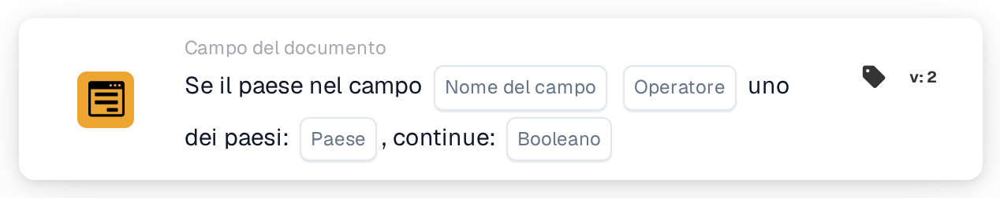

# Se il Paese nel campo è Uno di

<figure><figcaption>
Versione 2
</figcaption></figure>

Utilizzare questa condizione quando un passaggio di elaborazione aggiuntivo deve applicarsi ai documenti di determinati paesi, ad esempio Germania e Francia. La scheda confronta il paese letto da un campo del documento con un elenco di paesi configurato.

**Posizione:** Workflow standard → condizioni aggiuntive (AND) → Campo del documento. Configurare separatamente l’azione successiva in THEN.

## Configurazione — versione 2

| Impostazione | Valore |
| --- | --- |
| Campo | Un campo di testo esistente contenente il nome del paese |
| Operatore | `is` |
| Paesi | `Germany, France` |
| Valore di continuazione | `true` |

<!-- workflow-card-practical-example-20261021 -->

## Esempio pratico

| Valore del paese nel campo | Condizione attesa |
| --- | --- |
| `Germany` | Soddisfatta |
| `France` | Soddisfatta |
| `United States` | Non soddisfatta |

I nomi dei paesi mostrati come codice sono valori di input fissi per questo esempio.

## Limiti e verifiche

`false` non inverte il confronto. Con questa impostazione, nemmeno un paese corrispondente produce una condizione positiva. Per verificare la condizione opposta, selezionare `isnot` con `true`.

Gestire separatamente i campi mancanti e i valori di paese vuoti: possono restituire un risultato di dati mancanti anziché una normale mancata corrispondenza.

L’esame del codice sorgente della versione di sviluppo del 22 ottobre 2026 mostra un errore di conversione per input ISO come `DE` e `DEU`. Questi esempi utilizzano quindi nomi di paesi completi. Verificare separatamente la gestione dei codici ISO nella versione installata.
