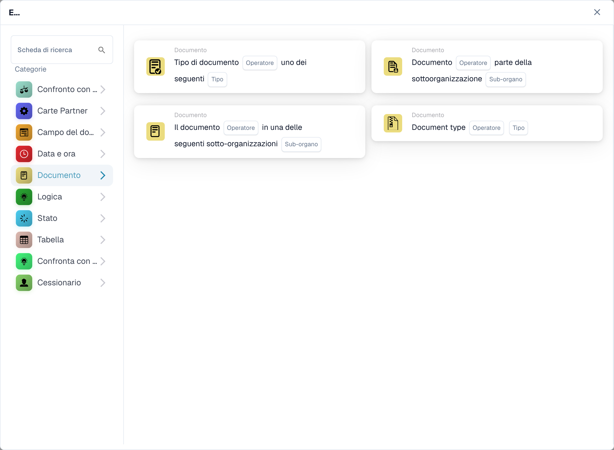
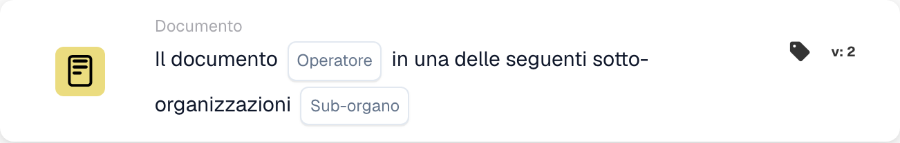

# Documento

Le schede di questa categoria nel selettore **Aggiungi carta** del Workflow Builder:

<figure><figcaption>
Schede disponibili nella categoria selezionata. Configurare i campi prima dell’uso. Alcune etichette dell’interfaccia di questa versione sono ancora in inglese o tradotte in modo non corretto. Le spiegazioni di questa pagina sono tradotte; l’immagine mostra l’interfaccia reale.
</figcaption></figure>

<!-- workflow-card-example-condition_sub_org_is_isnot_in_list-20261021 -->

### Documento in una delle numerose organizzazioni secondarie

<figure><figcaption>
Campi della scheda nella versione visualizzata. I campi non sono ancora configurati.
</figcaption></figure>

`CONDITION_SUB_ORG_IS_ISNOT_IN_LIST` · versione 2

Selezionare è una delle organizzazioni secondarie configurate `Demo North` e `Demo South`. Passa un documento appartenente ad una delle unità selezionate; `Demo Default` fallisce. Questo controlla la sottoorganizzazione del documento; non lo cambia.
