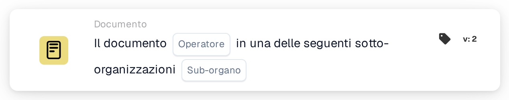

# Operatore documentale per le sotto-organizzazioni uno di

<figure><figcaption>
Versione 2
</figcaption></figure>

## Scopo:

Questa scheda del workflow verifica se un documento appartiene a una tra più sotto-organizzazioni. Invece di confrontare il documento con una sola sotto-organizzazione, lo confronta con un elenco: così una sola scheda copre un intero gruppo di sotto-organizzazioni che devono essere gestite allo stesso modo. In base al risultato, il workflow prosegue con la condizione vera o con quella falsa.

Per il confronto con una sola sotto-organizzazione è possibile utilizzare la scheda **Document Operator for Sub-Organizations**.

## Componenti della scheda:

1. **Operator**
   * **Descrizione:** Definisce se il documento dovrebbe appartenere a una delle sotto-organizzazioni indicate o a nessuna di esse.
   * **Opzioni:**
     * **Is:** La condizione è vera se la sotto-organizzazione del documento è una di quelle indicate.
     * **Is Not:** La condizione è vera se la sotto-organizzazione del documento non è nell'elenco.
2. **Sub-org**
   * **Descrizione:** L'elenco delle sotto-organizzazioni con cui viene confrontato il documento.
   * **Dettaglio:** È possibile selezionare una o più sotto-organizzazioni dell'organizzazione. Viene confrontata la sotto-organizzazione a cui è assegnato il documento.

## Funzionalità:

* **Valutazione della condizione:** Il sistema legge la sotto-organizzazione del documento e verifica se è una di quelle selezionate sulla scheda.
* **Esecuzione dell'azione:**
  * **Condizione vera:**\
    Con **Is** la sotto-organizzazione del documento è nell'elenco, con **Is Not** non lo è. Il workflow prosegue con la condizione vera, ad esempio per inoltrare il documento al team responsabile di queste sotto-organizzazioni o applicare regole valide solo per loro.
  * **Condizione falsa:**\
    Se la condizione non è soddisfatta, il workflow prosegue con la condizione falsa, ad esempio per applicare regole generali o inoltrare il documento altrove.
* **Dati mancanti:** Se il documento non è assegnato ad alcuna sotto-organizzazione, o sulla scheda non è selezionata alcuna sotto-organizzazione, la scheda non valuta la condizione. Segnala i dati mancanti nel log del workflow invece di proseguire con la condizione falsa.

## Configurazione e impostazione:

* La scheda può essere aggiunta dalla categoria **Documento**. Poi è possibile scegliere l'operatore (**Is** o **Is Not**) e, nel campo **Sub-org**, le sotto-organizzazioni da verificare. Infine si imposta la condizione di prosecuzione (vera o falsa), che determina il passo successivo del workflow.

## Conclusione:

La scheda del workflow "Document Operator for Sub-Organizations one of" permette a una sola condizione di coprire più sotto-organizzazioni contemporaneamente. In questo modo i workflow restano brevi quando più sotto-organizzazioni condividono le stesse regole di elaborazione, e i documenti vengono gestiti nel contesto organizzativo corretto.
