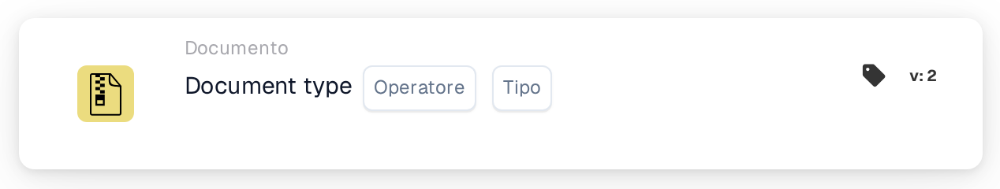

# Tipo di documento

<figure><figcaption>
Versione 1
</figcaption></figure>

<figure><figcaption>
Versione 2
</figcaption></figure>

## Scopo:

Questa scheda di workflow è progettata per valutare se un documento corrisponde a un tipo specifico. Verificando se il documento corrisponde al tipo indicato, i workflow possono proseguire o intraprendere azioni alternative in base a questa condizione. Ciò aiuta ad automatizzare i processi in cui il tipo di documento determina i passaggi successivi del workflow.

## Componenti della scheda:

1. **Operatore**
   * **Descrizione**: Definisce se il documento debba o meno essere del tipo specificato.
   * **Opzioni**:
     * **Is**: Il documento deve corrispondere al tipo specificato affinché la condizione sia vera.
     * **Non lo è**: Il documento non deve corrispondere al tipo specificato affinché la condizione sia vera.
2. **Tipo**
   * **Descrizione**: Specifica il tipo di documento con cui effettuare il confronto.
   * **Dettaglio**: Comprende una varietà di tipi di documento come "Invoice", "Purchase Order", ecc., in base ai quali verrà valutata la condizione (is/is not).

## Funzionalità:

* **Valutazione della condizione**: Il sistema valuta se il tipo di documento nel campo specificato soddisfa la condizione definita dall'operatore. Confronta il valore del campo con il tipo di documento fornito.
* **Esecuzione dell'azione**:
  * **Condizione vera**: Se il tipo di documento corrisponde al tipo specificato (o non corrisponde, in base all'operatore), il workflow prosegue con la condizione vera. Ciò può attivare azioni come l'ulteriore elaborazione del documento, l'invio per l'approvazione o l'applicazione di regole specifiche in base al tipo di documento.
  * **Condizione falsa**: Se il tipo di documento non corrisponde al tipo specificato, il workflow prosegue con la condizione falsa. Ciò può attivare azioni alternative, come l'instradamento del documento a un processo diverso o l'arresto di ulteriori azioni.

## Configurazione e impostazione:

* Gli utenti configurano la scheda selezionando il campo del documento che contiene il tipo di documento da un elenco di campi disponibili. Quindi viene selezionato l'operatore per definire se il documento debba essere del tipo specificato o meno. Infine, gli utenti impostano la condizione di continuazione (vera o falsa), che determina l'azione successiva in base al tipo di documento.

## Conclusione:

La scheda di workflow "Document Type Comparison" è essenziale per garantire che i workflow procedano in base al tipo di documento in elaborazione. Confrontando il tipo di documento, aiuta le organizzazioni ad automatizzare le attività di instradamento ed elaborazione dei documenti, garantendo che i documenti vengano gestiti in modo appropriato in base al loro tipo.

<!-- workflow-card-practical-example-20261021 -->

## Esempio pratico

**Quando utilizzarlo:** Esegui un controllo specifico della fattura.

**Configurazione:** Seleziona il tipo di documento `Invoice` e l'operatore uguale.

**Risultato atteso e controesempio:** Una fattura passa. Una nota di credito non soddisfa questa condizione.

Questa è una configurazione illustrativa e il risultato atteso. Utilizza campi, utenti e gruppi configurati nella tua organizzazione di test; non si afferma che questo esempio sia stato eseguito.
