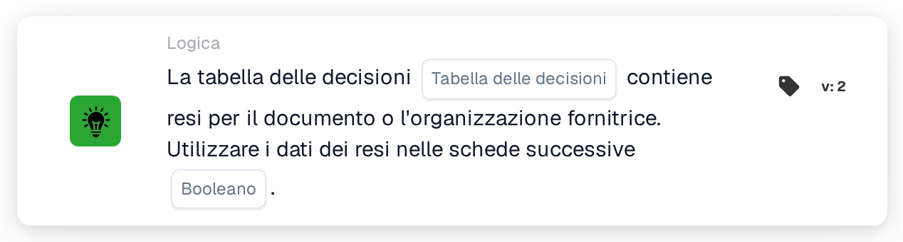
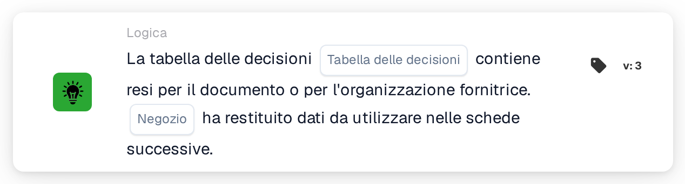

# La tabella decisionale restituisce risultati

<figure><figcaption>
Versione 2
</figcaption></figure>

<figure><figcaption>
Versione 3
</figcaption></figure>

## **Scopo:**

Questa scheda DocBits verifica se una decision table specificata restituisce valori per un determinato documento e determina se i dati restituiti debbano essere utilizzati nei passaggi successivi del workflow. Garantisce che i workflow possano adattarsi dinamicamente in base agli esiti della decision table.

## **Funzionalità:**

* **Validazione della decision table:** Questa scheda verifica se la decision table selezionata fornisce valori di ritorno per il documento in elaborazione.
* **Selezione della decision table:** Gli utenti specificano il nome della decision table da verificare.
* **Utilizzo dei dati di ritorno:** Gli utenti possono specificare se utilizzare i dati di ritorno nelle schede successive con un'impostazione **Booleano**:
  * **True:** I dati di ritorno sono disponibili e verranno utilizzati nei passaggi successivi del workflow.
  * **False:** I dati di ritorno non verranno utilizzati e il workflow procede senza di essi.

## **Utilizzo:**

Questa scheda è ideale per i workflow che coinvolgono logica condizionale o processi decisionali basati su regole predefinite in una decision table. Garantisce un'integrazione fluida degli output della decision table nei processi di workflow.

## **Scenario di esempio:**

* Un utente configura la scheda per verificare i valori di ritorno della decision table **"Regole per il trattamento delle fatture"**. Il valore **Booleano** è impostato su **True**, a indicare che i dati di ritorno (es. i requisiti di approvazione) verranno utilizzati nelle schede successive per guidare le decisioni del workflow.

Utilizzando la scheda "Decision Table Check", le organizzazioni possono migliorare la flessibilità dei workflow, semplificare l'elaborazione basata su regole e garantire coerenza nel processo decisionale tra i workflow automatizzati.
