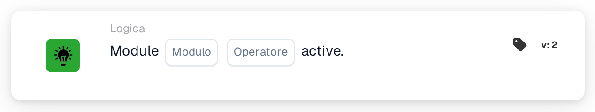

# Modulo attivo

<figure><figcaption>
Versione 2
</figcaption></figure>

## **Scopo:**

Questa scheda DocBits verifica se un modulo specifico del sistema è attivo o inattivo. Consente ai workflow di proseguire in base allo stato di attivazione di un modulo, garantendo che le azioni vengano eseguite solo se il modulo necessario è disponibile.

## **Funzionalità:**

* **Validazione dello stato del modulo:** Questa scheda verifica lo stato di attivazione di un modulo specificato e lo valuta rispetto a una condizione definita dall'utente.
* **Selezione del modulo:** Gli utenti specificano il nome del modulo da verificare, garantendo una validazione precisa.
* **Operatori:** Possono essere applicate le seguenti condizioni:
  * **Is:** Il workflow prosegue se il modulo selezionato è attivo.
  * **Non è:** Il workflow prosegue se il modulo selezionato è inattivo.

## **Utilizzo:**

Questa scheda è particolarmente utile per gli amministratori o i gestori di sistema che devono creare workflow dipendenti dalla disponibilità o dalla funzionalità di moduli specifici. Aiuta a garantire che i workflow vengano eseguiti solo quando tutti i moduli richiesti sono configurati in modo appropriato.

## **Scenario di esempio**

* Un utente configura la scheda per verificare se il modulo **"Elaborazione documenti"** **è attivo**. Se il modulo è attivo, il workflow prosegue, attivando attività automatizzate di elaborazione dei documenti. Se il modulo è inattivo, il workflow si arresta, prevenendo azioni non necessarie.

Utilizzando la scheda "Module Active Check", le organizzazioni possono migliorare l'affidabilità dei workflow, evitare errori dovuti a moduli inattivi e garantire che i processi siano allineati con la configurazione del sistema.
