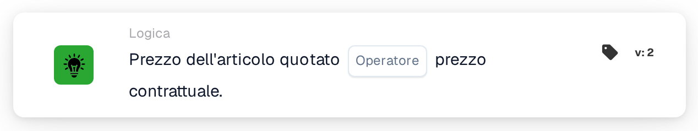
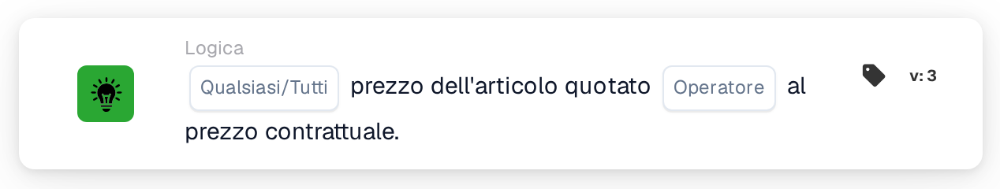

# Prezzo dell'articolo citato

<figure><figcaption>
Versione 2
</figcaption></figure>

<figure><figcaption>
Versione 3
</figcaption></figure>

## **Scopo:**

Questa scheda DocBits confronta il prezzo indicato di un articolo con il prezzo contrattato, consentendo ai flussi di lavoro di attivare azioni a seconda che i due valori corrispondano o differiscano. Aiuta a garantire la coerenza dei prezzi e il rispetto dei termini contrattuali.

## **Funzionalità:**

* **Confronto prezzi:** Questa scheda valuta se il prezzo dell'articolo quotato soddisfa la condizione specificata rispetto al prezzo contrattato.
* **Operatori:** Possono essere applicate le seguenti condizioni:
  * **Uguale (=):** Controlla se il prezzo indicato corrisponde al prezzo contrattato.
  * **Non uguale (≠):** Garantisce che il prezzo quotato sia diverso dal prezzo contrattato.

## **Utilizzo:**

Questa scheda è particolarmente utile nei flussi di lavoro di approvvigionamento, vendita o gestione dei contratti, dove è fondamentale verificare che i prezzi quotati siano allineati ai termini contrattuali concordati prima di procedere con le approvazioni o l'elaborazione degli ordini.

## **Scenario di esempio:**

* Un utente configura la carta per verificare se il prezzo quotato ** è uguale a (=)** il **prezzo contrattato**. Se i prezzi corrispondono, il flusso di lavoro procede all'approvazione; in caso contrario, attiva una notifica per la revisione manuale per risolvere la discrepanza.

Utilizzando la scheda "Prezzo articolo quotato rispetto a prezzo contrattato", le organizzazioni possono applicare politiche di prezzo, mantenere la conformità contrattuale e ridurre gli errori nelle transazioni finanziarie.

## Versione 3: Qualsiasi o tutti

La versione 3 aggiunge `match_any` e `match_all`. Qualsiasi richiede almeno una linea comparabile di successo; Tutto richiede che ogni linea confrontata soddisfi l'operatore selezionato. La versione 2 mantiene All. Una selezione non impostata su v3 viene impostata su Tutti e viene registrata. In nessuna riga comparabile mancano dati, nessuna corrispondenza riuscita. Vedi [Citare le schede di confronto](../../cards-overview/quote-comparison-guide.md) per risultati contrastanti, righe saltate e test.
