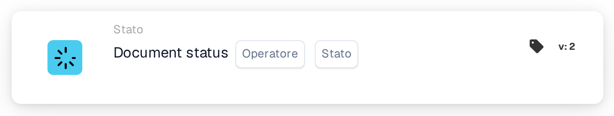

# Condizione di stato del singolo documento

<figure><figcaption>
Versione 2
</figcaption></figure>

**Scopo**

Questa scheda di workflow è concepita per gestire le operazioni sui documenti in base a un singolo stato del documento specificato. Semplificando la condizione a un solo stato, la scheda si concentra su trigger di workflow molto specifici, rendendola ideale per attività mirate di elaborazione dei documenti all'interno di un sistema ERP.

**Componenti della scheda**

1. **Operatore**
   * **Descrizione**: Specifica il metodo per valutare lo stato del documento rispetto alla condizione selezionata.
   * **Opzioni**:
     * **is**: Attiva l'operazione se lo stato corrente del documento corrisponde allo stato selezionato.
     * **non lo è**: Attiva l'operazione se lo stato corrente del documento non corrisponde allo stato selezionato.
2. **Stato**
   * **Descrizione**: Consente la selezione di un singolo stato del documento per impostare la condizione.
   * **Esempi di stati**: "Errore", "Errore di esportazione", "Pronto in validazione", "Pronto in revisione", "Approvazione in attesa", "Seconda approvazione in attesa".
   * **Dettaglio**: Gli utenti scelgono uno stato da un menu a discesa o da un set di pulsanti di opzione. Questo stato funge quindi da criterio per l'operazione della scheda.

**Funzionalità**

* **Identificazione dello stato del documento**: Identifica lo stato corrente di un documento mentre viene elaborato attraverso il sistema ERP.
* **Valutazione della condizione**:
  * In base all'operatore selezionato (`is` o `is not`), la scheda verifica se lo stato corrente del documento è allineato al criterio di stato scelto.
* **Esecuzione dell'azione**:
  * **Condizione vera**: Se lo stato corrisponde (o non corrisponde, a seconda dell'operatore), viene avviata l'azione corrispondente. Potrebbe trattarsi di instradamento per ulteriore elaborazione, generazione di notifiche o altri workflow predefiniti.
  * **Condizione falsa**: Se la condizione non è soddisfatta, non viene intrapresa alcuna azione, oppure viene attivato un percorso alternativo.
* **Integrazione con altri workflow**: Anche se è progettata per la valutazione di un singolo stato, questa scheda può essere integrata efficacemente in sequenze di workflow più ampie per garantire una gestione precisa dei documenti.

**Interazioni dell'utente**

* **Configurazione e impostazione**: Gli utenti configurano la scheda selezionando un operatore e poi scegliendo uno stato tra le opzioni disponibili. Questo processo di selezione è semplice e progettato per prevenire confusione.
* **Monitoraggio e reporting**: Consente il monitoraggio tramite report o dashboard generati dal sistema che tracciano l'elaborazione dei documenti in base al loro stato, aiutando a supervisionare l'efficacia dei workflow implementati.
* **Gestione degli errori e notifiche**: Configurabile per avvisare gli utenti di eventuali anomalie di elaborazione o per segnalare i documenti che non soddisfano le condizioni impostate, garantendo attenzione e risoluzione tempestive.

#### Conclusione

La scheda di workflow "Single Document Status Condition" semplifica la gestione dei documenti concentrandosi su singole condizioni di stato. Questa specifica è utile nei casi in cui è necessario un controllo preciso sui flussi documentali, specialmente in ambienti con criteri di elaborazione rigorosi. Documentare chiaramente questa versione della scheda garantirà che gli utenti ne comprendano appieno l'applicazione e possano integrarla efficacemente nelle operazioni quotidiane, migliorando sia la conformità che l'efficienza nell'elaborazione dei documenti.

<!-- workflow-card-complete-example-20261021 condition_doc_status_is_isnot -->

### Esempio di stato singolo

**Configurazione:** Scegli l'operatore `is` e lo stato `Pending Approval`. Aggiungi una successiva azione di revisione appropriata per quello stato.

**Risultato atteso e controesempio:** La condizione è vera per un documento attualmente `Pending Approval`; è falso per un documento con stato `Ready in Validation`. Utilizza lo stato effettivo selezionato dalla tua versione. La modifica di uno stato non comporta di per sé l'esportazione del documento.

Questa è una configurazione di test illustrativa e il risultato atteso; non è stato eseguito. Utilizza dati e destinatari configurati nella tua organizzazione di test.
