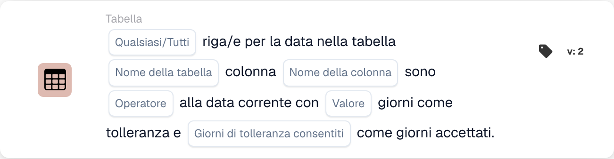

# Tabella

Le schede di questa categoria nel selettore **Aggiungi carta** del Workflow Builder:

<figure><figcaption>
Schede disponibili nella categoria selezionata. Configurare i campi prima dell’uso. Alcune etichette dell’interfaccia di questa versione sono ancora in inglese o tradotte in modo non corretto. Le spiegazioni di questa pagina sono tradotte; l’immagine mostra l’interfaccia reale.
</figcaption></figure>

<!-- workflow-card-example-condition_table_column_exists-20261021 -->

### La tabella dei documenti contiene una colonna

<figure><figcaption>
Campi della scheda nella versione visualizzata. I campi non sono ancora configurati.
</figcaption></figure>

`CONDITION_TABLE_COLUMN_EXISTS` · versione 2

Seleziona la tabella `lines`, la colonna `article_number` e l'operatore esiste. Una tabella popolata contenente quella colonna passa; la stessa tabella senza la colonna non supera il confronto tra le esistenze. Una tabella assente o vuota può produrre un risultato con dati mancanti e non è la prova di un confronto negativo riuscito.

<!-- workflow-card-example-condition_compare_table_date_to_current_date-20261021 -->

### Date in una tabella rispetto alla data di riferimento

<figure><figcaption>
Campi della scheda nella versione visualizzata. I campi non sono ancora configurati.
</figcaption></figure>

`CONDITION_COMPARE_TABLE_DATE_TO_CURRENT_DATE` · versione 2

Per la data di riferimento `2026-10-21`, confronta la tabella `lines`, la colonna `delivery_date`, successivo a, Tutti e tolleranza zero giorni. Le righe datate `2026-10-22` e `2026-10-23` soddisfano il confronto. Una riga datata `2026-10-20` fa fallire tutto. Testare separatamente le date mancanti e quelle non valide.
