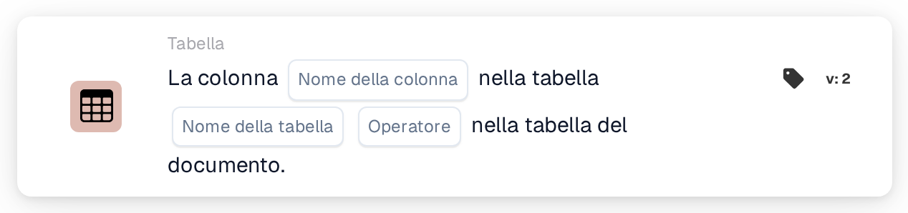

# La colonna esiste nella tabella

<figure><figcaption>
Versione 2
</figcaption></figure>

## Scopo:

Questa scheda del workflow verifica se una tabella del documento contiene una colonna specifica. Può essere utilizzata per eseguire le schede successive solo per i documenti la cui tabella contiene i dati necessari, ad esempio una colonna con la data di consegna o con il codice articolo, oppure per instradare altrove i documenti con un layout di tabella diverso. In base al risultato, il workflow prosegue con la condizione vera o con quella falsa.

## Componenti della scheda:

1. **Nome della colonna**
   * **Descrizione:** Il nome della colonna che la scheda cerca.
   * **Dettaglio:** Il nome della colonna viene confrontato senza distinguere tra maiuscole e minuscole.
2. **Nome della tabella**
   * **Descrizione:** Il nome della tabella del documento che viene verificata.
   * **Dettaglio:** Il nome della tabella viene confrontato senza distinguere tra maiuscole e minuscole.
3. **Operatore**
   * **Descrizione:** Definisce se la colonna dovrebbe essere presente nella tabella o no.
   * **Opzioni:**
     * **È:** La condizione è vera se la tabella contiene la colonna.
     * **Non è:** La condizione è vera se la tabella non contiene la colonna.

## Funzionalità:

* **Valutazione della condizione:** La scheda cerca la tabella del documento con il nome indicato e verifica se la prima riga di quella tabella ha una colonna con il nome indicato. La colonna trovata, oppure le colonne presenti al suo posto, vengono annotate nel log del workflow.
* **Esecuzione dell'azione:**
  * **Condizione vera:**\
    Con **È**, la colonna è presente nella tabella. Con **Non è**, non lo è. Il workflow prosegue con la condizione vera, ad esempio per eseguire un confronto su questa colonna.
  * **Condizione falsa:**\
    Se la condizione non è soddisfatta, il workflow prosegue con la condizione falsa.
* **Dati mancanti:** La scheda non valuta la condizione e segnala i dati mancanti nel log del workflow se sulla scheda non è impostato alcun nome di colonna o di tabella, se il documento non ha una tabella con il nome indicato, oppure se quella tabella non ha righe o la sua prima riga non ha colonne.
* **Errori:** Se non è impostato alcun operatore, o è impostato un operatore diverso da **È** o **Non è**, la scheda segnala un errore di configurazione.

## Configurazione e impostazione:

* La scheda può essere aggiunta dalla categoria **Tabella**. Successivamente è possibile impostare il nome della colonna, il nome della tabella e l'operatore (**È** o **Non è**). Infine si imposta la condizione di prosecuzione (vera o falsa), che determina il passo successivo del workflow.

## Conclusione:

La scheda del workflow "Column Exists in Table" verifica il layout di una tabella del documento prima che i suoi dati vengano utilizzati. Collocata prima di altre schede di tabella, aiuta a garantire che tali schede vengano eseguite solo sui documenti che contengono la colonna prevista.
