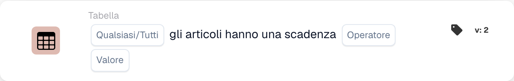

# Gli articoli hanno una durata di conservazione

<figure><figcaption>
Campi della scheda nella versione visualizzata. I campi non sono ancora configurati.
</figcaption></figure>

## **Scopo:**

Questa scheda DocBits verifica se gli articoli in un dataset soddisfano condizioni specificate in base alla loro durata di conservazione (shelf life). La scheda consente agli utenti di scegliere tra "un articolo qualsiasi" o "tutti gli articoli" per la validazione e supporta vari operatori di confronto. È ideale per gli scenari in cui le decisioni del workflow dipendono dalla durata di conservazione degli articoli, come il controllo qualità, la gestione dell'inventario o le verifiche di conformità.

## **Funzionalità:**

* **Validazione della durata di conservazione:** Questa scheda verifica la durata di conservazione degli articoli rispetto a una condizione specificata. Gli utenti possono scegliere di validare **un articolo qualsiasi** o **tutti gli articoli** del dataset e applicare vari operatori di confronto per definire la condizione.
* **Selezione degli articoli:** Gli utenti possono scegliere tra:
  * **Any Item:** La scheda si attiva se almeno un articolo soddisfa la condizione di durata di conservazione specificata.
  * **Tutti gli articoli:** La scheda si attiva solo se tutti gli articoli soddisfano la condizione di durata di conservazione specificata.
* **Operatori:** Sono disponibili i seguenti operatori per impostare la condizione di durata di conservazione:
  * **Uguale (=):** Verifica se la durata di conservazione è esattamente uguale al valore specificato.
  * **Diverso (≠):** Garantisce che la durata di conservazione non sia uguale al valore specificato.
  * **Maggiore di (>):** Conferma che la durata di conservazione sia maggiore del valore specificato.
  * **Maggiore o uguale (≥):** Garantisce che la durata di conservazione sia maggiore o uguale al valore specificato.
  * **Less Than (<):** Verifica se la durata di conservazione è minore del valore specificato.
  * **Minore o uguale (≤):** Garantisce che la durata di conservazione sia minore o uguale al valore specificato.

## **Utilizzo:**

Questa scheda è adatta ai team di controllo qualità, ai responsabili dell'inventario o ai responsabili della conformità che devono garantire che gli articoli soddisfino requisiti specifici di durata di conservazione prima di procedere con ulteriori azioni o workflow.

## **Scenario di esempio:**

* Un utente configura la scheda per verificare se **tutti gli articoli** hanno una durata di conservazione **maggiore o uguale a 30 giorni**. Se ogni articolo soddisfa questa condizione, il workflow procede, confermando che tutti gli articoli hanno una durata di conservazione sufficiente per la vendita o la distribuzione.

Utilizzando la scheda "Shelf Life Validation", le organizzazioni possono applicare standard di durata di conservazione, mantenere la qualità del prodotto e garantire l'accuratezza del workflow in base alle condizioni di durata di conservazione degli articoli.
