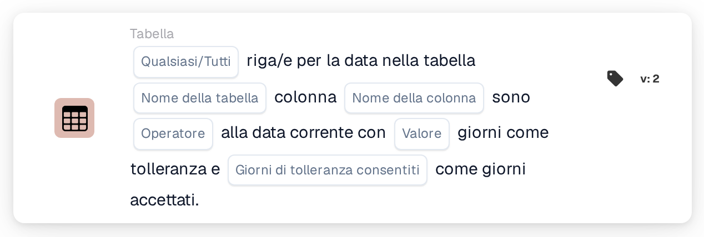

# Data della tabella rispetto alla data corrente

<figure><figcaption>
Versione 2
</figcaption></figure>

Il modo in cui viene calcolata la finestra di tolleranza, con esempi come "oggi o domani", è spiegato in [Date Tolerances](../date-tolerances.md).

## Scopo:

Questa scheda del workflow confronta una data presente in ogni riga di una tabella del documento, ad esempio una data di consegna, con la data corrente. È possibile impostare una tolleranza in giorni e scegliere i giorni della settimana che vengono conteggiati, così che ad esempio vengano utilizzati solo i giorni lavorativi. Può essere utilizzata per verificare se le date di un documento sono nel passato, oggi, entro pochi giorni o nel futuro. In base al risultato, il workflow prosegue con la condizione vera o con quella falsa.

## Componenti della scheda:

1. **Qualsiasi/Tutti**
   * **Descrizione:** Definisce se una riga o ogni riga della tabella dovrebbe soddisfare la condizione.
   * **Opzioni:**
     * **Qualsiasi:** La condizione è vera se almeno una riga soddisfa la condizione.
     * **Tutti:** La condizione è vera solo se ogni riga soddisfa la condizione.
2. **Nome della tabella**
   * **Descrizione:** Il nome della tabella del documento che contiene le date.
3. **Nome della colonna**
   * **Descrizione:** La colonna della tabella che contiene la data.
4. **Operatore**
   * **Descrizione:** Definisce come la data nella tabella viene confrontata con la data corrente, tenendo conto della tolleranza.
   * **Opzioni:**
     * **Pari:** La data rientra nell'intervallo di tolleranza attorno alla data corrente.
     * **Non uguali:** La data è al di fuori dell'intervallo di tolleranza.
     * **Maggiore di:** La data è successiva all'intervallo di tolleranza.
     * **Maggiore o uguale:** La data rientra nell'intervallo di tolleranza o è successiva.
     * **Meno di:** La data è precedente all'intervallo di tolleranza.
     * **Meno o uguale:** La data rientra nell'intervallo di tolleranza o è precedente.
5. **Valore**
   * **Descrizione:** La tolleranza in giorni.
   * **Dettaglio:** L'intervallo di tolleranza si estende per questo numero di giorni prima e dopo la data corrente. Vengono conteggiati solo i giorni selezionati in **Giorni di tolleranza consentiti**. Se non è impostato alcun valore, viene utilizzata una tolleranza di 0 giorni, quindi l'intervallo comprende solo la data corrente.
6. **Giorni di tolleranza consentiti**
   * **Descrizione:** I giorni della settimana che contano come giorni accettati.
   * **Opzioni:** Da lunedì a domenica; è possibile selezionare più giorni.

## Funzionalità:

* **Valutazione della condizione:** La scheda legge la data nella colonna selezionata per ogni riga della prima tabella con il nome indicato e la confronta con la data corrente (la data in UTC). L'intervallo di tolleranza viene calcolato contando il numero di giorni indicato in avanti e indietro a partire dalla data corrente. I giorni della settimana non selezionati non vengono conteggiati, quindi l'intervallo si estende oltre di essi, ed essi restano all'interno dell'intervallo. Ad esempio, con una tolleranza di 2 giorni, solo i giorni da lunedì a venerdì selezionati e un venerdì come data corrente, l'intervallo va dal mercoledì al martedì successivo.
* **Giorni accettati:** Oltre al confronto, la data di ogni riga dovrebbe cadere in uno dei giorni della settimana selezionati. Una riga soddisfa la condizione solo se entrambe le verifiche vengono superate. I risultati di tutte le righe vengono quindi combinati con **Qualsiasi** o **Tutti**.
* **Esecuzione dell'azione:**
  * **Condizione vera:**\
    Le date soddisfano l'operatore selezionato e cadono in giorni accettati, per qualsiasi riga o per tutte. Il workflow prosegue con la condizione vera.
  * **Condizione falsa:**\
    Se la condizione non è soddisfatta, il workflow prosegue con la condizione falsa, ad esempio per inviare il documento a una revisione manuale.
* **Dati mancanti:** La scheda non valuta la condizione e segnala i dati mancanti nel log del workflow se sulla scheda non sono impostati il nome della tabella, il nome della colonna o i giorni accettati, se il documento non ha una tabella con il nome indicato, se una riga della tabella non ha la colonna, oppure se la tabella non ha righe. Se non è impostata alcuna opzione **Qualsiasi/Tutti**, la scheda lo annota nel log e utilizza **Tutti**.
* **Errori:** Se un valore nella colonna della data non può essere letto come data, la scheda termina con un errore.

## Configurazione e impostazione:

* La scheda può essere aggiunta dalla categoria **Tabella**. Successivamente è possibile impostare **Qualsiasi** o **Tutti**, il nome della tabella, il nome della colonna, l'operatore, la tolleranza in giorni e i giorni della settimana accettati. Infine si imposta la condizione di prosecuzione (vera o falsa), che determina il passo successivo del workflow.

## Conclusione:

La scheda del workflow "Table Date to Current Date" verifica le date delle righe rispetto alla data odierna, con una tolleranza che può essere limitata ai giorni lavorativi o a qualsiasi altro insieme di giorni della settimana. Ciò aiuta a segnalare i documenti con date troppo anticipate, troppo tardive o in giorni non accettati.
