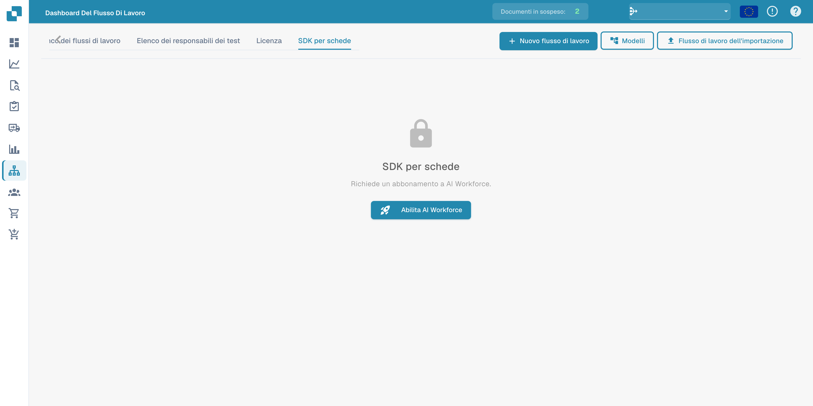

# Card SDK

Il **Card SDK** consente a partner e sviluppatori di creare schede di workflow personalizzate per DocFlow. Confeziona una scheda come app partner e la carichi, oppure la importi direttamente da GitHub.

<figure><figcaption>
Scheda Card SDK con l’avviso di abbonamento AI Workforce richiesto.
</figcaption></figure>

## Come funziona

- **Scarica il modello SDK** — parti dal template ufficiale che contiene la struttura prevista.
- **Carica il file ZIP** — lo ZIP deve contenere `app.json` e una cartella `.docflowcompose/flow/` con le definizioni delle schede (massimo 10 MB). Upload &#x26; Validate controlla il pacchetto prima che venga accettato.
- **Importazione da GitHub** — importa una definizione di scheda direttamente da un repository GitHub.
- **Invii** — monitora lo stato delle schede che hai inviato.

Una volta validate e accettate, le tue schede personalizzate appaiono nella libreria **Aggiungi scheda** insieme alle schede integrate.
