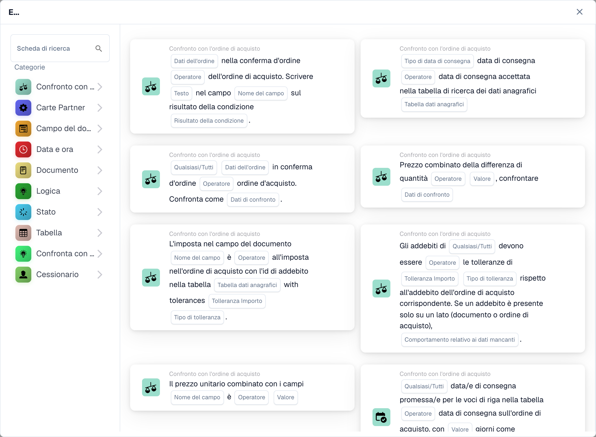

# Carte

Le carte sono gli elementi costitutivi di ogni flusso di lavoro. Li combini nei gruppi **Quando/E/Allora** per descrivere quando viene eseguito un flusso di lavoro e cosa fa. Questa sezione spiega le carte disponibili e cosa fa ciascuna.

<figure><figcaption>
Schede disponibili nella categoria selezionata. Configurare i campi prima dell’uso. Alcune etichette dell’interfaccia di questa versione sono ancora in inglese o tradotte in modo non corretto. Le spiegazioni di questa pagina sono tradotte; l’immagine mostra l’interfaccia reale.
</figcaption></figure>

## Gruppi di carte

* **Quando** — le carte trigger che avviano un flusso di lavoro (ad esempio tipo di documento, tipo di documento uno di).
* **E**: carte condizione che devono essere vere prima che le azioni vengano eseguite. Questi includono il _Confronto con l'ordine d'acquisto_ (corrispondenza dell'ordine d'acquisto), i confronti del _Campo documento_, le condizioni di _Data e ora_, _Logica_, _Stato_, _Tabella_ e _Assegnatario_.
* **Poi**: schede azione che eseguono il lavoro: imposta campi, approva/rifiuta, modifica stato, esporta, crea attività, assegna documenti, manipola tabelle ed esegue azioni (Chiama API, Invia richiesta HTTPS, Esegui flusso di lavoro, calcoli AI).

## Guide di riferimento delle carte

Per un riferimento completo su ciascuna carta e le sue opzioni, vedere le pagine della _guida completa_ in questa sezione (Carte Condizione, Carte abbinamento PO, Carte Assegnazione e Utente, Carte Compito, Carte Campi e Tabelle e carte Azione).

## Combinazione di carte

Per vedere combinazioni collaudate di schede che risolvono scenari aziendali comuni, consulta le **Guide ai modelli di flusso di lavoro**.

[Carte logiche: riferimento completo](cards-overview/logic-cards-guide.md).
