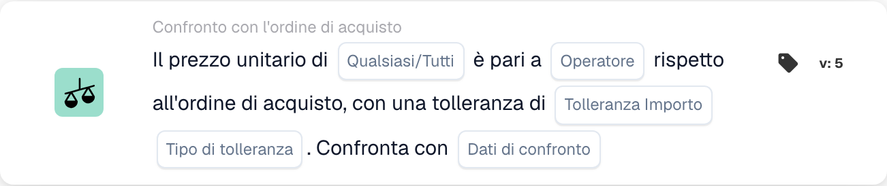

# Versioni e disponibilità delle carte

<figure><figcaption>
Campi della scheda nella versione visualizzata. I campi non sono ancora configurati.
</figcaption></figure>

Una carta in un flusso di lavoro salvato conserva l'ID e la versione della carta. Un modello più recente può aggiungere campi o modificare il comportamento senza modificare ogni flusso di lavoro salvato in precedenza. Controlla la versione sulla carta effettiva prima di applicare le istruzioni per una versione più recente.

## Prima di modificare una carta salvata

1. Registrare i suoi campi e il risultato corrente su dati di test rappresentativi.
2. Confronta la sua versione con il riferimento, inclusi i valori predefiniti e il comportamento dei dati mancanti.
3. Aggiorna o sostituisci la scheda solo tramite l'azione del builder supportata e rivedi nuovamente le sue impostazioni.
4. Convalidare il grafico e testare i casi di dati positivi, negativi e mancanti prima di attivare il flusso di lavoro modificato.

Non modificare un tipo di scheda tecnica memorizzata semplicemente per correggerne l'ortografia. I flussi di lavoro esistenti possono dipendere da tale identificatore. Una versione non supportata rappresenta un errore di esecuzione, non una falsa condizione aziendale.

## Se manca una carta documentata

Controlla con il tuo amministratore il gruppo Quando, E o Poi selezionato, la categoria, il builder Standard o Avanzato, i moduli abilitati, le autorizzazioni e la versione distribuita. Una carta menzionata in un'integrazione tecnica o in un riferimento più recente non è necessariamente abilitata per la tua organizzazione. Non creare o importare la definizione di una carta indovinata per aggirare un modello mancante.

Le condizioni di calendario aggiuntive descritte in alcuni materiali di sviluppo non sono un set selezionabile confermato in ogni versione. Il setter della variabile documento viene implementato anche senza un modello di interfaccia utente generalmente seminato. Utilizza le carte effettivamente disponibili nel tuo ambiente e richiedi chiarimenti prima di dipendere da una non disponibile.

## Riferimenti che dipendono dalla versione

- [Carte di esportazione](export-cards-guide.md): stato del risultato ed esportazione immediata rispetto a quella in coda.
- [Carte di confronto PO](po-comparison-versions-guide.md): direzione del confronto e base di tolleranza.
- [Schede di confronto delle quotazioni](quote-comparison-guide.md): Qualsiasi/Tutto e prezzi comparabili mancanti.
- [Schede logiche](logic-cards-guide.md): tag, variabili organizzative e tipologie di input.

Utilizzare [Registri del flusso di lavoro](../workflow-logs.md) per distinguere il successo, una condizione falsa, dati mancanti, un errore di configurazione e una carta saltata. Registrare lo stato del documento e le impostazioni della carta con il risultato del test; uno screenshot del solo selettore di carte non stabilisce il comportamento in fase di esecuzione.
