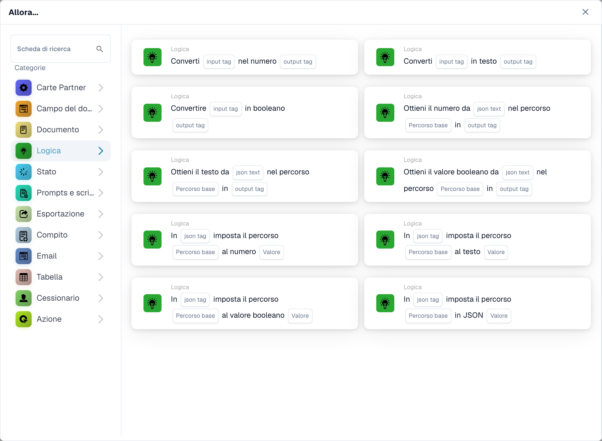

# Schede logiche: variabili, conversioni, JSON e trigger

<figure><figcaption><p>Schede di conversione e JSON nella libreria. Le schede delle variabili di organizzazione richiedono Advanced Builder; i modelli visibili dipendono anche dalla versione. Alcune etichette dell’interfaccia di questa versione sono ancora in inglese o tradotte in modo non corretto. Le spiegazioni di questa pagina sono tradotte; l’immagine mostra l’interfaccia reale.</p></figcaption></figure>

Utilizza queste schede nell'Advanced Workflow Builder dove la scheda selezionata è disponibile. La visibilità della carta dipende dalla versione e dai modelli abilitati. I riferimenti seguenti descrivono la versione 2. Tieni a mente la versione archiviata in un flusso di lavoro esistente quando confronti i suoi campi con questa guida.

## Scegli il negozio con il giusto valore

Una variabile del flusso di lavoro dell'organizzazione selezionata dal pannello Variabili viene condivisa tra i flussi di lavoro e viene salvata indipendentemente dall'area di disegno. Un tag denominato utilizzato dalle schede di conversione, JSON e di confronto tag appartiene al contesto di esecuzione corrente. La creazione di un tag non crea una variabile organizzativa. Immettere il nome del tag senza prefisso di archiviazione interna. Un campo documento è una terza origine dati separata.

Una variabile di organizzazione e un tag di esecuzione rimangono separati anche quando i loro nomi corrispondono. Seleziona un campo variabile compatibile o fornisci esplicitamente il valore previsto dalla carta ricevente. Vedere [Variabili](../advanced-workflow/variables.md) per l'ambito dell'organizzazione e la persistenza immediata.

## Azioni variabili dell'organizzazione

Crea prima la variabile con il tipo corretto e selezionala sulla scheda. Un riferimento variabile assente riporta `MISSING_VARIABLE`. Le carte che impostano variabili registrano il valore precedente e quello nuovo nello storico delle carte. Evitare dati personali o riservati reali nei valori dei test e nei registri condivisi.

| Carta | Ingresso richiesto | Risultato ed esempio | Fallimento o caso limite |
| --- | --- | --- | --- |
| `ACTION_LOGIC_SET_TEXT_VAR` | Variabile testo e `value` | Memorizza il testo; ad esempio, imposta un'etichetta di instradamento su `review`. | Un valore mancante è diverso da un valore di testo intenzionalmente vuoto. |
| `ACTION_LOGIC_SET_NUMBER_VAR` | Variabile di tipo Numero e numerica `value` | Memorizza un numero finito; ad esempio, imposta una soglia su `1000.50`. | Testo numerico non valido, infinito e NaN vengono rifiutati. Utilizza un punto decimale, senza il simbolo della valuta. |
| `ACTION_LOGIC_CALC_NUMBER` | Numero variabile e `expression` | Memorizza il risultato aritmetico; `(100 + 20) / 2` dà `60`. | Supporta valori letterali numerici, parentesi, `+`, `-`, `*`, `/`, `%` e `**`. Nomi, chiamate di funzioni e riferimenti a campi di documento non sono accettati nell'espressione. Le espressioni non valide o la divisione per zero falliscono. |
| `ACTION_LOGIC_SET_BOOLEAN_VAR` | Variabile Sì/No e `value` | Imposta il flag su Sì o No. | Utilizza il valore booleano offerto dalla carta anziché un sinonimo di testo libero tradotto. |
| `ACTION_LOGIC_INVERT_BOOLEAN` | Variabile Sì/No | Inverte il suo valore corrente; Il sì diventa no. | Inizializza la variabile prima di fare affidamento su un particolare primo risultato. |

### Azione di riferimento del documento

`ACTION_LOGIC_SET_DOCUMENT_VAR` memorizza l'ID del documento corrente in una variabile del documento selezionata. Necessita di un documento attuale; senza uno riporta `NO_DOCUMENT`. Un flusso di lavoro attivato riceve l'ID del documento, non un oggetto documento serializzato. L'implementazione verificata non dispone di un modello di scheda dell'interfaccia utente seminato per questa azione, quindi non aspettarti che venga visualizzato in ogni selettore di carte. Utilizzalo solo se l'amministratore conferma che è disponibile un modello corrispondente; l'immissione di un ID documento nel modulo di creazione delle variabili non è un sostituto.

## Tag e conversioni di tipo

Queste azioni utilizzano i nomi dei tag nel contesto di esecuzione corrente. Produrre il tag di input prima di leggerlo. Un tag di input mancante o un nome mancante riporta `MISSING_VARIABLE`; una conversione numerica non valida segnala un errore di impostazione. L'output è un tag nuovo o sovrascritto, non un campo del documento estratto.

| Carta | Ingressi | Risultati ed esempi |
| --- | --- | --- |
| `ACTION_LOGIC_CREATE_TEXT_TAG` | `tag_name`, `value` | Crea un tag di testo; `raw_amount` con valore `125.50`. È consentito un valore di testo vuoto. |
| `ACTION_LOGIC_CONVERT_TO_NUMBER` | `input_tag`, `output_tag` | Converte `125.50` nel numero `125.5`. Un booleano diventa `1` o `0`. Testo come `EUR 125,50` non è un input numerico valido. |
| `ACTION_LOGIC_CONVERT_TO_TEXT` | `input_tag`, `output_tag` | Converte il valore memorizzato in testo. Non formatta una valuta né localizza i separatori decimali. |
| `ACTION_LOGIC_CONVERT_TO_BOOLEAN` | `input_tag`, `output_tag` | Converte direttamente un booleano esistente; un numero diverso da zero diventa vero e zero diventa falso. Utilizza `true` o `false` per l'immissione di testo prevedibile e testa altre rappresentazioni accettate. |

### Esempio di conversione

1. Crea tag di testo `raw_amount` con valore `125.50`.
2. Converti `raw_amount` in Numero, scrivendo in `amount_number`.
3. Usa Numero maggiore di con `tag_name` impostato su `amount_number` e `value` impostato su `100`.
4. Verifica che la condizione abbia esito positivo per `125.50`, fallisca per `100` e riporti un errore di conversione per `EUR 125,50` al passaggio 2.

## Leggere i valori da JSON

Tutte e tre le carte lette accettano `json_text`, `json_path` e `output_tag`. Nonostante il nome, `json_text` è il nome di un tag contenente JSON, non una casella per incollare un documento JSON letterale. Produci prima quel tag, ad esempio con Crea tag di testo.

I percorsi sono chiavi separate da punti e indici di elenco in base zero: `invoice.lines.0.amount`. Non utilizzare la sintassi JSONPath come `$.invoice.lines[0].amount`. Se manca una chiave, un indice non è valido o JSON non è valido, il risultato è `ERROR_CARD_SETUP`; un tag sorgente mancante riporta `MISSING_VARIABLE`.

| Carta | Uscita |
| --- | --- |
| `ACTION_LOGIC_JSON_TO_NUMBER` | Valore numerico; il testo numerico viene convertito e un booleano diventa `1` o `0`. Il testo numerico non valido fallisce. |
| `ACTION_LOGIC_JSON_TO_TEXT` | Rappresentazione testuale del valore selezionato. Questa non è una promessa di serializzazione JSON per oggetti annidati. |
| `ACTION_LOGIC_JSON_TO_BOOLEAN` | Un booleano; il testo `true`, `1` o `yes` è vero dopo la minuscola, mentre l'altro testo è falso. I numeri seguono il loro valore zero/diverso da zero. |

Per un tag `payload` contenente il seguente JSON, leggere `invoice.lines.0.amount` in `amount` con JSON per numerare produce `125.5`:

```json
{"invoice":{"lines":[{"amount":"125.50"}],"approved":false}}
```

Testa anche un percorso inesistente, un indice fuori intervallo e un JSON non valido. Una lettura non riuscita non deve essere trattata come uno zero valido o come un'approvazione riuscita.

## Aggiorna JSON

Le quattro carte di scrittura accettano `json_tag`, `json_path` e `value`. `json_tag` nomina un tag esistente contenente JSON. Aggiornano quel tag con JSON serializzato. Si applica la stessa sintassi del percorso separato da punti; È possibile creare chiavi di oggetti intermedi mancanti, ma gli indici di elenco devono identificare gli elementi esistenti. Non estendono un elenco né supportano percorsi con caratteri jolly.

| Carta | Valore ed effetto |
| --- | --- |
| `ACTION_LOGIC_JSON_SET_NUMBER` | Un valore numerico, ad esempio `125.5`; memorizza un numero JSON. Il testo numerico non valido fallisce. |
| `ACTION_LOGIC_JSON_SET_TEXT` | Testo, ad esempio `review`; memorizza una stringa JSON. |
| `ACTION_LOGIC_JSON_SET_BOOLEAN` | Il testo `true`, `1` o `yes` diventa vero dopo la minuscola; l'altro testo viene impostato su falso. Preferisci `true` e `false`. |
| `ACTION_LOGIC_JSON_SET_JSON` | JSON valido, ad esempio `{"status":"review"}`; inserisce il valore analizzato, non il testo tra virgolette. JSON non valido fallisce. |

Ad esempio, imposta il percorso da `invoice.approved` a `true` in `payload` con JSON impostato su Booleano. Quindi leggi lo stesso percorso con JSON in Boolean e verifica vero. Prima di continuare è necessario diagnosticare un tag di origine mancante, un JSON non valido o un percorso non valido nel registro della scheda.

## Condizioni

Tutte e sei le condizioni riportate di seguito sono la versione 2. Una condizione falsa è un risultato aziendale, non un'azione riuscita o un errore di esecuzione. In una sequenza di condizioni in stile Standard impedisce le seguenti azioni; in un flusso di lavoro avanzato collega il risultato al ramo desiderato.

| Carta | Campi | Valutazione e confine importante |
| --- | --- | --- |
| `CONDITION_LOGIC_VALUE_EQUALS` | `tag_name`, `value` | Confronta esattamente le rappresentazioni del testo, incluso il caso. Non utilizzarlo come controllo di presenza: un tag mancante non viene automaticamente segnalato come errore. |
| `CONDITION_LOGIC_BOOLEAN_IS` | `tag_name` | Controlla se il tag è vero. Un tag mancante viene valutato falso. Utilizza un valore booleano reale per risultati affidabili. |
| `CONDITION_LOGIC_TEXT_CONTAINS` | `tag_name`, `value` | Ricerca di sottostringhe con distinzione tra maiuscole e minuscole. Un tag mancante viene considerato come testo vuoto. Una stringa di ricerca vuota corrisponde; imposta sempre il valore di ricerca deliberatamente. |
| `CONDITION_LOGIC_NUMBER_LESS` | `tag_name`, numerico `value` | Rigorosamente inferiore a. Un tag mancante o un valore di confronto omesso viene impostato automaticamente su zero; i dati numerici non validi rappresentano un errore di impostazione. |
| `CONDITION_LOGIC_NUMBER_GREATER` | `tag_name`, numerico `value` | Strettamente maggiore di. Un valore pari alla soglia non soddisfa questa condizione. Si applicano gli stessi valori predefiniti pari a zero e il comportamento di errore numerico. |
| `CONDITION_LOGIC_EXPRESSION` | `value1`, `operator`, `value2` | Supporta `==`, `!=`, `<`, `<=`, `>`, `>=`, `contains`, `not_contains`. Prova prima il confronto numerico e altrimenti confronta il testo. Non è un campo arbitrario di espressione Python. |

Per Numero maggiore di `100`, testare `99`, `100` e `101`. Per Testo contiene `ABC`, prova `ABC`, `abc` e una ricerca vuota. Controlla sia il ramo che il log; un nodo grigio è stato saltato e non dimostra che il confronto è riuscito.

## Trigger

| Carta | Configurazione | Quando corrisponde |
| --- | --- | --- |
| `CONDITION_LOGIC_VAR_CHANGED` | Seleziona una variabile organizzativa. Il riferimento memorizzato utilizza il relativo ID, quindi rinominare la variabile non modifica intenzionalmente la destinazione. | I valori della corrente fornita e della variabile precedente differiscono. Ripetere lo stesso valore non è un cambiamento. Un riferimento alla variabile mancante riporta `MISSING_VARIABLE`. |
| `CONDITION_LOGIC_WEBHOOK_EVENT` | Opzionale `event_name`. | Un payload webhook è presente nel contesto di esecuzione del flusso di lavoro. Con un nome, il valore `event` del carico utile deve corrispondere esattamente; senza un nome, qualsiasi evento webhook fornito corrisponde. Nessun evento significa falso. |

La selezione dell'evento Webhook non crea un endpoint webhook pubblico o la relativa autenticazione. La tua integrazione deve fornire l'evento attraverso un punto di ingresso configurato. Testare l'evento corrispondente, un altro evento e nessun evento. Per un trigger di variabile, testare una modifica del valore reale e un valore invariato ed evitare una catena che riscrive ripetutamente la stessa variabile condivisa.

## Testare e diagnosticare

Convalidare il grafico, testare ogni ramo con input rappresentativo e ispezionare [Registri del flusso di lavoro](../workflow-logs.md). Includi tag mancanti, JSON non valido, tipi di variabili errati, limiti numerici e condizioni false. Un test senza documento non può dimostrare un'azione dipendente dal documento. Ricontrolla la versione della carta salvata e lo stato abilitato prima di fare affidamento sull'esecuzione automatica.

<!-- workflow-card-logic-examples-20261021 -->

## Esempi realizzati per ciascuna scheda logica

Questi sono input illustrativi e risultati attesi per la versione 2. Utilizzare le schede con variabili organizzative solo laddove Advanced Builder espone i relativi modelli.

| Carta | Configurazione di esempio | Risultato atteso e controesempio |
| --- | --- | --- |
| `ACTION_LOGIC_SET_TEXT_VAR` | Imposta la variabile del testo dell'organizzazione da `routing_label` a `review`. | La variabile condivisa contiene `review`. Un flusso di lavoro successivo può leggere la stessa variabile organizzativa. |
| `ACTION_LOGIC_SET_NUMBER_VAR` | Imposta la variabile numerica `approval_limit` su `1000.50`. | Memorizza il numero `1000.5`. Il testo `EUR 1000,50` non è un input numerico valido. |
| `ACTION_LOGIC_CALC_NUMBER` | Memorizza l'espressione `(100 + 20) / 2` nella variabile numerica `calculated_limit`. | Il risultato è `60`. Un nome di campo documento o una divisione per zero non è un sostituto valido. |
| `ACTION_LOGIC_SET_BOOLEAN_VAR` | Imposta la variabile Sì/No `review_required` sul booleano offerto `true`. | Il flag dell'organizzazione è vero. Utilizza il booleano `false` in un caso separato per cancellarlo. |
| `ACTION_LOGIC_INVERT_BOOLEAN` | Inizia con la variabile organizzativa `demo_flag` uguale a `true`. | Un'esecuzione arriva a `false`. L'esecuzione ripetuta rende `true`, quindi l'esecuzione ripetuta non è idempotente. |
| `ACTION_LOGIC_CREATE_TEXT_TAG` | Crea il tag di esecuzione `raw_amount` con il testo `125.50`. | Il tag contiene quel testo in questa esecuzione; non è una nuova variabile dell'organizzazione o un campo del documento. |
| `ACTION_LOGIC_CONVERT_TO_NUMBER` | Converti il tag di input `raw_amount`, contenente `125.50`, nel tag di output `amount_number`. | L'output è numerico `125.5`. `EUR 125,50` produce un errore di conversione. |
| `ACTION_LOGIC_CONVERT_TO_TEXT` | Converti il tag numerico `amount_number` contenente `125.5` in `amount_text`. | L'output è il testo `125.5`; non è localizzato come importo in valuta. |
| `ACTION_LOGIC_CONVERT_TO_BOOLEAN` | Converti un tag di input numerico contenente `1` nel tag di output `has_value`. | L'output è vero. Il numerico `0` produce falso. |
| `ACTION_LOGIC_JSON_TO_NUMBER` | Crea il tag sorgente `payload` con `{"invoice":{"amount":"125.50"}}`; leggere il percorso da `invoice.amount` a `amount_number`. | L'output è numerico `125.5`. Un percorso assente è un errore, non uno zero valido. |
| `ACTION_LOGIC_JSON_TO_TEXT` | Utilizza il tag sorgente `payload` contenente `{"invoice":{"status":"review"}}` e il percorso `invoice.status`. | Il tag di output contiene il testo `review`. |
| `ACTION_LOGIC_JSON_TO_BOOLEAN` | Utilizza il tag sorgente `payload` contenente `{"invoice":{"approved":false}}` e il percorso `invoice.approved`. | L'output è booleano falso. Un percorso mancante non è la stessa cosa di un falso memorizzato. |
| `ACTION_LOGIC_JSON_SET_NUMBER` | Utilizza il tag JSON esistente `payload` contenente `{"invoice":{}}`; impostare `invoice.total` su `125.5`. | Il tag contiene un totale numerico JSON, non una stringa numerica tra virgolette. |
| `ACTION_LOGIC_JSON_SET_TEXT` | Utilizza il tag JSON esistente `payload` contenente `{"invoice":{}}`; impostare `invoice.status` su `review`. | Il valore JSON memorizzato è una stringa: `{"invoice":{"status":"review"}}`. |
| `ACTION_LOGIC_JSON_SET_BOOLEAN` | Utilizza il tag JSON esistente `payload` contenente `{"invoice":{}}`; impostare `invoice.approved` con il testo `true`. | Il valore JSON memorizzato è booleano vero. Usa `false` per cancellarlo. |
| `ACTION_LOGIC_JSON_SET_JSON` | Utilizza il tag JSON esistente `payload` contenente `{"invoice":{}}`; imposta `invoice.metadata` su JSON valido `{"source":"demo"}`. | Il valore inserito è un oggetto. È necessario segnalare un JSON non valido e non archiviarlo come aggiornamento dell'oggetto riuscito. |
| `CONDITION_LOGIC_VALUE_EQUALS` | Crea il tag `route` con il testo `review` e confrontalo con `review`. | Passa. Il confronto con `Review` fallisce perché il confronto fa distinzione tra maiuscole e minuscole. |
| `CONDITION_LOGIC_BOOLEAN_IS` | Utilizza il tag `review_required` contenente il booleano reale `true`. | Passa; false o un tag mancante non stabilisce un risultato vero. |
| `CONDITION_LOGIC_TEXT_CONTAINS` | Utilizza il tag `note` con il testo `manual review` e cerca `review`. | Passa. La ricerca della lettera maiuscola `REVIEW` fallisce. Una stringa di ricerca vuota corrisponde e dovrebbe essere evitata se non previsto. |
| `CONDITION_LOGIC_NUMBER_LESS` | Utilizza il tag numerico `amount` uguale a `50` e valore di confronto `100`. | Passa. Un valore di `100` fallisce il confronto rigoroso inferiore a. |
| `CONDITION_LOGIC_NUMBER_GREATER` | Utilizza il tag numerico `amount` uguale a `125` e valore di confronto `100`. | Passa. `100` fallisce il confronto rigoroso maggiore di. |
| `CONDITION_LOGIC_EXPRESSION` | Seleziona valore1 `120`, operatore `>` e valore2 `100`. | Il confronto numerico passa. Usa `80` come valore1 per un ramo falso; questa non è un'espressione Python in formato libero. |
| `CONDITION_LOGIC_VAR_CHANGED` | Seleziona una variabile organizzativa il cui valore precedente è `new` e il valore corrente fornito è `review`. | L'evento del valore modificato corrisponde. La ripetizione di `review` sia come valore precedente che come valore corrente non corrisponde. |
| `CONDITION_LOGIC_WEBHOOK_EVENT` | Seleziona il nome dell'evento `invoice.ready` e fornisci un evento di integrazione configurato con payload `{"event":"invoice.ready"}`. | Corrisponde. `{"event":"invoice.updated"}` e nessun evento non corrispondono. La scheda non crea un endpoint webhook. |

L'azione facoltativa di riferimento al documento `ACTION_LOGIC_SET_DOCUMENT_VAR` non ha alcun modello seed nell'origine controllata. Se l'amministratore fornisce un modello supportato, seleziona una variabile Documento ed eseguilo con un documento demo corrente: memorizza l'ID del documento. Senza documento riporta `NO_DOCUMENT`. Non trattarla come una carta disponibile semplicemente perché esiste l'implementazione.
