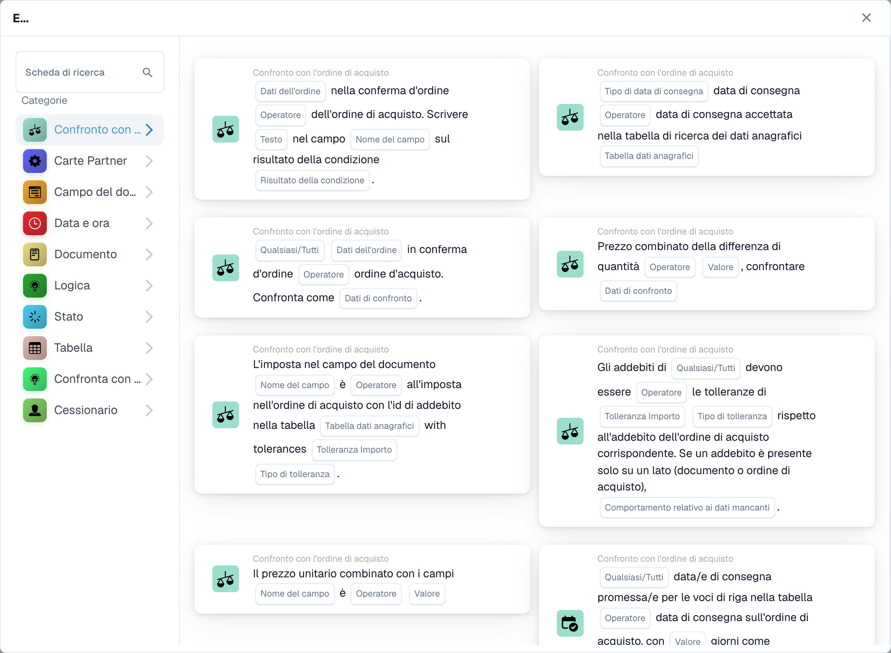

# Confronti PO: direzione, tolleranza e versioni della carta

<figure><figcaption>
Schede disponibili nella categoria selezionata. Configurare i campi prima dell’uso. Alcune etichette dell’interfaccia di questa versione sono ancora in inglese o tradotte in modo non corretto. Le spiegazioni di questa pagina sono tradotte; l’immagine mostra l’interfaccia reale.
</figcaption></figure>

Le carte di confronto PO confrontano una parte scelta con una parte di riferimento. Il riferimento determina la base per una tolleranza percentuale. Completare prima l'abbinamento degli ordini d'acquisto, quindi selezionare il confronto, l'operatore, Qualsiasi/Tutto e la tolleranza richiesta dalla specifica carta.

## Direzioni di confronto

| Opzione memorizzata | Lato a confronto | Lato di riferimento |
| --- | --- | --- |
| `po_document` | Ordine d'acquisto | Documento |
| `received_document` | Dati ricevuti | Documento |
| `po_received` | Ordine d'acquisto | Dati ricevuti |
| `document_po` | Documento | Ordine d'acquisto |
| `document_received` | Documento | Dati ricevuti |
| `received_po` | Dati ricevuti | Ordine d'acquisto |

Il lato ricevuto deriva dai dati dell'ordine di acquisto abbinati. Un confronto ricevuto sulla scheda del prezzo unitario può utilizzare le quantità per ricavare un importo comparabile; non è un confronto diretto di una quantità con un prezzo in valuta. Utilizzare i valori registrati da quella carta nel registro quando si controlla il calcolo.

## Perché la direzione è importante

Per un riferimento di `100` e un valore comparato di `110`, una tolleranza percentuale di `5` corrisponde a `5` attorno al riferimento. Se il documento è il riferimento e il suo valore è modificabile, la modifica del documento modifica anche la base di tolleranza. Scegli il riferimento consapevolmente, soprattutto per l'approvazione automatica.

Invertendo i lati si invertono gli operatori di ordinamento: `>` diventa `<`, `>=` diventa `<=` e viceversa. Uguaglianza e disuguaglianza mantengono il loro significato. Non invertire un operatore senza aver ispezionato anche i lati scelti.

Le versioni contenenti la migrazione di confronto hanno interessato le carte salvate da `po_document` a `document_po` e da `received_document` a `document_received`, invertendo l'operatore di ordinamento. Le versioni interessate sono la tolleranza sulla quantità v4, la conferma dell'ordine all'ordine d'acquisto v4 e il prezzo unitario v4/v5. Il prezzo combinato della differenza di quantità è escluso dalla migrazione della carta salvata. Ispezionare la configurazione salvata e testarne i risultati aziendali dopo un rilascio; non invertirlo manualmente una seconda volta.

## Versioni di cartellini a prezzo unitario

| Versione | Configurazione |
| --- | --- |
| v3 | Utilizza il comportamento di confronto precedente. Non dare per scontato che esponga la nuova direzione e i campi di tolleranza. |
| v4 | Aggiunge la selezione del lato confronto. |
| v5 | Include Qualsiasi/Tutto, operatore, importo di tolleranza, tipo di tolleranza e selezione del lato di confronto. |

Scegli una tolleranza assoluta per un importo fisso e una tolleranza percentuale per una varianza relativa al riferimento selezionato. Utilizza l'operatore offerto dalla carta; l’uguaglianza esatta e l’essere all’interno di una tolleranza sono decisioni diverse. Non esiste una tolleranza aziendale universale adatta a ogni fornitore o tipo di documento.

## Esempio di verifica

1. Utilizza un riferimento PO corrispondente di `100` e un valore del documento `110`.
2. Selezionare Documento per ordine d'acquisto, un confronto entro la tolleranza dove offerto e `5` percento. Aspettatevi un confronto fuori banda.
3. Testare l'esatto limite di tolleranza, i valori su entrambi i lati e un PO corrispondente mancante.
4. Con più righe, verifica Qualsiasi contro Tutti utilizzando una riga positiva e una negativa.
5. Ispeziona i valori confrontati del registro, i lati selezionati, l'operatore e la tolleranza, quindi verifica il ramo del flusso di lavoro risultante.

Un ordine d'acquisto senza corrispondenza, un valore non numerico e una condizione aziendale falsa sono risultati diversi. Non considerare i dati mancanti come una corrispondenza riuscita. Per gli addebiti, utilizzare [Qualsiasi / Tutti gli addebiti](../and/compare-with-purchase-order/any-all-charges.md), che spiega separatamente il comportamento di carica mancante e v2/v3.

Continua con la [Guida alla corrispondenza PO](../and/compare-with-purchase-order/po-matching-complete-guide.md) e il riferimento della carta individuale per i campi rimanenti.
