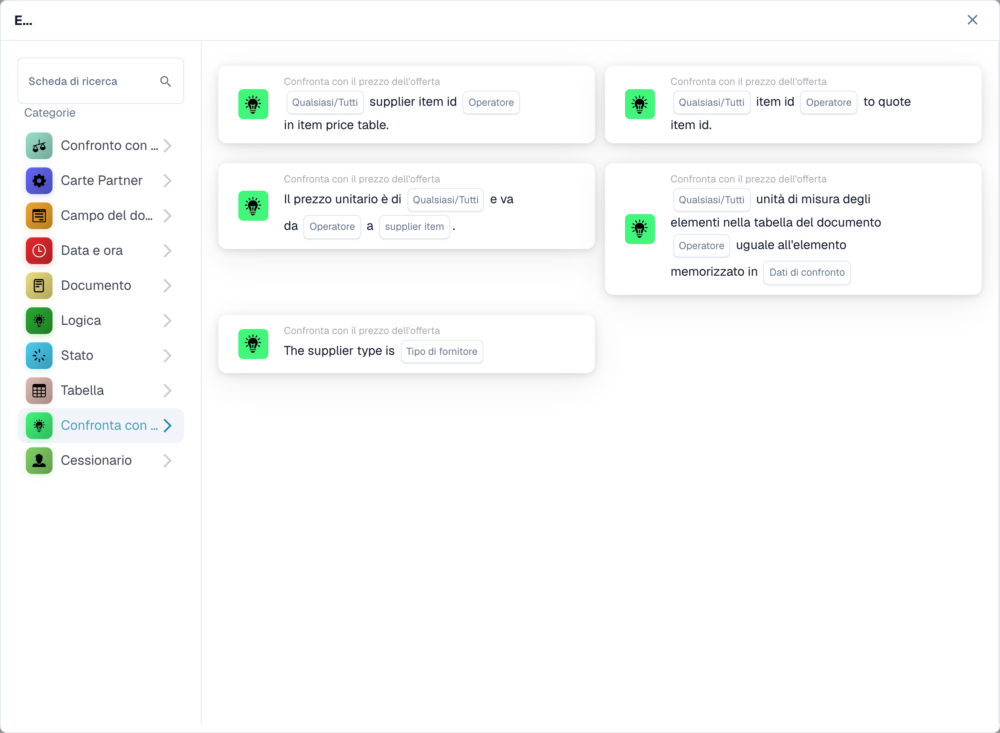

# Schede di confronto preventivi

<figure><figcaption>
Schede disponibili nella categoria selezionata. Configurare i campi prima dell’uso. Alcune etichette dell’interfaccia di questa versione sono ancora in inglese o tradotte in modo non corretto. Le spiegazioni di questa pagina sono tradotte; l’immagine mostra l’interfaccia reale.
</figcaption></figure>

Queste condizioni E utilizzano i dati del preventivo o dell'articolo del fornitore disponibili nel documento. Configurali e testali dopo che i dati del preventivo richiesti sono stati caricati. Un identificatore di articolo corrispondente non dimostra di per sé che il prezzo o l'unità di misura siano corretti.

## Seleziona l'assegno

| Tipo di carta | Controllo e configurazione |
| --- | --- |
| `CONDITION_QUOTES_ITEM_NUMBER_COMPARISON` | Controlla l'identificatore dell'articolo rispetto ai dati del prezzo dell'articolo. Seleziona il confronto e Tutti/Tutti i campi offerti dalla scheda. |
| `CONDITION_SPECIFY_SUPPLIER_TYPE` | Confronta il tipo di fornitore dai dati del preventivo con `supplier_type`. Questo è un controllo della classificazione dei fornitori, non un confronto dei prezzi. |
| `CONDITION_QUOTE_SUPPLIER_ITEM_NUMBER_EXISTS` | Controlla se l'ID articolo del fornitore è o meno presente nei dati del prezzo dell'articolo; scegliere l'operatore e Qualsiasi/Tutti. I dati del preventivo o dell'articolo mancanti devono essere esaminati nel registro. |
| `CONDITION_QUOTE_PRICE_MATCH` | Confronta un prezzo unitario con il prezzo del fornitore selezionato: `ManagedPrice` o `LastPrice`. Scegli Qualsiasi/Tutto e l'operatore di confronto numerico. Le righe senza un numero comparabile su entrambi i lati vengono saltate e registrate; se nessuna riga è confrontabile la scheda segnala i dati del documento mancanti. |
| `CONDIITON_UNIT_OF_MEASURE_EQUAL` | Verifica l'unità di misura rispetto ai dati correlati. Il tipo tecnico contiene un errore di ortografia mantenuto; non modificarlo nel flusso di lavoro memorizzato JSON. Un prezzo espresso per unità diverse richiede un'attenzione separata. |
| `CONDITION_ITEM_QUOTES_TO_CONTRACTED_PRICE` | Confronta i prezzi quotati e contrattuali. La versione 3 aggiunge Qualsiasi/Tutto; vedere sotto. |

Le etichette visibili possono variare in base alla versione e alla lingua dell'interfaccia utente. Seleziona in base al controllo effettivo, non solo in base al nome della categoria. Ad esempio, il prezzo dell'articolo preventivato può essere visualizzato in Logica mentre gli altri controlli del preventivo vengono visualizzati in Confronta con prezzo preventivo.

## Prezzo articolo citato: versione 3

Scegli l'operatore di uguaglianza o disuguaglianza e se qualsiasi linea confrontata o ogni linea confrontata deve soddisfarlo:

- `match_any`: è sufficiente una riga comparabile riuscita.
- `match_all`: ogni linea confrontata deve soddisfare l'operatore selezionato.

La versione 2 mantiene il comportamento Tutto. Un'impostazione Qualsiasi/Tutto non configurata su v3 torna a Tutti e viene registrata. Una scheda senza righe comparabili riporta dati mancanti; l’assenza di un prezzo non è una prova di uguaglianza o disuguaglianza. Ispeziona le righe saltate e il lato mancante nel registro.

Ad esempio, due linee comparabili producono risultati vero e falso per l'uguaglianza. Eventuali passaggi; Tutto fallisce. Con la disuguaglianza cambia prima il risultato del confronto per ogni riga e poi Qualsiasi/Tutto combina tali risultati. Non inverte il risultato finale All per implementare Any.

## Casi di prova

Utilizza gli ID articolo e fornitore esatti, la fonte di prezzo prevista e le unità corrispondenti. Testare la corrispondenza di tutte le righe, risultato misto, prezzi non comparabili, dati di preventivo mancanti e ID fornitore errato. Verificare sia il risultato del confronto sia quali righe sono state saltate. Mantenere l'approvazione o l'esportazione dietro i controlli aziendali effettivamente richiesti; un controllo dell'identificatore riuscito non costituisce una convalida completa dell'appalto.

Consulta [Corrispondenza ordine d'acquisto](../and/compare-with-purchase-order/po-matching-complete-guide.md) per confronti tra ordini di acquisto e [Registri del flusso di lavoro](../workflow-logs.md) per la risoluzione dei problemi.

<!-- workflow-card-complete-example-20261021 condition_quotes_item_number_comparison -->

### Esempio di confronto tra codici articolo

**Configurazione:** Preparare due righe di preventivo comparabili: l'articolo fornitore `DEMO-S1` corrisponde all'articolo `DEMO-I1` su entrambi i lati; l'articolo fornitore `DEMO-S2` ha l'articolo documento `DEMO-I2` e l'articolo matrice `DEMO-I9`. Scegli uguaglianza e `match_all`.

**Risultato previsto e controesempio:** Il risultato della condizione è falso con `match_all`, perché un numero di articolo comparabile è diverso. Il risultato è vero con `match_any`, perché il primo numero di articolo corrisponde. La ricerca utilizza il codice articolo del fornitore. Una voce di matrice senza numero di articolo viene saltata e registrata; se nessuna linea è comparabile, il risultato della condizione è falso. Il solo registro dell'intervallo di date non costituisce una condizione di validità separata.

Questa è una configurazione di test illustrativa e il risultato atteso; non è stato eseguito. Utilizza dati e destinatari configurati nella tua organizzazione di test.

<!-- workflow-card-complete-example-20261021 condition_quote_supplier_item_number_exists -->

### Esempio di esistenza dell'articolo fornitore

**Configurazione:** Il documento ha i numeri di articolo del fornitore `DEMO-S1` e `DEMO-S2`; i dati del prezzo dell'articolo del fornitore caricati contengono solo `DEMO-S1`. Scegli l'operatore di presenza e `match_all`.

**Risultato atteso e controesempio:** Il risultato della condizione è falso con `match_all` e vero con `match_any`. Con l'operatore assenza, la seconda riga è un risultato di assenza positivo. L'esistenza non dimostra che il prezzo dell'articolo, l'unità o la classificazione del fornitore siano corretti. Carica prima i dati del preventivo valido e controlla gli errori dei dati mancanti.

Questa è una configurazione di test illustrativa e il risultato atteso; non è stato eseguito. Utilizza dati e destinatari configurati nella tua organizzazione di test.

<!-- workflow-card-complete-example-20261021 condition_quote_price_match -->

### Esempio di prezzo del fornitore

**Configurazione:** Per due linee abbinate scegliere `ManagedPrice`, uguaglianza e `match_all`. I prezzi dei documenti sono `10` e `12`; i prezzi gestiti corrispondenti sono `10` e `13`, in valute e unità corrispondenti.

**Risultato atteso e controesempio:** Il risultato della condizione è falso con `match_all` e vero con `match_any`. Il passaggio a `LastPrice` utilizza una sorgente diversa e deve essere testato in modo indipendente. Una riga senza un prezzo numerico comparabile viene saltata e registrata; se nessuna linea è comparabile, la scheda riporta i dati mancanti del documento, non l'uguaglianza.

Questa è una configurazione di test illustrativa e il risultato atteso; non è stato eseguito. Utilizza dati e destinatari configurati nella tua organizzazione di test.

<!-- workflow-card-complete-example-20261021 condition_specify_supplier_type -->

### Esempio di classificazione dei fornitori

**Configurazione:** Scegli il tipo di fornitore `Contract`. Preparare due voci del fornitore di preventivo caricate con `managed_class` uguale a `contract`.

**Risultato atteso e controesempio:** La condizione è vera quando ogni voce caricata ha quella classificazione. La condizione è falsa se una voce ha classificazione `managed`. Il valore selezionabile `Nonmanaged` è normalizzato in `unmanaged` dal backend. Questa classificazione non è correlata alla forma giuridica del fornitore. I dati del preventivo mancanti non corrispondono.

Questa è una configurazione di test illustrativa e il risultato atteso; non è stato eseguito. Utilizza dati e destinatari configurati nella tua organizzazione di test.

<!-- workflow-card-complete-example-20261021 condiiton_unit_of_measure_equal -->

### Esempio di unità di misura

**Configurazione:** Preparare righe di preventivo abbinate con unità del documento `EA` e unità di confronto del fornitore `EA`. Scegliere uguaglianza e `match_all`. Mantenere la versione della scheda da verificare.

**Risultato atteso e controesempio:** La condizione è vera per l'abbinamento di unità comparabili; una seconda riga comparabile utilizzando `KG` invece di `EA` rende falsa la condizione con `match_all`. Le unità di confronto mancanti vengono saltate e registrate; se nessuno è comparabile, la scheda segnala i dati mancanti. La versione 3 può applicare la mappatura dell'unità configurata, quindi verificare tale mappatura separatamente. L'abbinamento dei prezzi da solo non stabilisce le unità corrispondenti.

Questa è una configurazione di test illustrativa e il risultato atteso; non è stato eseguito. Utilizza dati e destinatari configurati nella tua organizzazione di test.
