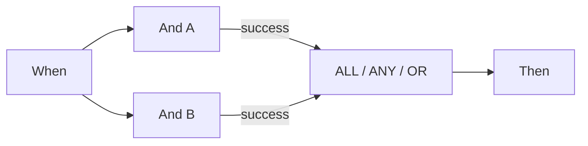

# P0: collegare correttamente Wait ALL, Wait ANY e OR

ALL richiede un’uscita collegata corrispondente da **ogni sorgente distinta**. ANY e OR richiedono almeno una sorgente corrispondente. Collegare verde e arancione dalla stessa sorgente la conta una sola volta. OR non crea una scelta esclusiva e non annulla altre azioni. ANY non garantisce che vinca il ramo più veloce.

Lo scheduler esaminato attende prima tutti i predecessori in ingresso. Se un ramo non scelto rende un predecessore irraggiungibile, l’esecuzione normale salta la convergenza bloccata. La modalità test può valutarla con i risultati disponibili. **Un test parziale verde non dimostra quindi che un’esecuzione documentale prosegua nello stesso grafo.**

Per due controlli obbligatori, eseguirli entrambi e collegare le uscite richieste ad ALL. Per percorsi alternativi in questa versione, usare la scheda Then finale comune del caso v2. Tale convergenza riguarda percorsi mutuamente esclusivi; non è una barriera per più azioni simultanee.

Verificare separatamente sorgente, uscita collegata, uscita scelta e raggiungibilità effettiva. Un errore sorgente rimane errore complessivo anche se ANY/OR riesce dopo. Nel codice esaminato, un ALL non soddisfatto contiene anche un dettaglio di errore: il solo colore arancione non basta.

## Schede e parametri di esempio

I valori descrivono parametri delle schede, non un workflow completo importabile. Sostituire YOUR_* con selezioni proprie di test. Il designer gestisce l’ID nascosto del chiamante. Catalogo: Dev, DocFlow 2.10.38, 21 ottobre 2026; verificare versioni e abilitazioni della propria organizzazione.

`node_type`: `all`, `any`, `or`

## Casi di prova aziendali

| Caso | Input / configurazione | Risultato atteso |
| --- | --- | --- |
| MERGE-01 | A=success; B=success | ALL/ANY/OR: join=success |
| MERGE-02 | A=success; B=failed_condition; B→failed_condition: — | ALL: join=failed_condition, workflow=error; ANY/OR: join=success, workflow=failed_condition |
| MERGE-03 | A=success; B=error | ANY/OR: join=success; workflow=error |
| MERGE-04 | A=success; B=non raggiunto | test: valutare; scheduler: saltare |
| MERGE-05 | A→success + A→failed_condition; B→success | sources=2 |

## Prove e limiti

Risultati selezionati di schede e nodi sono stati verificati con dati sintetici in Advanced Test. Le risposte sono nel kit. Le azioni documentali sono simulate e non provano esecuzione persistente o consegna esterna.

[Continuare il percorso](../workflow-learning-path.md) · [Kit di esercitazione](../workflow-training-kit.md)
