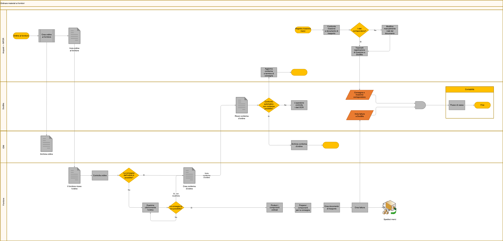

# Flusso di lavoro per l’ordine e l’elaborazione dei materiali

Il diagramma illustra un processo di esempio. Le corsie distinguono **Acquisti INFOR**, **DocBits**, **IDM** e **Fornitore**; la contabilità è una destinazione separata. Non tutti i passaggi sono funzioni eseguite da DocBits.

<figure><figcaption>
Esempio di ordinazione dei materiali con ruoli distinti per fornitore, acquisti INFOR, IDM, DocBits e contabilità. L’archiviazione illustrata appartiene a IDM. Diagramma tradotto con geometria conservata, non prova di esecuzione.
</figcaption></figure>

## Ordine e conferma

Acquisti crea l’ordine e lo invia al fornitore. L’ordine viene archiviato nella corsia **IDM**. Il fornitore verifica la possibilità di consegna e prepara una conferma; se serve, riesamina l’ordine e concorda modifiche.

DocBits riceve la conferma e il processo valuta se il confronto con l’ordine sia automatizzabile. In caso contrario è previsto un controllo dell’operatore sui dati OCR. La conferma viene archiviata in **IDM**, mentre acquisti mantiene conferma e termine di consegna.

## Consegna e ricezione merci

Il fornitore prepara componenti, documento di trasporto e fattura, quindi spedisce la merce. Acquisti registra la ricezione merci e la confronta con il documento di trasporto. Le differenze richiedono il controllo e l’eventuale correzione prevista dal processo prima della trasmissione a DocBits.

## Fattura e contabilità

La fattura viene inviata a DocBits e il processo collega l’elaborazione ai dati di consegna e ricezione. Il passaggio verso la contabilità e il nodo di flusso di cassa rappresentano fasi del processo complessivo: il diagramma non certifica registrazioni o pagamenti automatici.

## Verifica dell’integrazione

Controlla ruoli, associazioni tra documenti, risultati dei confronti e gestione degli errori nell’ambiente reale. Questo diagramma tradotto conserva forme e collegamenti della sorgente; non è una prova di esecuzione e non attribuisce a DocBits l’archiviazione mostrata nella corsia IDM.
